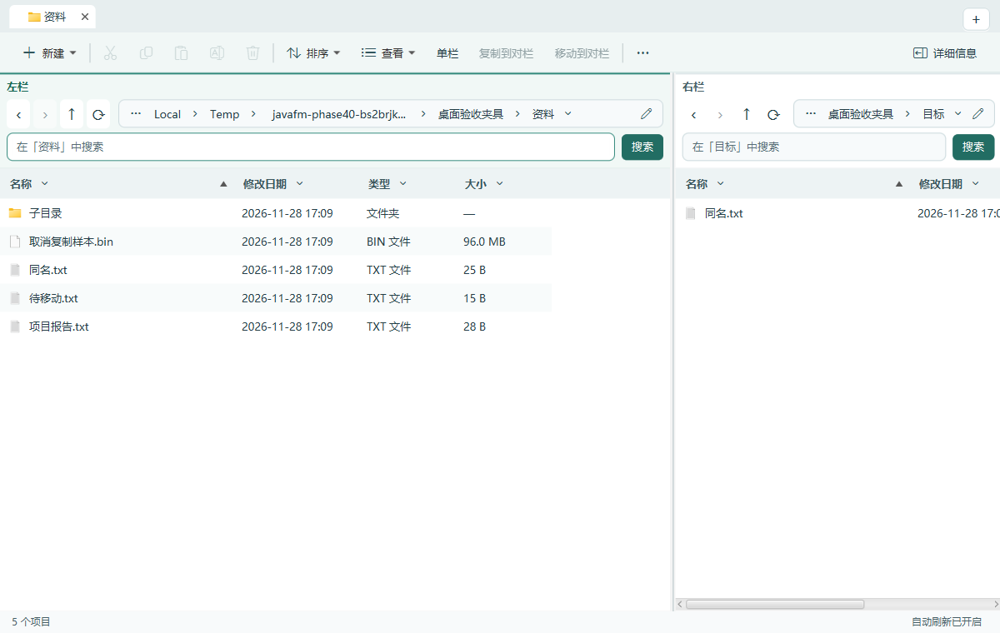

# 本地文件管理器

本地文件管理器是一款 Windows 桌面应用，提供多标签、双栏浏览、搜索、预览、批量文件操作及资源管理器互通。



## 下载与运行

1. 在发行页选择 Windows x64 便携 ZIP 或 EXE 安装程序，对照同页的 `SHA256SUMS.txt` 核验文件。 [GitHub Releases](https://github.com/hrao233/Java-/releases)
2. 便携版解压完整目录后双击 `JavaFXFileManager.exe`。EXE 安装版支持当前用户安装，从开始菜单启动，可在安装时选择桌面快捷方式。
3. 安装版与便携版均携带 Java 运行时，普通使用无需另外安装 Java、Maven 或 IDE。窗口设置保存在当前用户的 Windows 注册表，移动便携目录仍使用同一份设置。

1.0.0 的支持目标为 Windows 11 x64 的本地 NTFS 文件与目录。Windows 10、其他文件系统、网络共享和特殊 Shell 项的能力以实际验证范围为准。 [支持范围和验收](docs/development/13_独立打包与正式发布/README.md)

## 常用操作

| 快捷键或手势 | 操作 |
| --- | --- |
| Ctrl+L、F5、F6 | 编辑地址、刷新、切换活跃栏 |
| Ctrl+T、Ctrl+W、Ctrl+Tab | 新建标签、关闭标签、切换标签 |
| Ctrl+C、Ctrl+X、Ctrl+V | 复制、剪切、粘贴 |
| F2、Delete、Ctrl+Z | 改名、回收、尝试撤销最近一次支持的改名或移动 |
| Ctrl+Shift+F5、Ctrl+Shift+F6 | 复制到对栏、移动到对栏 |
| Ctrl 拖放、窗内 Shift 拖放 | 复制、已核验同卷移动 |

应用与资源管理器之间支持复制。冲突可以跳过、保留两份或取消。目标覆盖、目录合并及完整跨卷目录移动在当前发行范围外。复制、新建和回收的应用内自动撤销受限。同一对象上并发增删 NTFS 硬链接仍有已知竞争风险。部分成功及未知结果需要按实际任务回执核查。 [用户手册](docs/用户使用手册.md) · [文件安全](docs/development/12_发布前质量审查/03_文件安全与发布边界.md)

## 从源码开始

使用 JDK 21 和 Maven。在仓库根目录运行下列命令。

```powershell
mvn test
mvn "-Djavafx.integration=true" package
mvn javafx:run
```

[开发者快速入门](docs/开发者快速入门.md) · [源码阅读路线](docs/development/12_发布前质量审查/07_源码阅读路线.md) · [构建与发行指南](docs/构建与发行指南.md) · [更新记录](CHANGELOG.md) · [MIT](LICENSE) · [第三方许可](packaging/THIRD-PARTY-NOTICES.txt)
