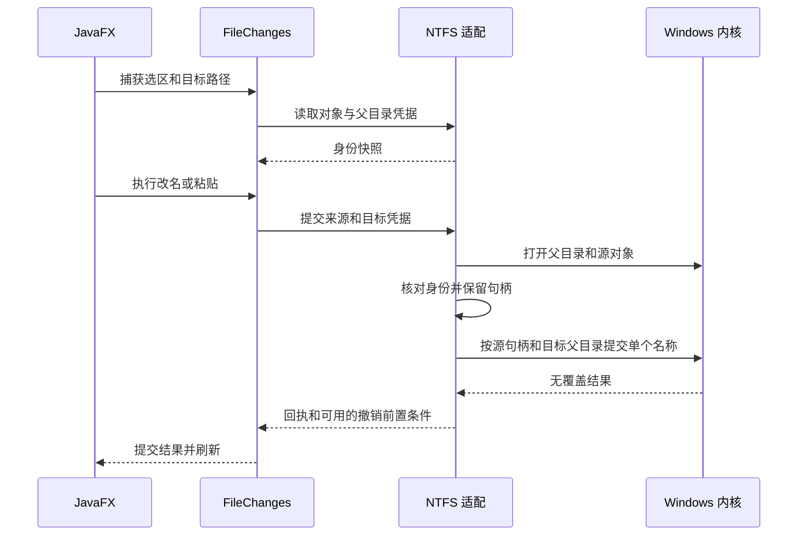

# 02 身份模型与安全边界

| 概念 | 实现与采集时机 |
| --- | --- |
| 用户请求 | `FileChanges.Selection` 保存浏览快照和可选原生凭据。复制、剪切或打开行内改名时在磁盘线程采集，不在列目录时为每行打开句柄。粘贴时采集目标 `Destination`。 |
| 文件对象 | 本地 NTFS 用卷序列、128 位文件 ID、创建时间和对象类型核对。创建时间是附加比较条件。正文摘要和修改时间不是对象凭据。 |
| 目录项 | `NtfsFileOperations.Item` 同时保存父目录凭据和名称。多个硬链接的对象 ID 相同，测试确认改名针对通过指定名称打开的链接。 |
| 执行对象 | 打开原父目录和目标目录的各级普通目录，保持句柄，核对两侧直接父目录身份。随后打开源并核对对象，用已打开的源执行。NIO 降级时也会在写入前复验已有的目标目录凭据。 |
| 内容与回执 | 内容变化是独立信息。`Receipt` 存来源、实际目标及写入后的原生凭据。复制还保留实际副本名。成功改名后如果身份回读失败，结果记为已写入且拒绝自动撤销。 |
| 撤销前置条件 | 目标仍是写入后的对象，原父目录仍匹配，原名可用，原生能力仍可用。再次通过句柄提交。系统以无覆盖规则决定目标名称能否占用。 |

初次采集用浏览快照中的类型、创建时间、修改时间和大小筛掉可检测变化。凭据生成前，等元数据替换仍无法由快照区分。建立原生凭据后，测试中原文件移开再放入等名、等字节、等时间的夹具会被拒绝。正常原地写入则保持对象 ID，撤回保留这些字节。用临时文件替换旧文件的编辑器会产生不同对象，自动撤回按身份变化处理。[身份采集与验证](../../../src/main/java/edu/files/NtfsFileOperations.java) · [回执和逆操作](../../../src/main/java/edu/files/FileChanges.java)

验证与实际修改之间的竞争试验在已经打开源与目录句柄、尚未调用改名的位置提交竞争操作。另一个线程尝试移走源、改名目标目录、改名目标上级目录，并占用目标名称。前三个普通改名被拒，目标名称占用成功，随后原生唯一一次提交返回冲突，双方保留。更早发生的直接父目录替换也有独立用例，测试将同一个对象的硬链接放回替换目录，身份校验仍因父目录改变而拒绝。[竞争试验](../../../src/test/java/edu/files/Win32FileHandlesTest.java) · [父目录替换用例](../../../src/test/java/edu/files/NtfsFileOperationsTest.java)

短时句柄约束普通 Windows 命名空间操作。跨卷、SMB、ReFS、WSL、云占位、Junction 和符号链接走降级或拒绝。祖先和末端重解析点分别核对。剪贴板和撤销记录持有身份值，句柄在每次操作结束时关闭。ID 重用、删除目录项后又以同名硬链接指回同一对象、系统重挂载、筛选驱动和进程异常退出仍需独立验证。目录移动用一次系统改名保留整棵树。目录复制约束根和相关路径，树内条目仍能被其他程序修改。[平台适配](../../../src/main/java/edu/files/NtfsFileOperations.java)

源缺少原生凭据时，路径确认曾绕过已有的目标凭据。回归夹具在捕获目标后替换目录，旧代码对复制和移动都返回已写入。现在两条路径都重新核对已知目标，发现替换便保留源及两个目录。校验结束后，NIO 仍通过路径执行。阶段 2.1 在提供者公开稳定 `fileKey` 时已有路径式逆操作，本阶段沿用该行为并保留原测试。它没有 NTFS 句柄提交的保证。[降级回归](../../../src/test/java/edu/files/NtfsFileOperationsTest.java) · [阶段 2.1 限制](../02_文件操作安全/02_危险撤销修复.md)
