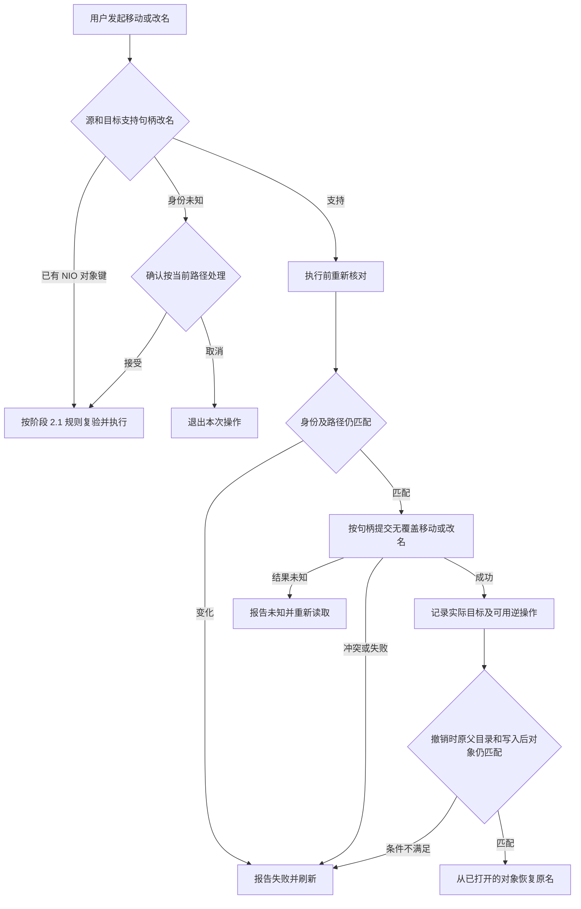

# 03 撤销交互与状态

本地 NTFS 有可用凭据且目标兼容时，复制、剪切和改名不会打开额外身份确认。普通目录浏览、排序和预览仍使用原来的读取方式。身份未知或需要路径降级时，应用列出待确认的项目。核对到来源或已记录的父目录发生变化时停下并提示重新选择。系统回收保留正常确认，并提示按路径处理的并发风险。[选区捕获与粘贴](../../../src/main/java/edu/files/FileManagerApp.java#L1621) · [系统回收确认](../../../src/main/java/edu/files/FileManagerApp.java#L1662)

确认按钮与写入接口是两道不同的检查。身份未知时，人工确认只是同意操作当前路径，Java NIO 继续核对所能观察到的内容和类型。系统回收按路径提交，无法让原生身份查询跨越外部回收 API。复制和新建的删除式逆操作继续拒绝。改名后的新建项可恢复名称，该操作保留该项目。

批次维持阶段 2.1 的执行顺序。每项明确为已写入、无变化、失败、结果未知、未执行或拒绝撤销。成功项按倒序生成逆操作。剪切只消费已处理前缀。未知结果显示只读路径观察。界面在失败和可能发生写入时重新读取列表。JavaFX 测试验证目标列表、剪切余下两项、冲突文件内容与第一项逆操作一致。[批次执行](../../../src/main/java/edu/files/FileChanges.java) · [刷新与撤回](../../../src/main/java/edu/files/FileManagerApp.java#L1721)
