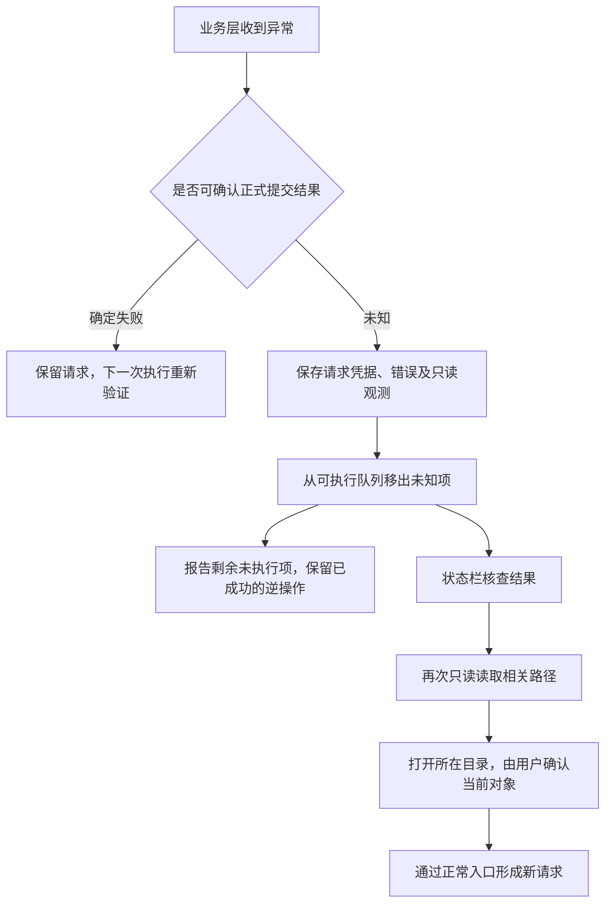

# 01 未知结果与重试机制

阶段 2.2 用成功前缀长度截取剪切队列，且将 `UNKNOWN` 视为可撤销重试的待处理项。阶段 2.3 的红灯测试让假操作先移动真实夹具，再抛出结果未知异常。两个旧队列都留下了可再执行的旧请求。刷新只能观测当前路径，等名替代、对象已移动或第三方删除都能改变这份观测，无法由它恢复旧调用的执行事实。 [回归用例](../../../src/test/java/edu/files/FileSafetyTest.java) · [阶段 2.2 的边界](../03_文件身份与撤销恢复/02_身份模型与安全边界.md)

| 项目状态 | 处理方式 |
| --- | --- |
| `APPLIED` | 保存实际目标和可用逆操作。剪切去掉已处理项。 |
| `UNCHANGED` | 同位置剪切等无需改动。该剪切项已经处理。 |
| `FAILED` | 明确失败，保留可重试项。下一次执行重新检查前置条件。 |
| `UNKNOWN` | 保存核查记录，移出复制、剪切及撤销的可执行队列。 |
| `NOT_RUN` | 批次在此项前停止，保留可执行意图。 |
| `CANCELLED` | 当前项目的正式提交前取消。清理及残留单独记录。 |
| `REFUSED` | 策略明确拒绝，例如删除式撤销。批次可继续处理其它逆操作。 |

每项输出的位置与输入相同，`remainingCut` 和 `remainingCopy` 按该位置过滤。批次遇到未知或失败时停止，后续项以「未执行」显示，用户可单独再粘贴或撤销。同批已成功的逆操作仍可用。只有未知结果的正向批次保留先前的撤销记录。记录包括操作类型、时间、原请求的路径、可用的原生或 NIO 身份、提交错误及初次只读观测，生命周期为当前窗口会话。核查记录只保存证据字段，原来的可执行动作由队列丢弃。 [结果和队列](../../../src/main/java/edu/files/FileChanges.java) · [结构化路径观测](../../../src/main/java/edu/files/LocalFiles.java)

「核查结果」使用磁盘执行器重新读取每个相关路径，并同时展示首次记录与当前观测。选择「打开所在文件夹并重新选择」只负责定位列表。复制、剪切、粘贴或改名须用常规入口发起。此前的未知记录与新的意图分别保留。真实 JavaFX 用例注入了移动和撤销写入后的回执丢失，检验旧请求退出队列，替代品通过重新选择才可处理。 [核查界面](../../../src/main/java/edu/files/UnknownResultsDialog.java) · [JavaFX 回归](../../../src/test/java/edu/files/JavaFxFileOperationsTest.java)
