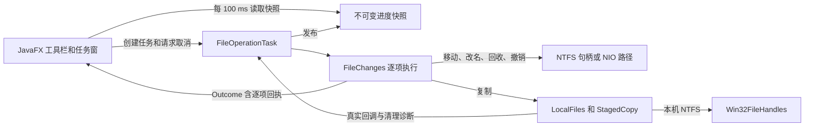
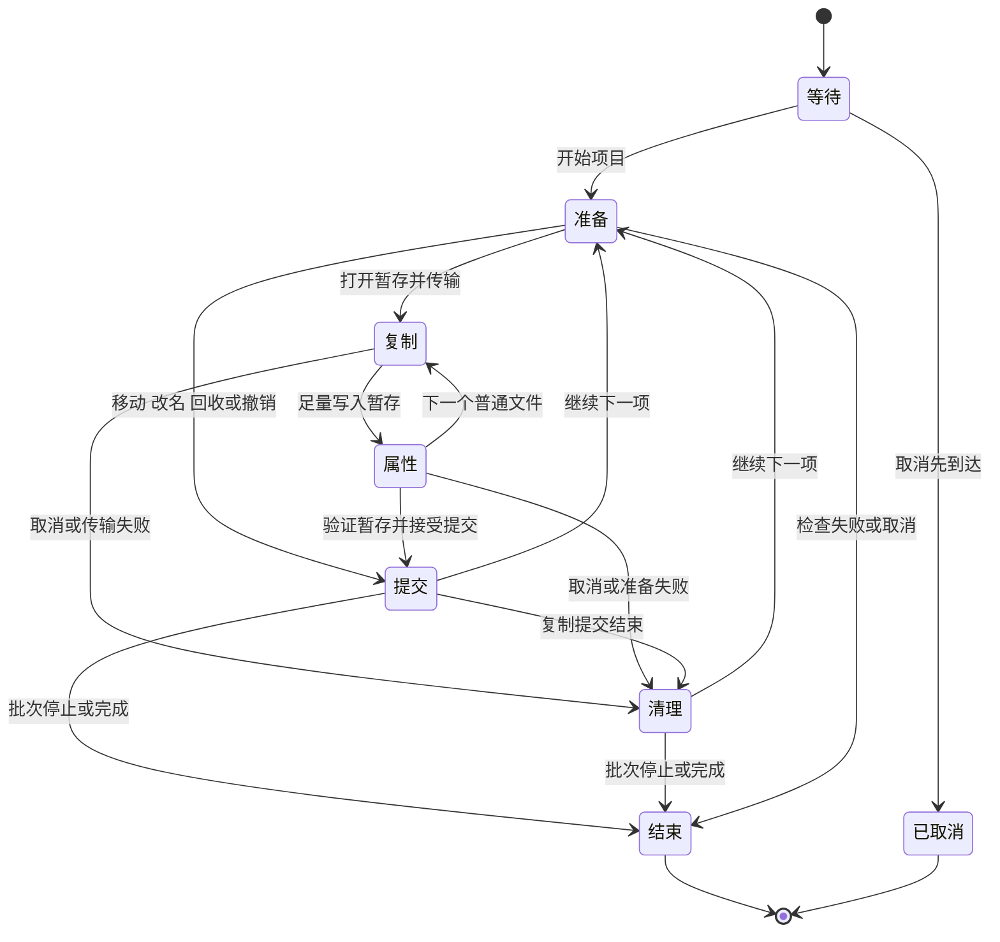

# 02 任务模型与状态转换

`FileChanges` 保持请求核对、逐项执行与回执的边界。`FileOperationTask` 增加 UUID、操作类型、当前源和目标、总项数、结果计数、传输和已发布字节、阶段及起止时间。任务的判断来自逐项结果。单项可以已经完成时任务仍在等待剩余项，因此最终回执和运行快照各自承担不同职责。 [任务模型](../../../src/main/java/edu/files/FileOperationTask.java) · [逐项协调](../../../src/main/java/edu/files/FileChanges.java)

「已请求取消」是并行标记。提交授权和取消请求通过同一锁排序，可以在动画更新前准确确定边界。若提交已经被接受，线程等待系统返回，然后登记实际写入。后续项目由入口检查拦住。结果优先反映未知，其次考虑失败、取消和是否已有提交，终态显示已完成、部分完成、已取消、执行失败或存在未知结果。 [取消与终态](../../../src/main/java/edu/files/FileOperationTask.java) · [时机回归](../../../src/test/java/edu/files/FileOperationTaskTest.java)

磁盘线程依次写入任务字段，`volatile` 发布不可变快照。状态转换和终点立即记录。连续字节更新至多每约 100 ms 写入一个中间快照，首次字节会立即可见。JavaFX 用独立的 100 ms 定时器读取最新值，系统复制回调无需跨线程发送每次 I/O 的事件。测试观察器属于受控同步点，生产窗口只轮询快照。 [任务界面](../../../src/main/java/edu/files/FileOperationProgress.java)
