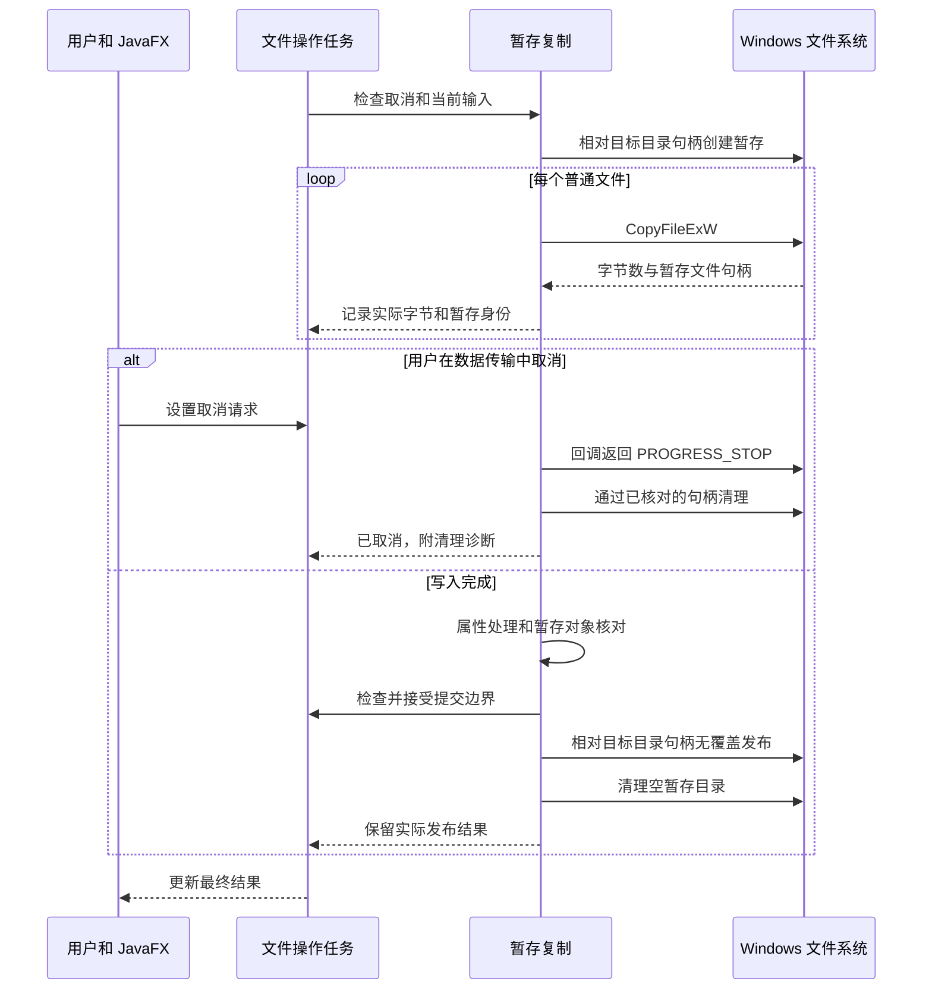

# 03 复制进度与协作式取消

Windows JDK 21 的 `Files.copy` 这一路径使用 `CopyFileExW`，并另尝试复制所有者、组和 DACL。其公开接口没有向调用者提供进度回调。阶段 2.3 在可用的本地 NTFS 目标使用已存在的 JNA 调用同一原生复制 API，回调报告已复制逻辑字节和暂存对象句柄。普通文件保留 DOS 属性、时间和 NTFS 备用数据流，独立步骤尽力保留安全描述符，失败附在任务诊断中。回归实际检查只读、隐藏、时间、所有者、显式 ACL 规则和备用数据流。特殊条目沿用无跟随的 `Files.copy(COPY_ATTRIBUTES)`。 [Win32 复制和安全属性](../../../src/main/java/edu/files/Win32FileHandles.java) · [属性与字节回归](../../../src/test/java/edu/files/StagedCopyTest.java)

| 总量策略 | 开销和语义 |
| --- | --- |
| 预先遍历 | 在传输前读完整目录树，能得到当时的估计。后续文件增减仍会使统计过时。 |
| 边遍历边复制 | 启动时无需额外扫描。目录用不确定进度条，同时报告原生回调已经确认的字节。 |
| 文件快照和目录流式结合 | 批次只有普通文件时用请求快照估计大小。回调报告的大小与估计不同则切换到不确定。遇到目录直接流式遍历。这是当前实现。 |

底层传输统计包括尚在暂存区的字节。只有取得正式发布结果才增加已发布字节。同卷移动和改名使用项目进度。速度按至少 250 ms 的真实字节增量估算，再用权重 0.35 的指数平滑降低波动。滑动窗口可以限定回看区间，但需要少量样本队列。指数平滑只保留上一估计值，适合本阶段在单线程上发布有限频率的快照。只在复制数据且总量已知、速率达到 1 KiB/s 时提供剩余时间。 [进度模型](../../../src/main/java/edu/files/FileOperationTask.java)

复制发布前使用目标卷上的暂存目录，未完成数据处于随机名称下。同目录副本沿用「副本」后缀序列。正式名冲突由原生无覆盖提交裁决，即使目标在最后一刻才出现也会保留。已经接受提交后收到取消时，系统调用继续返回真实结果，已发布项留在目标，后续项保持待处理。 [发布实现](../../../src/main/java/edu/files/StagedCopy.java) · [副本命名](../../../src/main/java/edu/files/LocalFiles.java)

NTFS 暂存目录由 `NtCreateFile` 相对于绑定的父目录句柄创建。普通文件的原生回调提供创建对象 ID。清理按任务自己的目录项记录逐件打开相对句柄，核对 ID 后对打开的对象申请删除。根目录使用空目录删除语义。在占用或存在额外条目时，保存残留和原因。特殊条目缺少创建时句柄，失败时可能留存。普通进程换名和同名替换有隔离回归，按路径读取的源数据仍会看到复制期间的修改。同账号程序在最后一次验证后向普通目录插入内容、颠覆路径语义的文件系统驱动及断电恢复属于现有边界。后续可评估私有隔离区或系统级快照。 [替换和清理回归](../../../src/test/java/edu/files/StagedCopyTest.java)

原生暂存不可用时使用 NIO 同父目录暂存，成功后暂存名随副本发布消失。无法证明所有权的残留保留并显示位置。阻塞中的 NIO 单文件调用结束后才能响应取消。目录遍历和项目之间仍检查取消。此降级路径保有路径校验与提交之间的窗口，具体提供者的覆盖和共享语义依其实现。 [NIO 回退](../../../src/main/java/edu/files/StagedCopy.java)
