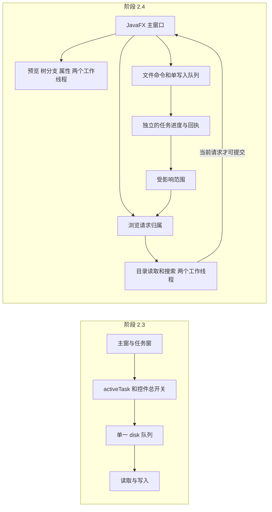

# 02 浏览请求与文件任务架构

`ReadExecutor` 固定两个前台读取线程和两个辅助读取线程。前台队列容量为 2，辅助队列容量为 24。导航可以在一条旧 I/O 仍未结束时占用另一前台线程。缩略信息、树分支或原生属性占用的是辅助容量。新请求移除旧的排队项，对已运行的旧项请求取消。执行器满时报告读取繁忙。写入及其命令准备使用单独的顺序队列，界面按槽位限制提交。 [ReadExecutor](../../../src/main/java/edu/files/ReadExecutor.java) · [主窗调度](../../../src/main/java/edu/files/FileManagerApp.java)

共享优先队列只能改变尚未执行项的顺序，已经阻塞的系统调用仍占住执行器。单一有界读取池能解决读写排队，属性和目录树高峰仍可能占满导航线程。两个固定的读取车道使用少量额外线程来隔离常见拥塞。更重的通用请求协调器可以服务多标签页，但本阶段一个 `BrowseIntent`、一个活动请求和一个已提交页面版本已经足够。 [排队回归](../../../src/test/java/edu/files/ReadExecutorTest.java)

| 操作 | 文件写入期间的行为 |
| --- | --- |
| 普通目录、地址栏、前进后退、上一级 | 可用。历史采用已经提交的页面和栈。 |
| 刷新和搜索 | 可用。刷新跟随最近导航意图，搜索以当前已提交位置为作用域。 |
| 属性、文本和图片预览 | 可用。按辅助队列容量执行并核对页面和选区归属。 |
| 排序、分组、筛选、展示方式 | 可用。即时作用于当前已提交条目。 |
| 文件任务窗 | 可开关并协作取消。切换目录期间继续显示该任务。 |
| 复制请求、剪切、粘贴、改名、新建、回收、撤销 | 写入或命令准备期间暂停。状态栏提示写入命令暂不可用。需要以当前列表定位的写入还等待最新浏览请求提交。 |
| 核查未知结果与暂存位置 | 可用。核查通过只读队列。问题位置可从任务窗打开。 |

截图来自真实 JavaFX 用例。左侧为写入期间切换到另一目录后的文件列表和文本预览，右侧为同一进程的复制任务窗。测试把复制停在首个有效进度回调，并取主窗列表区与任务窗两个 Scene 画面。 [真实控件用例](../../../src/test/java/edu/files/JavaFxFileOperationsTest.java)

