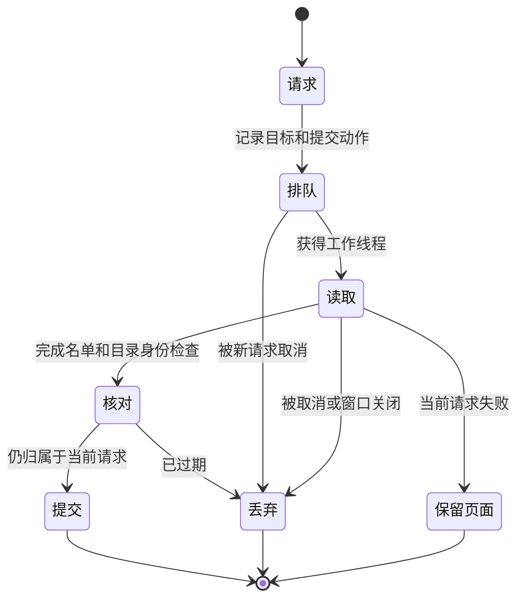
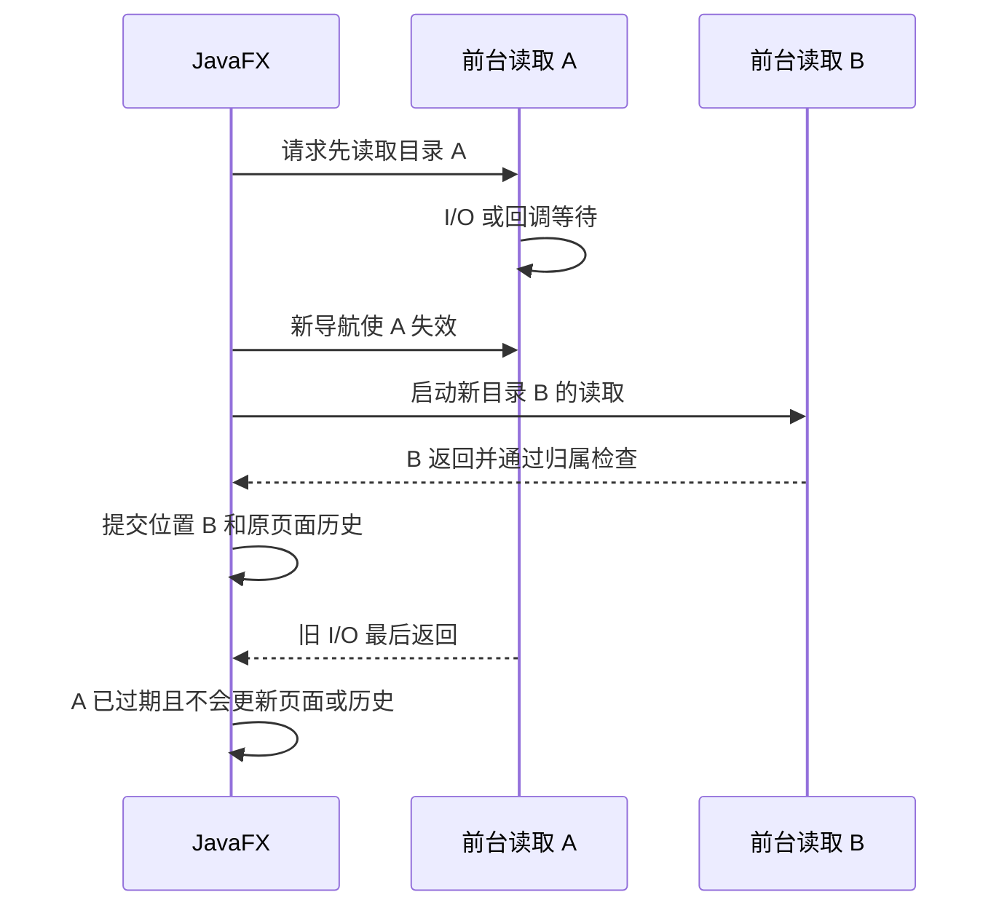
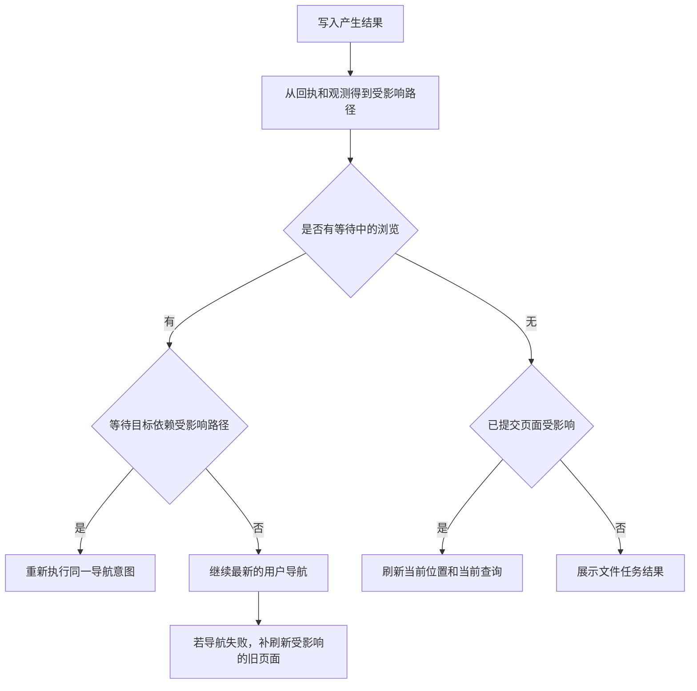
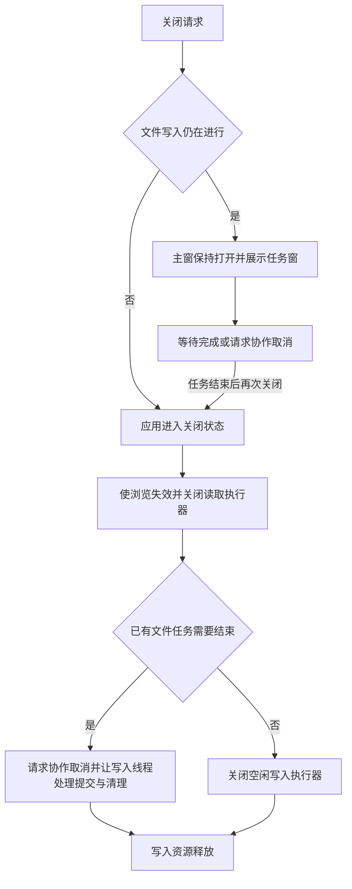

# 03 并发状态与刷新机制

每个浏览请求持有目标位置、搜索词、首页标签及成功时的导航动作。请求实例就是一次读取的归属标识。可见页面版本随提交递增，预览和地址子菜单用该版本校验归属，目录树另用树代次和分支任务标识。旧请求的失败回调同样需要检查归属，避免在新页面弹出旧错误。 [主窗请求处理](../../../src/main/java/edu/files/FileManagerApp.java)

前进和后退以最近一次成功提交的栈为依据。连续请求只提交最终成功的目标，历史中的前一项是请求发起时已经展示的页面。刷新优先沿用待提交的导航和查询。目录读取前后采样身份，本机 NTFS 使用卷及文件 ID。普通提供者可提供文件键，权限受限时允许降级为可访问性检查。发现读取期间身份变化时要求重读。读到当前目录被删除、移动或变为不可访问时，位置仍可作为后退或上移的起点，现有列表清空，写入命令暂停。 [目录标识](../../../src/main/java/edu/files/DirectoryIdentity.java)

### 写后刷新

`BrowseImpact` 使用已应用项目的源和目标记录、未知项的观测路径、以及问题路径。复制的源目录只在实际问题涉及它时受影响。普通目录关注直接父目录和本身的祖先替换。递归搜索与图库还关注目录树内部。首页近期项与收藏根据具体引用路径失效，快速访问的修改记录单独刷新。缓存的系统位置等由相应的系统目录更新。 [影响范围](../../../src/main/java/edu/files/BrowseImpact.java)

预览使用选中 `BrowserItem`、页面代次和独立任务引用。读取文件前核对所选属性，读取后核对原生身份或提供者可用凭据。新名单提交后清除旧选区，避免把同路径的新文件作为旧对象保留。活跃复制暂存以任务登记的对象 ID 为依据从名单、递归搜索和目录树中过滤，路径同名但身份不同的对象仍可见。任务退役解除登记，保留的暂存可以从任务细节的「打开问题位置」或未知结果核查进入所在目录。无法证明身份的可移植单文件暂存采用可见降级。 [活跃暂存识别](../../../src/main/java/edu/files/ActiveStaging.java) · [未知结果](../04_文件操作引擎/01_未知结果与重试机制.md)

### 关闭与资源

直接退出时先屏蔽迟到界面回调并取消读取，非守护写入线程仍能完成已接受的提交和暂存清理。收起任务窗可由状态栏重新打开。在读取和提交相隔的时间里，外部程序仍可能修改文件内容或目录。NTFS 目录的身份采样能发现常见换名替换，读取期间的并发原地修改仍遵循系统实时语义。阶段 2.4 由用户刷新和应用内写入触发更新。 [任务边界](../04_文件操作引擎/03_复制进度与协作式取消.md)
