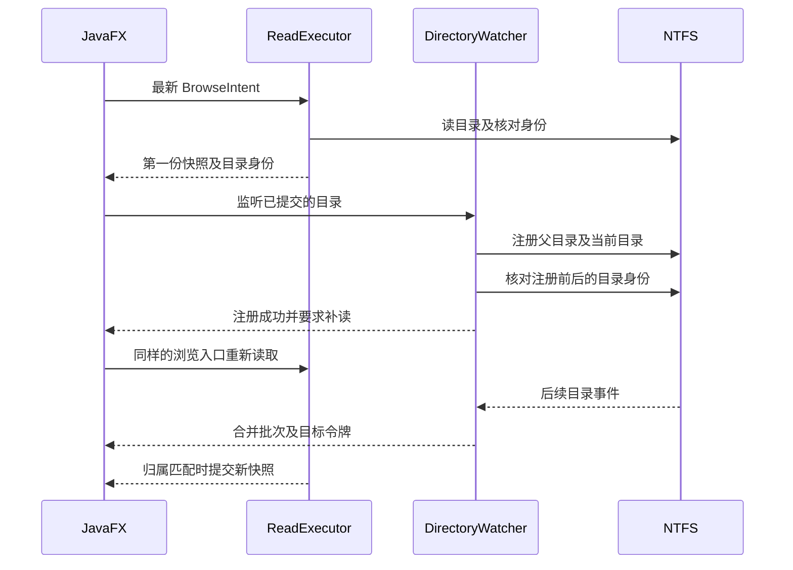
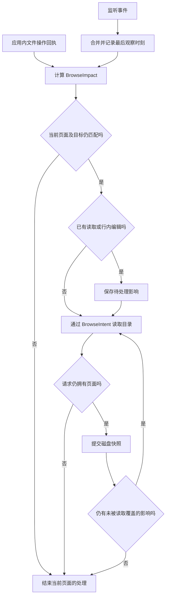

# 02 生命周期与刷新调度

`DirectoryWatcher` 与 JavaFX 无依赖。每个窗口有一个惰性启动的协调线程，每次只持有一个目标注册会话。同一会话最多一个目录键和一个父目录键。父目录只关心当前目录名称的创建、删除及溢出。工作线程拥有 WatchService，切换目标或退出时通过资源块关闭它。窗口只接收不可变通知。 [监听模块](../../../src/main/java/edu/files/DirectoryWatcher.java)

第一次浏览保持阶段 2.4 的提交时延。只有目录读取成功才建立监听，注册完成立即安排一次补读，覆盖第一份快照与注册之间的变化。注册后到补读期间的通知仍可排队。读盘仍通过 `ReadExecutor`，目录身份仍在读取前后取样。离开普通目录时停用该目标，迟到通知经工作线程和 FX 两次令牌检查。 [浏览请求与读取](../../../src/main/java/edu/files/FileManagerApp.java)

目录键失效、父目录相关结构事件及目录身份变化均可触发重绑。已注册目录每 2 秒复核身份，缺失或注册失败每 1 秒重试注册。父目录键和目录键随重绑一起更新。失效状态通过状态栏呈现，快照读取确认目录无法访问时清空列表并保留后退、上移。关闭窗口先取消 FX 通知的归属，再中断等待、关闭 WatchService 和浏览执行器。 [生命周期](../../../src/main/java/edu/files/DirectoryWatcher.java)

## 事件合并

单独防抖会在持续写入时反复推迟，固定节流则可能在一个保存过程中起多个读取。当前使用 160 ms 静默期和从首个事件计算的 500 ms 最长合并等待。普通批次记录发生变化的路径，供预览判断。溢出、结构重绑和收集超过 128 条不同路径时触发全量失效。合并器的输出仍是完整目录读取。创建和删除之间可能隔着多个替换，事件即使按序到达也无法为每条记录提供可靠身份。 [DirectoryEvents](../../../src/main/java/edu/files/DirectoryEvents.java)

`BrowseImpact` 表达受影响目录及条目，文件操作回执沿用 `refreshAffected` 的写后路径。监听信号等待已有读取完成，提交后比较枚举请求的排队时刻和事件观察时刻。若读取在观察之后排队，可覆盖该批次。若观察发生在本次读取期间，保留一次后续读取。用户发起导航或 F5 可立即取代自动读取。用户发起文件命令时，把被中止的自动刷新影响放回待处理批次。写入回执遇到进行中的自动读取时排队，读取结束后沿现有写后路径重读。内核事件可能晚于对应写入回执送达，此时保留补读以确认状态。 [刷新进入点](../../../src/main/java/edu/files/FileManagerApp.java) · [BrowseImpact](../../../src/main/java/edu/files/BrowseImpact.java)

`ActiveStaging` 按已登记暂存对象的身份过滤监听提示和读取结果。相同前缀的外部项及已解除登记的遗留项可显示。未知写入仍通过文件任务回执和「核查结果」处理，监听只更新列表快照。 [活跃暂存](../../../src/main/java/edu/files/ActiveStaging.java) · [未知结果](../04_文件操作引擎/01_未知结果与重试机制.md)

已展开树分支可能涉及许多目录，搜索和图库还跨递归树。当前只自动刷新普通目录列表。树按现有导航、展开和应用内写后机制更新，搜索、图库、首页近期及收藏可手动重读。未来共享注册可从 `DirectoryWatcher.Target` 和不可变通知这条边界接入引用计数。 [阶段 2.4 的树及浏览调度](../05_浏览调度与性能优化/03_并发状态与刷新机制.md)
