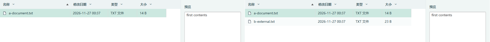

# 03 选区、预览与行内编辑

自动刷新沿用当前排序、分组和列筛选。目录自身被替换时沿用原有规则清除列筛选。列表重建前记录虚拟列表首个可见文件和滚动位置，按新列表定位该文件。找不到原来的位置时使用原滚动比例。地址栏正在输入的内容与未提交搜索词仍由用户控制。 [BrowserView](../../../src/main/java/edu/files/BrowserView.java) · [自动快照提交](../../../src/main/java/edu/files/FileManagerApp.java)

| 状态 | 自动刷新的处理 |
| --- | --- |
| 选区 | 在辅助读取线程为最多 64 项选区采集身份。刷新读取线程比较旧、新目录项的 NTFS 卷及对象 ID、创建时间、父目录身份和名称。只恢复仍被选择且核验一致的项目。选择尚未完成采样、过大、身份未知或对象被替换时安全清理相应选区。 |
| 预览 | 同一选中项的完成预览可直接保留。该路径受影响、元数据变化或批次全量失效时重新读取，读取前后继续检查身份并核对页面版本。文本预览即使遇到相同长度的原地修改也会因该路径通知而重新读取。 |
| 行内改名 | 编辑框打开时累积自动刷新请求，结束后补读。提交使用打开前取得的凭据。若编辑期间出现同名替代品，原生校验拒绝旧请求。监听位置上无法验证身份的项目会取消行内改名。新建后的行内编辑使用新建任务完成时采集的凭据。 |
| 剪贴板和撤销 | 快照提交从浏览层恢复界面状态。剪贴板和撤销的更新来源仍是明确的用户命令和文件操作回执。 |

身份采样按选区执行，避免在普通的一万项枚举中逐条打开原生句柄。第一次选中与后台采样间，以及最终核对与 FX 提交间，外部程序仍可改变项目。后续通知会要求复查。写入命令继续使用执行时的身份校验与授权。选区保留的证据只适用于已成功采样并核对的对象。 [文件变更凭据](../../../src/main/java/edu/files/FileChanges.java) · [NTFS 校验](../../../src/main/java/edu/files/NtfsFileOperations.java)

截图是 JUnit 启动真实 JavaFX 后两次对文件列表和预览区域取景的拼接。夹具没有用到真实用户文档。右图新增文件由测试调用外部于应用命令的文件系统写入产生。 [截图与交互测试](../../../src/test/java/edu/files/JavaFxFileOperationsTest.java)
