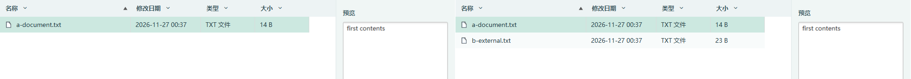

# 阶段 2.5 目录监听与自动刷新

Windows 本地固定 NTFS 普通目录默认启用自动刷新。列表从磁盘重新读取，外部创建、删除、改名、原地写入和替换式保存都会触发更新。状态栏显示监听情况，「查看 → 自动刷新」保存窗口偏好。F5 和原刷新按钮适用于各种可浏览位置。

阶段 2.4 基线为 `2caac10c9ae38d7dc4b2f4383c0c17b1e9a6d3bb`。 [阶段 2.4 调度与刷新](../05_浏览调度与性能优化/03_并发状态与刷新机制.md) · [原工程审查](../../audit/README.md)

| 阅读顺序 | 内容 |
| --- | --- |
| [01 监听实验与技术选型](01_监听实验与技术选型.md) | WatchService、原生接口和轮询取舍，NTFS 实验 |
| [02 生命周期与刷新调度](02_生命周期与刷新调度.md) | 注册、失效、事件合并、快照归属和应用内回执 |
| [03 选区、预览与行内编辑](03_选区预览与行内编辑.md) | 交互的恢复条件及真实画面 |
| [04 测试与性能验证](04_测试与性能验证.md) | 回归数量、测量、对照和复现命令 |
| [05 代码变更与后续工作](05_代码变更与后续工作.md) | 文件职责、提交、剩余风险和可验证的下一步 |

左图是外部程序写盘前的实际文件列表，右图新增了 `b-external.txt`。两张画面均来自同一真实 JavaFX 窗口，原文档的选区和预览持续可用。 [截图用例](../../../src/test/java/edu/files/JavaFxFileOperationsTest.java)

