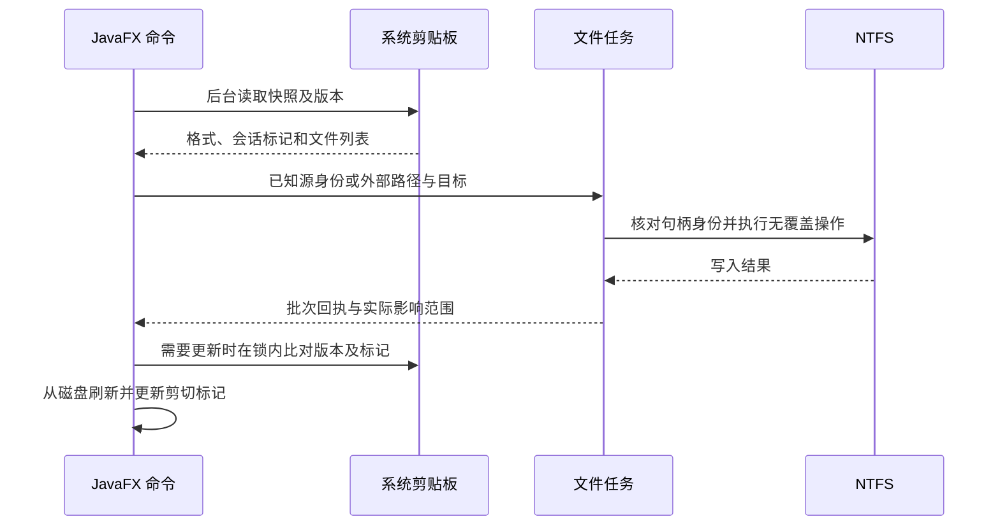

# 02 会话与文件安全

| 数据 | 所有者与用途 |
| --- | --- |
| 剪贴板状态和快照 | `FileClipboard.State` 记录版本和可用格式。用户触发粘贴时才读取 `Snapshot` 中的路径列表、标记和外部移动意图。 |
| 本窗口的凭据 | `Transfer` 拼合版本、随机标记、复制或剪切意图及 `FileChanges.Selection`。同一版本与标记同时匹配时沿用已采集的源对象身份。 |
| 外部复制请求 | 路径经过格式、数量和父子关系检查。实际工作前读取当前源对象并核对目标。外部最初选择的对象无法从路径表证明。 |
| 执行快照和结果 | `PasteRequest` 和准备阶段的 `Destination` 固定本次批次。文件任务协调器和 `Outcome` 判断磁盘写入、失败、取消、未知及撤销。 |

同样的路径可以出现在多个版本，也可以指向后来创建的对象。对于同一份本地传输，粘贴继续使用复制或剪切时的身份。运行中的批次保有已经读取的执行快照，用户在其他程序复制的数据可以随时成为下一个请求。剪贴板更新进入 Win32 锁后检查版本和标记，匹配才能写入或清理，避免旧任务覆盖后来复制的内容。 [文件身份及撤销](../03_文件身份与撤销恢复/02_身份模型与安全边界.md) · [WindowsClipboard](../../../src/main/java/edu/files/WindowsClipboard.java)

外部 Unicode 文件列表最多 4 MiB、4,096 路径，重复路径按标准化后的路径去重。无法解析、相对、设备命名空间、父子同时出现的列表会被拒绝。粘贴来源中的顶层链接或特殊对象被拒绝，普通目录内部的校验沿用现有文件引擎。路径文本只作为文本。从外部列表采集的是执行准备时的对象，之后仍通过 NTFS 句柄验证源和目标。身份不可得时沿用确认或拒绝流程。 [格式解析](../../../src/main/java/edu/files/ClipboardFiles.java) · [写入引擎](../../../src/main/java/edu/files/FileChanges.java)

剪切成功或无需移动的项退出队列，失败、未执行、取消项在原身份复验后可再试。未知项退出可直接执行的队列并保留核查记录。部分剪切保留私有标记，仅更新窗口内的剩余列表。复制继续可重复粘贴，未知的复制项也会被隔离。外部复制的未知项仅按该剪贴板版本在本窗口屏蔽，外部剪贴板由来源程序掌控。 [未知结果机制](../04_文件操作引擎/01_未知结果与重试机制.md)
