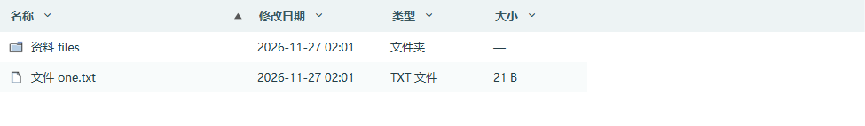
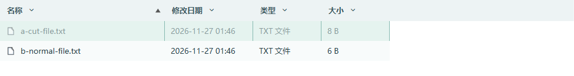

# 03 界面与互通实测

工具栏、右键菜单和快捷键共享同一套文件命令。Ctrl+Shift+C 或右键「复制为路径」将每条路径加双引号，多选逐行排列。文本控件获得焦点时，JavaFX 的普通编辑行为继续接收 Ctrl+C、Ctrl+X、Ctrl+V。右键「粘贴到此文件夹」在真正开始前核对目标。外部剪切触发提示后可以回到来源改用复制。 [命令入口](../../../src/main/java/edu/files/FileManagerApp.java)

剪切淡显依赖本窗口的剪切会话及核验成功的对象。自动刷新提交时先丢弃旧画面标记，在后台按新列表核对候选身份，然后投影到表格行和图标条目。排序、筛选保留同一画面对象时无需重新采集。用户换了剪贴板或选中路径已被替换时，淡显随相应状态清理。 [BrowserView](../../../src/main/java/edu/files/BrowserView.java) · [自动刷新](../06_目录监听与自动刷新/03_选区预览与行内编辑.md)

| 方向与意图 | 支持及实测 |
| --- | --- |
| JavaFX → Windows Shell 复制 | 隔离窗口站中，JavaFX 发布后退出。Windows Shell 通过 `OleGetClipboard`、`SHCreateShellItemArrayFromDataObject` 和 `IFileOperation` 粘贴文件与目录，SHA-256 一致。 |
| Windows Shell → JavaFX 复制 | Windows Shell 文件夹选择执行复制，JavaFX 工具栏粘贴成功。验证中文、空格、混合文件和目录及实际内容。 |
| 两个 JavaFX 进程间复制 | 一个进程发布并退出，另一个进程读取系统剪贴板并实际复制。隔离夹具验证超过 260 字符的实际路径。反复粘贴及无覆盖在窗口集成回归中验证。 |
| 同一 JavaFX 窗口剪切 | 真实系统剪贴板实验移动文件与目录，核对了来源、目标内容和会话消费。原生文件身份、部分成功、取消、撤回及剪切淡显继续由窗口回归覆盖。 |
| Windows Shell 与 JavaFX 或两个 JavaFX 进程间剪切 | 窗口间传输可在来源改用复制。真实 Shell 剪切可被识别，系统 MOVE 发布及删除式反馈保持停用。 |

`explorer.exe` 能在隔离桌面打开测试目录。UI Automation 返回空的控件树，向该窗口发送的粘贴应用命令也没有生成预期文件。图形菜单的双向路径仍待交互会话验证。上述通过项来自独立进程和真实 Windows Shell 文件操作。 [隔离测试](../../../src/test/windows/clipboard-integration.ps1)

下图为真实 Windows Shell 复制后对接收应用拍摄的画面。文件和目录都来自测试夹具。

