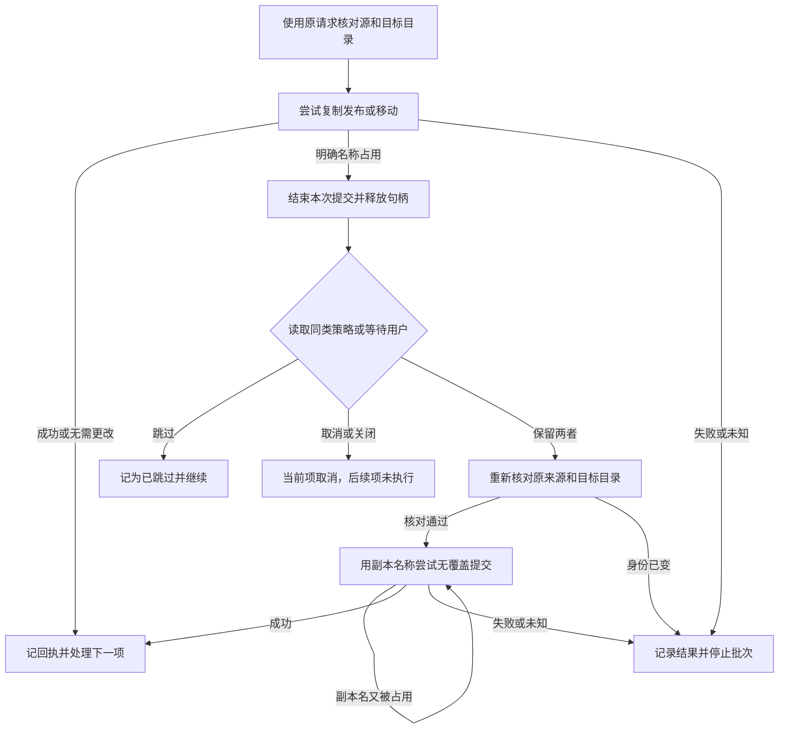

# 冲突决策与文件安全

## 哪些结果会进入冲突窗口

复制前发现正式名称存在、暂存发布返回名称占用、移动提交返回名称占用，都会产生带阶段和目标路径的 `TransferConflict.Collision`。Win32 的名称占用错误与共享冲突分别处理。比如源文件以禁止删除共享的方式打开时，移动会因访问受限而失败，即使目标也恰好有同名文件。已有对象已经被替换、普通 I/O 失败和结果未知沿用各自的结果语义。 [FileChanges](../../../src/main/java/edu/files/FileChanges.java) · [名称冲突模型](../../../src/main/java/edu/files/TransferConflict.java) · [NTFS 结果映射](../../../src/main/java/edu/files/NtfsFileOperations.java)

冲突确认后，任务记录来源选区的凭据，尽力读取目标当时的类型、文件 ID、大小和修改时间。目标可能在这两步之间变化。窗口里的目标信息描述读取时的对象。策略的执行依赖重新打开的来源、目录凭据和原生提交返回值。 [TransferConflict.observe](../../../src/main/java/edu/files/TransferConflict.java)

| 逐项结果 | 对批次及剪切队列的影响 |
| --- | --- |
| `APPLIED` 已写入 | 记录实际目标，安排刷新和可用的撤销。移出剪切队列。 |
| `UNCHANGED` 无需更改 | 同位置剪切已处理，移出剪切队列。 |
| `SKIPPED` 用户跳过 | 保留源和已有目标，继续下一项。剪切保留原选区凭据，重试时重验。 |
| `FAILED` 确定失败 | 保留失败原因，停止批次。剪切可在重验后重试。 |
| `UNKNOWN` 写入结果未知 | 停止批次，保留路径与当时的观测，移出可执行队列并提供核查入口。 |
| `CANCELLED` 当前项取消 | 停在正式提交前。之前的成功仍有效，该项保留待处理。 |
| `NOT_RUN` 尚未执行 | 列为未执行，保留待处理。 |
| `REFUSED` 拒绝撤销 | 用于受限的逆操作，保留拒绝原因。 |

`SKIPPED` 表达用户明确选择保留当前磁盘状态。它增加已处理和已跳过的计数，成功计数与撤销只认实际写入。可重复粘贴的复制选区保留已应用和跳过的项。未知结果意味着系统可能已经提交，因此即便后来路径看起来恢复原状，旧凭据也只能用于核查。 [Outcome](../../../src/main/java/edu/files/FileChanges.java) · [未知结果校验](../../../src/test/java/edu/files/TransferConflictTest.java)

## 等待与再次执行

文件工作线程发布不可变冲突信息，然后用条件等待让出任务锁。JavaFX 沿用进度窗口每 100 毫秒的采样，显示独立的非模态窗口。用户按钮交回一次决策并唤醒工作线程。任务以当前冲突实例判断回复归属，防止重复点击和迟到回复。等待仍占用一个串行写入任务的席位，读线程和剪贴板观察可继续运行。关闭冲突窗口或点击取消会唤醒线程。等待时关闭主窗口也会取消剩余项目，任务结束后可关闭主窗口。应用终止时沿用协作式取消和写线程关闭流程。 [任务等待与取消](../../../src/main/java/edu/files/FileOperationTask.java) · [冲突窗口](../../../src/main/java/edu/files/FileConflictDialog.java) · [主窗口接入](../../../src/main/java/edu/files/FileManagerApp.java)

在等待前释放源、目标目录与暂存句柄，让外部程序能照常操作。保留两者重新打开原来选中的源和目标目录。目标目录完成核验后，复制由同一个已绑定的目录句柄创建暂存和发布。若原目标条目在等待期间消失或变成另一对象，仍使用副本名称，保留当前同名位置的状态。批量选项只保存操作、来源类型和目标类型对应的策略，后续项目各自检查凭据。无法读取目标类型的冲突单独询问。 [源与目标绑定](../../../src/main/java/edu/files/NtfsFileOperations.java) · [冲突策略的使用范围](../../../src/main/java/edu/files/FileOperationTask.java)

### 副本名称由提交决定

候选按 `名称 - 副本`、`名称 - 副本 (2)` 递增。普通文件在最后一个扩展名前插入后缀，点开头且没有其他扩展名的文件和目录在完整名称后追加。候选被抢占时只对明确的名称占用重试。每次提交仍检查取消。回执带有实际成功的名称，浏览刷新按回执和目录影响范围处理，同卷移动撤销也从实际路径重新验证身份。 [命名与重试](../../../src/main/java/edu/files/LocalFiles.java) · [实际回执与撤销](../../../src/main/java/edu/files/FileChanges.java) · [刷新范围](../../../src/main/java/edu/files/BrowseImpact.java)

Windows 11 隔离实验发现，旧 `FileRenameInformation` 和零标记的 `FileRenameInformationEx` 遇到已存在的同对象硬链接时，返回成功并移除源目录项。扩展接口使用 `FILE_RENAME_POSIX_SEMANTICS` 且关闭替换后，C 卷返回 `STATUS_OBJECT_NAME_COLLISION`，D 卷仍可能折叠该目录项。发布、移动和撤回在提交前额外检查目标名称是否已经存在，再用关闭替换的扩展接口提交。若外部程序恰好在最后一次检查与提交之间为同一对象新建同名硬链接，系统仍可能折叠源目录项。该竞争中的两条目录项指向同一份数据。不同对象的名称竞争由原生无覆盖提交裁决。两条路径解析到同一实际目录项时，大小写改名沿用旧接口。对明确不支持扩展接口的系统报告失败。 [原生改名](../../../src/main/java/edu/files/Win32FileHandles.java) · [硬链接和抢占回归](../../../src/test/java/edu/files/TransferConflictTest.java) · [大小写回归](../../../src/test/java/edu/files/NtfsFileOperationsTest.java)

### 暂存与代价

复制开始前遇到冲突时，保留两者仅复制一次。正式发布首次遇到冲突时，复制的数据可能已经写完。暂存树校验能确认目录项和对象身份，仍无法证明用户等待期间内容保持完整。因此当前尝试按既有规则清理或记录可疑残留，再等待。保留两者开始一次新复制。在同一次新尝试里，多个候选名的抢占只增加改名调用，使用的是同一份已经校验的暂存。传输计数包含丢弃的那次复制，已发布字节只记录最终发布的数据。 [暂存发布与清理](../../../src/main/java/edu/files/StagedCopy.java) · [复制计数](../../../src/main/java/edu/files/FileOperationTask.java)

### 剪贴板和刷新

已启动的粘贴任务持有原传输快照。后续应用接管剪贴板时，界面可以更新到新会话，运行中的已接受操作仍按原凭据完成。提交结果回到 JavaFX 后，剪切列表按每项结果过滤。系统剪贴板更新仍需在锁内匹配版本和令牌。监听和应用内写后刷新复用现有调度，写入路径来自实际回执，未知项使用既有核查路径。 [粘贴与剪贴板回执](../../../src/main/java/edu/files/FileManagerApp.java) · [版本校验](../../../src/main/java/edu/files/WindowsClipboard.java)
