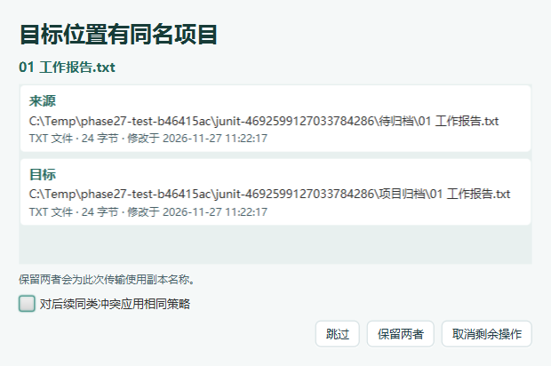
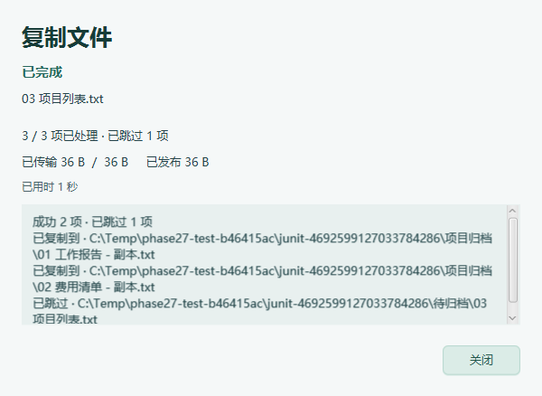

# 验证与人工复验

## 自动化验证

2026-11-27 在 Windows 11 26200 x64、本地 NTFS、Microsoft OpenJDK 21.0.13.0.2、Maven 3.10.0 和 JavaFX 21.0.6 环境运行。文件夹具彼此隔离。JavaFX 用例启动实际窗口，自动操作按钮和关闭事件，使用测试剪贴板模拟外部程序接管。

| 运行 | 通过 | 跳过 | 失败或错误 |
| --- | ---: | ---: | ---: |
| 2.6 基线 `mvn test` | 92 | 9 | 0 |
| 2.6 基线 `mvn "-Djavafx.integration=true" package` | 100 | 1 | 0 |
| 2.7 `mvn test` | 112 | 12 | 0 |
| 2.7 `mvn "-Djavafx.integration=true" package` | 123 | 1 | 0 |
| 第二个 NTFS 卷，仅运行 `TransferConflictTest` | 20 | 0 | 0 |

常规测试跳过 11 项需要显式开启的 JavaFX 集成用例。两组运行各有一项 NIO 撤销用例因当前 JDK 文件提供者未公开该夹具的文件键而跳过。NTFS 原生身份、句柄改名、暂存、回执和自动刷新用例均在相应运行中通过。 [NIO 用例](../../../src/test/java/edu/files/FileSafetyTest.java) · [JavaFX 集成用例](../../../src/test/java/edu/files/JavaFxFileOperationsTest.java)

| 验收内容 | 实际检查 |
| --- | --- |
| 批次和命名 | 中间项跳过后继续，同类策略在任务间失效。核对普通文件、后缀、点文件、目录及文件与目录冲突。 |
| 竞争和身份 | 在等待期间移动来源或目标目录并建立替代品，旧请求失败。原冲突项消失或替换时仍发布到副本名。有不同对象或同对象硬链接占用候选名时，选用下一名称。 |
| 暂存、回执与撤销 | 发布前制造占用，检查等待时常规暂存已清理。重试复制原路径的新内容，候选名再次被占用时继续使用该次暂存。真实移动路径进入撤销，原位置被占用时保留双方，移开占用者后可撤回最新字节。 |
| 失败分类 | 已占用的目标遇到源共享权限不足时报告失败。注入已提交但回执丢失的项目，核对成功、跳过、未知与尚未执行的混合结果及剪切队列。 |
| 窗口和会话 | 冲突期间切换浏览、观察真实监听刷新、收起和重开进度窗口。关闭冲突窗口或主窗口请求取消，停止应用后写入线程退出。等待中更换剪贴板所有者，已接受的移动完成，新版本保留。 |

第二个卷的初次整套运行发现 ACL 复制受拒导致三项基线断言失败。使用同一卷的夹具回跑 2.6，`BrowseImpactTest` 和 `StagedCopyTest` 也出现同样三项失败，故保留基线记录。该卷的 20 个阶段冲突用例单独通过。硬链接改名的卷差异与余下竞争窗口见设计文档。 [批次回归](../../../src/test/java/edu/files/TransferConflictTest.java) · [安全边界](01_冲突决策与文件安全.md)

## 冲突成本和界面

最终构建的 JavaFX 夹具中，从粘贴到显示冲突窗口为 141 毫秒，从关闭冲突窗口到显示取消摘要为 47 毫秒。截图运行中首次加载窗口为 276 毫秒。这些是本机单次采样，包含窗口采样和测试轮询。

在 2 MiB 夹具上，发布前冲突后重试从决定到到达下一次提交约 16–24 毫秒。最终传输了 4 MiB，发布了 2 MiB。同一次尝试的第一个副本名也被占用，额外改名没有增加复制字节。文件工作线程在等待冲突时被取消，从发出取消到取得批次结果约 0.07–0.23 毫秒。 [可控提交点和字节断言](../../../src/test/java/edu/files/TransferConflictTest.java)

截图直接采自运行中的 JavaFX 场景，路径和内容来自专用夹具。Mermaid 流程图在 Chrome 158.0.8127.38 中实渲染，检查了 SVG 节点、尺寸和文字，渲染尺寸为 1138 × 1064。





## 人工复验步骤

在开发分支的工作树中用 JDK 21 执行 `mvn javafx:run`。在另一个 PowerShell 窗口创建一组隔离样本，每次执行脚本都生成新的路径。

```powershell
$phase27Root = [IO.Directory]::CreateTempSubdirectory('javafm-phase27-').FullName
$phase27From = [IO.Directory]::CreateDirectory((Join-Path $phase27Root '来源')).FullName
$phase27To = [IO.Directory]::CreateDirectory((Join-Path $phase27Root '目标')).FullName
foreach ($phase27Name in 'a.txt','b.txt','c.txt','d.txt') {
    Set-Content -LiteralPath (Join-Path $phase27From $phase27Name) -Value ('来源 ' + $phase27Name)
}
foreach ($phase27Name in 'b.txt','c.txt') {
    Set-Content -LiteralPath (Join-Path $phase27To $phase27Name) -Value ('原目标 ' + $phase27Name)
}
$null = [IO.Directory]::CreateDirectory((Join-Path $phase27To 'd.txt'))
$phase27Root
```

1. 复制「来源」全部四项，到「目标」粘贴。处理 `b.txt` 时勾选「对后续同类冲突应用相同策略」并跳过。`c.txt` 也会跳过。`d.txt` 的目标是目录，会再次询问。选择保留两者后核对 `a.txt`、`d - 副本.txt` 的来源内容，以及仍在的两个旧文件和旧目录。任务详情应显示成功 2 项、跳过 2 项。
2. 再建一组样本。从「来源」剪切 `b.txt`，到「目标」粘贴并选保留两者。目标应有 `b.txt` 和 `b - 副本.txt`。用文本编辑器原地修改副本，回到管理器点「撤销」。新内容应回到来源的 `b.txt`，原目标的内容仍可读取。可先在来源新建占用原名的夹具，确认撤销拒绝覆盖，再移开夹具并重试。
3. 再建一组样本并复制全部四项。冲突窗口打开时可切换目录，在夹具内用资源管理器新建文件并观察自动刷新。对话框选「取消剩余操作」或点关闭。应看到 `a.txt` 已完成、`b.txt` 已取消、后两项未执行。等待时关闭主窗口也会取消当前冲突，任务结束后再次关闭即可退出。
4. 等待移动决策时，可以手动在记事本复制一段文本，再回到管理器选择保留两者。确认旧任务完成后，记事本剪贴板文本仍能粘贴。该步骤用于独立复验真实桌面的剪贴板交互。

本阶段自动化覆盖当前应用的真实窗口，系统剪贴板由测试替身模拟。阶段 2.6 的资源管理器双向复制人工记录保留在原文档。SMB、旧版 Windows 和其他文件系统的冲突交互待实际环境验证。 [阶段 2.6 的真实桌面记录](../07_系统剪贴板与文件传输/06_真实桌面验收.md)
