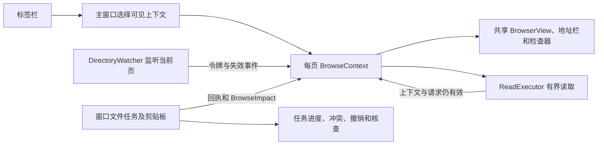
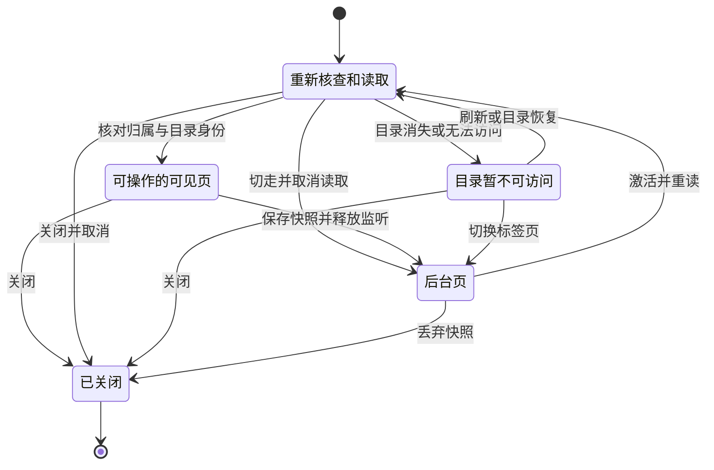

# 架构与状态归属

## 单浏览页基线与归属

阶段 2.7 的 `FileManagerApp` 持有唯一的当前位置、历史、列表、搜索、目录身份、请求版本和监听目标。筛选、滚动和行内改名由唯一的 `BrowserView` 保存。写入结果由 `BrowseImpact` 根据回执定位页面，剪贴板由窗口持有。单独增加 `TabPane` 只能切换页签，若字段仍由窗口共用，后退键、预览回调和粘贴目标会随当前页变化。 [审查中的状态模型](../../audit/05_状态管理与生命周期.md) · [2.7 主窗基线](https://github.com/hrao233/Java-/blob/0720f5a1e4d4e60c945d31aaebdeced152a28d84/src/main/java/edu/files/FileManagerApp.java)

| 归属 | 保存的状态 | 原因 |
| --- | --- | --- |
| 浏览上下文 | 稳定编号、已提交位置、导航栈、已提交搜索、首页子页、按页面类型设置的视图、筛选快照、滚动锚点、选区凭据和检查器模式 | 用户切回时继续使用同一浏览状态。 |
| 当前上下文的显示与读取 | 最新列表和目录身份、请求、显示版本、预览与选区读取、切痕检查、地址子菜单、监听令牌及待处理失效 | 数据可丢弃并从磁盘重读。提交条件与拥有者和请求实例绑定。 |
| 窗口会话 | 剪贴板版本和传输凭据、单写入任务、冲突与进度窗口、撤销、未知结果、收藏及系统位置 | 文件动作和共享资源有独立的生命周期，可在其他标签页访问。 |
| 应用偏好 | 显示隐藏项目、扩展名、紧凑视图、导航窗格、复选框和自动刷新开关 | 继续使用现有用户偏好。各页的排序、分组和展示模式从同一套默认值开始。 |
| 窗口服务 | 有界读取执行器、写入执行器、剪贴板执行器、目录监听、系统图标和活动暂存登记 | 服务按窗口分配。标签页数量增加时无需重复建立线程池和监听服务。 |

每页各有一个 `BrowserView` 时，切换可以直接显示原控件，同时要管理多个表格皮肤、缓存、弹窗、预览和焦点的关闭。本阶段为多个 `BrowseContext` 使用一个 `BrowserView`。后台页保留小型快照，重新激活会发生一次目录读取和渲染。筛选快照保存筛选值，滚动保存首个可见路径与比例。后台快照释放完整列表与预览，最多保留 64 个已核验的选区项目。窗口共享有界的缩略图和图标缓存。未来双栏可同时挂载两个显示控件和各自的可见上下文，沿用归属检查与窗口级文件任务。届时需扩展可见上下文和监听消费者的管理。 [BrowseContext](../../../src/main/java/edu/files/BrowseContext.java) · [BrowserView](../../../src/main/java/edu/files/BrowserView.java) · [ColumnFilters](../../../src/main/java/edu/files/ColumnFilters.java)

## 切换、导航和监听

双击目录等普通导航先创建读取请求。成功回调核对窗口仍开放、请求拥有者仍可见且请求实例仍一致，然后修改拥有者的位置与历史。失败保留上一个有效位置。取消旧请求时从有界队列移除并中断，已经进入底层 I/O 的任务仍可能较晚返回。前台和后台使用同一读取执行器，后台页停止提交新读。底层系统调用同时阻塞两个读取线程时，前台请求仍会等待其中一个返回。

标签停用时取消列表、预览、地址子目录、选区及剪切淡显读取，释放监听。带身份的选区和可恢复的滚动位置在再次读取后才应用。目录身份变化时解除旧关联。选区按原生文件身份、父目录和名称核验。预览基于新列表重新生成。切换取消行内改名以及地址栏和搜索框的未提交输入。可见页重新注册监听后沿用原有的补读机制。后台页依赖激活时的重新读取，可见页继续合并目录事件。 [请求归属与刷新](../../../src/main/java/edu/files/FileManagerApp.java) · [ReadExecutor](../../../src/main/java/edu/files/ReadExecutor.java) · [DirectoryWatcher](../../../src/main/java/edu/files/DirectoryWatcher.java)

普通目录的 Ctrl+T 和「+」打开同一目录的普通视图。搜索页的新标签打开当前搜索的根目录，首页和其他特殊页的新标签打开首页。复制标签页则复制已提交搜索、视图和前进后退记录，随后各自变化。关闭最后一个标签页后打开首页。标题和图标在实际位置提交后更新，过多标签使用 JavaFX 标签栏的溢出菜单。Ctrl+Tab 与 Ctrl+Shift+Tab 在标签间循环。

## 跨标签页文件操作

文件请求的生命周期从用户发出命令延伸到系统提交、回执与核查。粘贴从可操作的页面捕获目标路径、目录身份或文件夹选区凭据，再读取剪贴板并核对来源和目标。此后前台切换或关闭原页仍使用这份快照。复制或剪切保存的凭据属于窗口，同一窗口内的多个标签页使用同一个传输会话。切痕随可见列表重新验证，后来出现的同名对象不会继承凭据。

写入结束后，共享协调器更新剪切队列、撤销和未知结果。回执通过 `BrowseImpact` 刷新当前相关位置并给相关后台页留下返回时的刷新提示。关闭或切换标签页不会夺取用户的当前导航。未知结果保留核查路径，冲突等待和应用退出沿用文件任务自己的取消流程。 [粘贴与写入回执](../../../src/main/java/edu/files/FileManagerApp.java) · [BrowseImpact](../../../src/main/java/edu/files/BrowseImpact.java)

## 硬链接竞争的有限回归

在已检查目标名称、尚未提交改名的隔离同步点创建指向源对象的硬链接。C 卷返回名称占用，源目录项保留。D 卷的原生调用返回成功并折叠了源目录项，回执逻辑因观察到链接数量减少而记录未知结果，留下两个路径供核查，撤销队列为空。目标内容在两个夹具中均保留。实际移动在提交前和回执阶段对同一句柄采样。一次并发删除其他硬链接也可能产生数量减少，因此采用保守的未知结果。若最后一次提交前采样之后新增的链接被折叠，前后总数可能相同，这个窗口仍存在。 [原生回执](../../../src/main/java/edu/files/NtfsFileOperations.java) · [可控同步点回归](../../../src/test/java/edu/files/NtfsFileOperationsTest.java)
