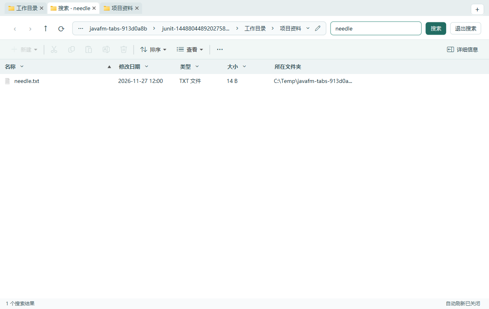
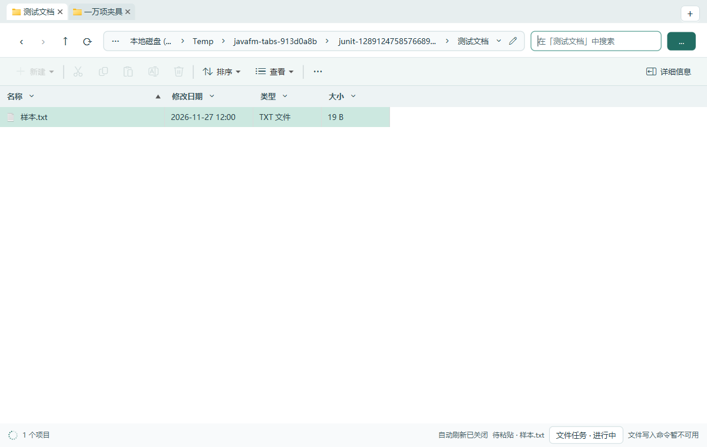

# 验证与人工验收

## JDK 21 回归

2026-11-27 使用 Windows 11 26200 x64、Microsoft OpenJDK 21.0.13.0.2、Maven 3.10.0、JavaFX 21.0.6 和本地 NTFS。JavaFX 测试创建实际的应用窗口，通过事件选择标签、调用文件命令、读取布局和验证内容。文件写入使用隔离夹具，剪贴板会话通过测试替身验证。

| 运行 | 通过 | 跳过 | 失败或错误 |
| --- | ---: | ---: | ---: |
| 2.7 基线 `mvn test` | 112 | 12 | 0 |
| 2.7 基线 `mvn "-Djavafx.integration=true" package` | 123 | 1 | 0 |
| 3.0 `mvn test` | 113 | 19 | 0 |
| 3.0 `mvn "-Djavafx.integration=true" package` | 130 | 2 | 0 |
| D 卷硬链接折叠专项 | 1 | 0 | 0 |
| 独立性能与截图运行 | 2 | 0 | 0 |

常规运行跳过需要开启 JavaFX 的用例，启用集成后额外跳过独立性能测量和一个需要 NIO 文件键的旧用例。第一个 NTFS 卷的硬链接实验得到确定名称冲突，第二个卷实际观察到折叠并得到未知回执。 [原生验收](../../../src/test/java/edu/files/NtfsFileOperationsTest.java)

| 回归内容 | 实际检查 |
| --- | --- |
| 标签命令及历史 | 右键打开文件夹、新建、Ctrl+Tab 循环、复制、关闭及最后一页回到首页。验证快速切换后的目录和搜索对应、失败导航保留历史、文本粘贴事件仍到达输入框。 |
| 选区和视图 | 同目录的不同标签使用不同模式、排序、筛选与滚动。重新核验选区后显示预览，替换文件解除旧选择。行内编辑因切换取消。 |
| 迟到任务和监听 | 阻塞旧读取或预览，切走并关闭来源，验证可见页先完成和迟到结果丢弃。同目录两页的监听令牌独立，第二页收到外部变化后第一页面可重读。验证后台目录同名替换及注册数上界。 |
| 文件传输 | 阻塞粘贴读取时切换页，阻塞复制发布时关闭发起页，确认写到原目标。剪切后关闭源页仍可粘贴，另一页可以撤销。同目录后台页返回时获取写后结果。 |
| 回执与会话 | 切走并关闭冲突来源页，处理部分成功，替代剪贴板保留。注入实际移动后回执丢失，核查记录仍在窗口中。已有 2.7 暂存、切痕、冲突及主窗取消回归继续执行。 |

Mermaid 架构图和生命周期图经 Chrome 158.0.8127.38 实际渲染及检查，分别为 1332 × 325 和 800 × 526。截图截取实际应用场景，采集时关闭了侧边栏以免显示本机快速访问路径。 [状态图与架构图](01_架构与状态归属.md) · [JavaFX 回归与测量](../../../src/test/java/edu/files/JavaFxFileOperationsTest.java)





## 性能和资源

夹具有一个文件的普通目录和一万个空文件的目录，使用详细信息视图和本地 NTFS。两目录来回切换三轮暖机，再开始采样。计时从 JavaFX 发出新建或切换命令到当前标签提交列表，包含后台读取和界面应用。测量关闭了自动监听，以避免注册补读混入单次切换耗时。

| 测量 | 样本 | 中位数 | 最小–最大 |
| --- | ---: | ---: | ---: |
| 新建普通目录标签 | 20 | 26.42 ms | 21.27–33.41 ms |
| 切回普通目录 | 6 | 10.85 ms | 9.33–14.73 ms |
| 两个标签时切回一万项 | 6 | 354.55 ms | 330.35–440.94 ms |
| 22 个标签时切回一万项 | 6 | 269.33 ms | 257.00–325.07 ms |
| 复制发布被夹具阻塞时切回普通目录 | 1 | 9.99 ms | 9.99 ms |

22 页的样本在两页样本之后取得，磁盘缓存和暖机程度可能不同。本组不用于推断页数带来速度变化。两个标签、22 个标签、关闭新增 20 个标签后，采样的 JVM 已用堆分别为 **21.52、23.54、23.34 MiB**。采样在请求 GC 后读取，涵盖 JavaFX 缓存和编译活动。三个检查点的 `file-manager-` 工作线程均为 6。20 个新增标签关闭前，测试核对所有后台页都已释放完整列表、读取和预览。独立监听回归中注册量最多为当前目录及其父目录两项。

复现性能和截图可以在本地 NTFS 上运行

```powershell
mvn "-Djavafx.integration=true" "-Djavafx.tabBenchmark=true" "-Djavafx.captureTabs=true" "-Dtest=JavaFxFileOperationsTest#measureTabSwitchingAndRetainedResources+tabCommandsKeepNavigationSearchAndTextInputSeparate" test
```

## 人工验收

人工键鼠验收待完成。用 JDK 21 在开发分支工作树启动 `mvn javafx:run`，在另一个 PowerShell 窗口生成一组样本。脚本只写新建的临时目录。

```powershell
$phase30Root = (New-Item -ItemType Directory -Path (Join-Path $env:TEMP ('javafm-tabs-' + [guid]::NewGuid().ToString('N')))).FullName
$phase30Source = (New-Item -ItemType Directory -Path (Join-Path $phase30Root '来源')).FullName
$phase30Target = (New-Item -ItemType Directory -Path (Join-Path $phase30Root '目标')).FullName
$phase30Other = (New-Item -ItemType Directory -Path (Join-Path $phase30Root '观察')).FullName
Set-Content -LiteralPath (Join-Path $phase30Source '可复制.txt') -Value 'source-copy'
Set-Content -LiteralPath (Join-Path $phase30Source '待移动.txt') -Value 'source-move'
Set-Content -LiteralPath (Join-Path $phase30Source '同名.txt') -Value 'source-conflict'
Set-Content -LiteralPath (Join-Path $phase30Target '同名.txt') -Value 'original-target'
$phase30Root
```

1. 在管理器打开「来源」，按 Ctrl+T 新建同目录标签，再导航到「目标」。用 Ctrl+Tab 和 Ctrl+Shift+Tab 切换，分别试后退和搜索。确认另一个标签保持原来的位置及搜索。
2. 在「来源」复制 `可复制.txt`，切到「目标」粘贴。用记事本打开两边夹具或对它们执行 `Get-FileHash`，确认内容一致且来源还在。
3. 在「来源」剪切 `待移动.txt` 后关闭该标签。到「目标」粘贴，再切到新开的「观察」执行「··· → 撤消」。确认文件回到「来源」，「目标」的移动结果消失，并核对内容为 `source-move`。
4. 从「来源」复制 `同名.txt` 到「目标」。出现冲突窗口后切到「观察」并关闭「目标」标签，回到冲突窗口选「保留两者」。核对任务显示实际副本路径，「目标」原文件内容仍为 `original-target`，副本内容为 `source-conflict`。后续重新打开「目标」应看到两项。
5. 在「观察」用资源管理器新建一个文本文件，确认前台自动刷新。再切到别处，为「观察」新增另一个夹具后切回，确认重新读取了新项目。用 Ctrl+W 关闭到最后一页，确认界面打开首页。
