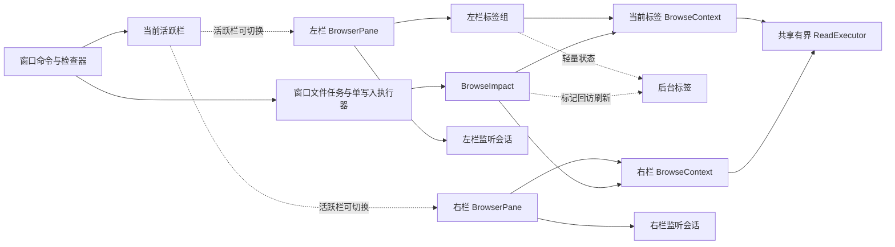
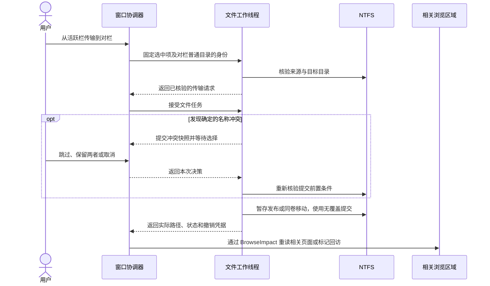

# 浏览区域、监听与跨栏写入

## 浏览状态归属

| 归属 | 状态与资源 | 生命周期 |
| --- | --- | --- |
| `BrowseContext` | 位置、上下页历史、查询、目录身份、列表版本、视图设置、筛选和滚动快照、已验证选区、待刷新状态 | 左栏每个标签一个。右栏一个。后台上下文释放完整列表和异步任务 |
| `BrowserPane` | 一个 `BrowserView`、地址栏、搜索框、检查器内容、监听会话 | 左栏始终挂载。右栏首次启用时创建，收起时释放列表、预览和监听键，重开时恢复轻量状态并重新读取 |
| 窗口 | 活跃栏、标签组、侧栏、工具栏、状态栏和检查器容器 | 集中处理窗口级命令，显示活跃栏的选区、属性和状态 |
| 窗口共享服务 | 有界读取执行器、单写入执行器、文件任务、冲突窗口、剪贴板会话、撤销、未知结果、收藏、系统位置、图标和缩略图缓存 | 文件任务可以跨越切换、关闭栏及标签等操作，主窗口关闭时统一清理 |

两个可见区域需要各自的 JavaFX 列表和选区模型，左栏仍在其标签之间复用同一个 `BrowserView`。`FileManagerApp` 通过内部 `BrowserPane` 复用导航、呈现和回调逻辑，两栏使用同一个窗口协调器。右栏首开到左栏当前目录，左栏停在首页等无目录页面时右栏也从首页打开。再次打开右栏会核查上次提交位置的身份，只有目录和所选对象的身份都仍有效才恢复选区。切换活跃栏会取消刚离开的行内改名，关闭右栏也会清除对应编辑。 [区域实现](../../../src/main/java/edu/files/FileManagerApp.java) · [上下文](../../../src/main/java/edu/files/BrowseContext.java) · [页面控件](../../../src/main/java/edu/files/BrowserView.java)

用户焦点只决定工具栏命令、F5、检查器和共享侧栏的归属。列表提交检查发起时的区域是否还可见、上下文是否仍挂载、请求是否仍为该上下文的当前请求。详情读取还检查列表版本、选中项及该详情任务的引用。右栏活跃时左栏仍能提交自己的读取。切换左栏标签与收起右栏都会取消该区域原上下文的列表、地址候选、选区核验、淡显和预览任务。 [请求提交与资源释放](../../../src/main/java/edu/files/FileManagerApp.java)

两个列表读取线程仍共用容量为 2 的等待队列，详情读取使用 2 个线程和容量为 24 的队列。一个可见区域最多持有一个当前列表请求，重复请求会移除本区域的旧排队请求并尝试取消运行任务。两个慢搜索可以同时占用列表线程，后续操作的等待时间取决于旧任务及时响应取消。详情和写入使用其他执行器。后台标签切回时才读取，不持续占用列表队列。 [读取执行器](../../../src/main/java/edu/files/ReadExecutor.java)

## 自动刷新

每个可见普通本地 NTFS 目录有一个独立的 `DirectoryWatcher` 会话，各注册目录及其父目录。考虑过共享同一路径的注册，采用独立会话可以沿用已有的注册、身份复核、完整重读和取消流程，资源上限为两个监听工作线程、两个 WatchService 和四个监听键。两栏同目录时各自接收事件并检查自己的请求及选区。关闭右栏会暂停其会话并释放键，右栏线程空闲等待复用，主窗口退出时关闭线程。搜索、图库及无法取得受支持身份的路径继续提供 F5。 [监听与事件合并](../../../src/main/java/edu/files/DirectoryWatcher.java) · [事件批次](../../../src/main/java/edu/files/DirectoryEvents.java)

通知通过注册返回的目标引用核对归属。事件批次被读取时间覆盖后可以丢弃，读取期间发生的新变化会排队。自动重读会等待已有导航和本栏行内编辑结束，必要时重新读取整个目录，并重新核验选区和预览。文件任务回执通过 `BrowseImpact` 触及两个可见栏，影响后台位置时记录回访信息。同目录的两个列表可以分别更新。写入提交与未知结果的核查依据仍来自任务回执，活动暂存则继续由共享的 `ActiveStaging` 过滤。 [阶段 2.5 刷新设计](../06_目录监听与自动刷新/) · [写入影响范围](../../../src/main/java/edu/files/BrowseImpact.java)

## 跨栏传输

Ctrl+C、Ctrl+X 和 Ctrl+V 共用窗口剪贴板会话。两栏共用同一个窗口身份，所以跨栏剪切沿用内部同卷移动及撤销。两栏的淡显各自验证列表项与已记录的对象身份。外部应用更新系统剪贴板后，旧任务仍使用已接受的来源和目标，剪切队列通过既有剪贴板版本检查更新。 [阶段 2.6 剪贴板](../07_系统剪贴板与文件传输/)

直接传输从当前选区和对栏已提交目录构造请求。开始核对时固定所选条目、已采集的凭据、目标路径与目录身份。预检核对双方身份、同目录、子目录和移动卷，同时把通过校验的请求交给现有 `FileChanges`。这样可以复用暂存复制、无覆盖发布、冲突决策、取消、进度和真实路径回执，并允许用户保留已有剪贴板内容。目标栏随后导航或关闭时，当前任务依然写入已核验的目录。 [共享文件任务](../../../src/main/java/edu/files/FileOperationTask.java) · [传输前置条件和回执](../../../src/main/java/edu/files/FileChanges.java)

直接复制只接收可核验的本地 NTFS 来源和普通 NTFS 目标目录，直接移动还要求同卷。搜索页可作为来源，作为目标时命令不可用。两栏同一路径时直接传输不可用，剪贴板复制仍按既有规则命名副本。父目录或目标身份变化会拒绝旧请求。覆盖、目录合并及硬链接竞争处理沿用既有安全边界。对检测到的链接折叠仍记录未知结果，链接计数未变化的竞争窗口继续存在。 [冲突处理](../08_文件冲突处理/01_冲突决策与文件安全.md) · [硬链接边界](../09_多标签页与浏览上下文/01_架构与状态归属.md#硬链接竞争的有限回归)
