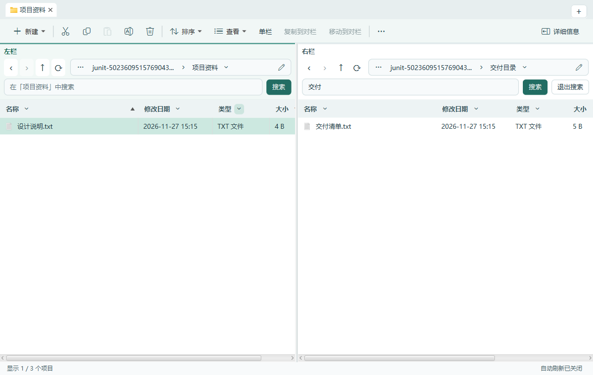
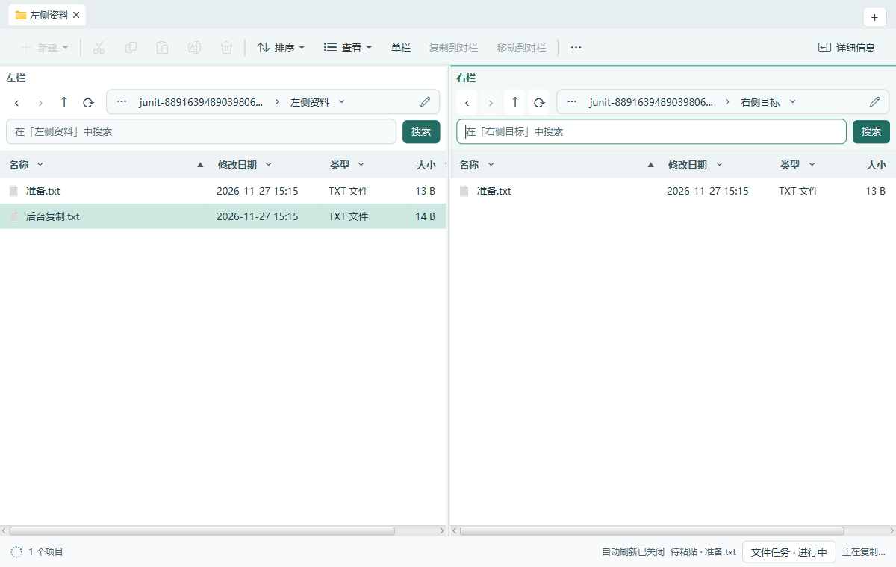

# 回归、性能与人工验收

## 测试环境与结果

在 Windows 11 26200 x64、Intel Core i7-14650HX、15.7 GiB 内存、本地 NTFS、Microsoft OpenJDK 21.0.13.0.2、Maven 3.10.0、JavaFX 21.0.6 上执行。JUnit 的写入使用新建隔离目录。集成用例启动真实 JavaFX 窗口，通过控件、事件和可控同步点检查结果，系统剪贴板使用测试替身。 [JavaFX 集成测试](../../../src/test/java/edu/files/JavaFxFileOperationsTest.java)

| 运行 | 通过 | 跳过 | 失败或错误 |
| --- | ---: | ---: | ---: |
| 阶段 3.0 基线 `mvn test` | 113 | 19 | 0 |
| 阶段 3.0 基线 `mvn "-Djavafx.integration=true" package` | 130 | 2 | 0 |
| 阶段 3.1 `mvn test` | 113 | 30 | 0 |
| 阶段 3.1 `mvn "-Djavafx.integration=true" package` | 139 | 4 | 0 |
| 隔离截图、跨卷拒绝及暂存取消 | 4 | 0 | 0 |
| 独立双栏性能用例 | 1 | 0 | 0 |
| 第二个 NTFS 卷的硬链接竞争回归 | 1 | 0 | 0 |

常规 `mvn test` 跳过 29 项需要启用 JavaFX 的用例，以及 1 项依赖当前 JDK 提供 NIO 文件键的旧用例。集成构建跳过该文件键用例、两个独立性能用例和需要第二个 NTFS 卷的专项。截图在单独的 `C:\Temp` 夹具中采集。将完整回归的临时目录也改到该处时，两个旧 ACL 用例和一个关联的 `BrowseImpact` 断言失败。阶段 3.0 在同一目录复现三项失败，其中包括 Windows 访问拒绝。完整回归采用与基线相同的用户临时目录。 [暂存测试](../../../src/test/java/edu/files/StagedCopyTest.java) · [回执刷新范围测试](../../../src/test/java/edu/files/BrowseImpactTest.java)

跨卷专项使用 C、D 两个 NTFS 卷。原有硬链接用例在 C 卷得到确定的名称冲突，在 D 卷观察到链接折叠并记录未知结果，撤销队列为空。 [原生回归测试](../../../src/test/java/edu/files/NtfsFileOperationsTest.java)

| 项目 | 实际检查 |
| --- | --- |
| 页面和命令归属 | 两栏位置、历史、搜索、排序及列筛选分开。拖动分隔条和最小窗口下导航可用。收起和再打开右栏保留有效位置，左栏继续使用标签组。 |
| 两个读取与监听 | 同步阻塞两次读取，确认右栏活跃时左栏能提交，收起后右栏迟到结果丢弃。不同目录各自变更，同目录时共同刷新，关闭右栏后左栏继续监听。 |
| 编辑、预览及身份 | 右栏外部变化保留左栏当前编辑，切换活跃栏取消旧输入。阻塞右栏预览并关闭右栏，左栏预览保持。右栏目录替换后重开，同名文件须重新选择。 |
| 剪贴板及直接传输 | 两个方向复制和剪切后核对实际内容。粘贴读取和直接传输准备期间切换或导航，仍使用原目标。直接传输保留既有剪贴板版本和文本。 |
| 部分成功与任务生命周期 | 冲突等待时在另一栏导航，选择跳过保留双方内容和已写入结果。收起目标栏后复制完成。收起来源栏后移动完成，从窗口撤销并核对最新内容。 |
| 错误与取消 | 对栏目录替换后拒绝旧目标，拒绝子目录和不同 NTFS 卷的直接移动。复制暂存期间可以浏览并取消，暂存清理后外部同前缀文件仍存在。注入回执丢失，两栏重读磁盘并保留核查记录。 |

架构图和操作时序图使用 Chrome 158.0.8127.38 实际渲染并检查文字和连线，尺寸分别为 1332 × 371 与 1332 × 926。截图来自测试运行中的应用场景，采集时隐藏个人快捷访问侧栏。 [架构与时序图](01_架构与文件操作.md)





## 性能与资源

左右各准备一个约 100 项的普通目录和一个恰好 10,000 项的目录，均使用详细信息视图，并启用本地目录监听。小目录与大目录来回导航三轮暖机后，分别采集五对读列表时间。导航从 JavaFX 连续发起两栏请求时开始，到各栏提交列表时止，包含磁盘读取和列表应用，结束点在系统合成绘制之前。开关耗时从点击到同步 CSS 与布局结束，包含界面重建，右栏异步加载另行等待。

| 测量 | 样本 | 中位数 | 最小–最大 |
| --- | ---: | ---: | ---: |
| 开启双栏并完成本次布局 | 10 | 17.89 ms | 8.65–28.96 ms |
| 收起双栏并完成本次布局 | 10 | 5.51 ms | 4.15–10.73 ms |
| 普通目录左栏导航 | 5 | 47.96 ms | 37.97–53.60 ms |
| 普通目录右栏导航 | 5 | 50.15 ms | 39.09–55.14 ms |
| 两栏各进一万项，左栏提交 | 5 | 536.32 ms | 517.03–624.54 ms |
| 两栏各进一万项，右栏提交 | 5 | 555.04 ms | 520.18–637.40 ms |
| 24 MiB 复制暂停在发布点，同时导航到一万项 | 1 对 | 左 685.77 ms，右 696.18 ms | — |

暂停发布时两栏均完成读取，放行后通过 `Files.mismatch` 核对完整内容和原目标。此样本测量有写任务占用时的读取响应，暂停点期间复制已经写完暂存数据。

在请求 GC 后采集的 Java 堆用量，单栏一万项 **26.79 MiB**，双栏各一万项 **37.15 MiB**，反复开关十次后收起右栏 **32.32 MiB**。JVM 缓存、暖机和回收时机都会影响绝对数值。应用工作线程从 7 变为 8，重复开关后仍为 8。确认的监听键为 2、4、4、2，分别对应单栏、双栏、重开十次后双栏及收起右栏。右栏监听线程空闲等待复用，每个 JavaFX 用例在窗口关闭后等待两个监听线程退出并核对键数为零。

用 JDK 21 复验性能时运行

```powershell
mvn "-Djavafx.integration=true" "-Djavafx.paneBenchmark=true" "-Dtest=JavaFxFileOperationsTest#measureDualPaneLatencyAndRetainedResources" test
```

跨卷专项可通过 `-Djavafx.secondaryNtfsParent` 指定另一块本地 NTFS 卷上的专用临时目录，测试在该目录下自行创建和清理子夹具。截图开关为 `-Djavafx.capturePanes=true`。

## 人工键鼠验收

在阶段 3.1 开发分支的工作树使用 JDK 21 运行 `mvn javafx:run`。在另一 PowerShell 窗口运行下列脚本建立夹具。实际剪切、复制、粘贴和键鼠操作由验收者执行。

```powershell
$phase31Root = [IO.Directory]::CreateTempSubdirectory('javafm-dual-').FullName
$phase31Left = (New-Item -ItemType Directory -Path (Join-Path $phase31Root '左栏')).FullName
$phase31Right = (New-Item -ItemType Directory -Path (Join-Path $phase31Root '右栏')).FullName
$phase31Observe = (New-Item -ItemType Directory -Path (Join-Path $phase31Root '观察')).FullName
New-Item -ItemType Directory -Path (Join-Path $phase31Left '长路径导航练习\子目录'), (Join-Path $phase31Right '右侧子目录') | Out-Null
$phase31Samples = @(
    @{ Dir = $phase31Left; Name = '可复制-L.txt'; Value = 'phase31-left-copy' }
    @{ Dir = $phase31Left; Name = '可剪切-L.txt'; Value = 'phase31-left-cut' }
    @{ Dir = $phase31Left; Name = '直接复制-L.txt'; Value = 'phase31-direct-copy' }
    @{ Dir = $phase31Left; Name = '同名.txt'; Value = 'phase31-source-conflict' }
    @{ Dir = $phase31Left; Name = '试改名.txt'; Value = 'phase31-edit' }
    @{ Dir = $phase31Right; Name = '可复制-R.txt'; Value = 'phase31-right-copy' }
    @{ Dir = $phase31Right; Name = '可剪切-R.txt'; Value = 'phase31-right-cut' }
    @{ Dir = $phase31Right; Name = '直接移动-R.txt'; Value = 'phase31-direct-move' }
    @{ Dir = $phase31Right; Name = '同名.txt'; Value = 'phase31-original-target' }
)
foreach ($phase31File in $phase31Samples) {
    Set-Content -Encoding utf8 -LiteralPath (Join-Path $phase31File.Dir $phase31File.Name) -Value $phase31File.Value
}
foreach ($phase31Index in 1..80) {
    New-Item -ItemType File -Path (Join-Path $phase31Left ('系列-{0:000}.log' -f $phase31Index)) | Out-Null
}
$phase31Root
```

| 项目 | 操作与预期 |
| --- | --- |
| A 布局与焦点 | 左栏用 Ctrl+L 打开 `左栏` 夹具目录。打开「双栏」，在右栏的地址编辑按钮打开 `右栏` 夹具目录。用 F6 和鼠标来回切换，确认高亮跟随。分别进入子目录、后退、前进并按 F5。拖动分隔条，缩小窗口，打开「详细信息」，检查导航控件和文本仍可用。 |
| B 独立呈现与编辑 | 左栏选择文件、滚动、按大小排序或筛选 `.log`，右栏搜索 `可复制`。确认左栏筛选和滚动仍有效。选中左栏 `试改名.txt` 按 F2，输入不同名称后直接点击右栏，确认原名仍保留。左栏新开标签再切回，核对独立位置和选区。 |
| C 两栏剪贴板 | 左侧选 `可复制-L.txt` 按 Ctrl+C，切到已退出搜索的右栏按 Ctrl+V。用 `可复制-R.txt` 反向操作。对 `可剪切-L.txt`、`可剪切-R.txt` 各做一次反向剪切粘贴，确认源目录项消失、目标内容正确。每次移动完成后可立即用「··· → 撤消」确认往返。 |
| D 直接传输 | 在搜索框内选中并复制文本 `phase31-clipboard`。从左栏直接复制 `直接复制-L.txt` 到右栏，随后在任一搜索框中粘贴文本检验剪贴板内容。然后从右栏用 Ctrl+Shift+F6 移动 `直接移动-R.txt` 到左栏，编辑其内容，再使用窗口的撤消，确认修改后的内容回到右栏。 |
| E 冲突与窗口生命周期 | 左栏选择 `同名.txt` 并复制到对栏。等待冲突时在右栏进入 `右侧子目录` 或直接收起右栏。选择「保留两者」，核对副本出现在初始 `右栏` 目录、原件内容仍为 `phase31-original-target`、副本内容为 `phase31-source-conflict`。可再复制一次并选择跳过或取消，确认结果统计。 |
| F 自动刷新 | 用资源管理器分别在两个夹具中创建新文件，两个列表各自更新。两栏打开同一个夹具目录，再创建一个文件，确认两栏同时更新。收起右栏后在其上次打开的目录新建文件，重新打开右栏时核对文件和位置，左栏仍能监听。 |

只读核对可执行 `Get-ChildItem -LiteralPath $phase31Left,$phase31Right -Name`。对两边的 `可复制-L.txt`、`可复制-R.txt` 和 `直接复制-L.txt` 分别运行 `Get-FileHash -LiteralPath <样本的完整路径>`，每对散列应相同。用 `Get-Content -LiteralPath <样本的完整路径>` 确认移动撤销保留最新文本、冲突保留双方内容。

人工键鼠验收待记录。开发分支用于复验，`main` 的快进以本阶段验收反馈为准。自动化场景的截图和测试替身用于验证行为，桌面的实际焦点、系统剪贴板及操作体验由上表核对。
