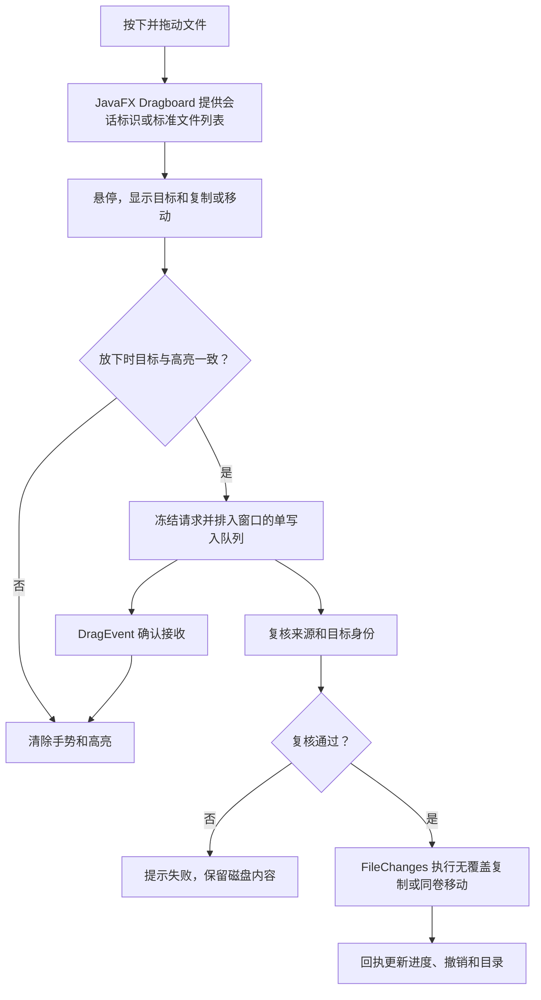

# 拖放入口与文件任务

## Windows 和 JavaFX 协议

JavaFX 在鼠标位移超过平台阈值后发出 `DRAG_DETECTED`。文件列表在鼠标按下时保存选区和已有身份凭据，进入该事件后才调用 `startDragAndDrop`。列表的普通点击、文本编辑、列头、滚动条和复选框仍使用原有事件处理。 `Dragboard` 在会话中属于 JavaFX 拖放通道，窗口剪贴板仍由独立的 `FileClipboard` 管理。 [JavaFX DragEvent](https://openjfx.io/javadoc/21/javafx.graphics/javafx/scene/input/DragEvent.html) · [剪贴板会话](../07_系统剪贴板与文件传输/02_会话与文件安全.md)

Windows Glass 在无修饰键和仅按 Shift 时都可能建议 MOVE，而且 JavaFX 21 的 `DragEvent` 没有修饰键字段。实现用现有 JNA 读取 Ctrl、Shift 和 Alt 的即时状态，区分默认复制、同卷移动和不支持的链接。传输仍走 JavaFX Dragboard 和 Windows OLE。JavaFX 源的标准 `DataFormat.FILES` 提供普通文件路径，带有窗内会话标识的拖放另附自定义格式。 [OpenJFX 21.0.6 Windows Glass](https://github.com/openjdk/jfx21u/blob/21.0.6%2B1/modules/javafx.graphics/src/main/native-glass/win/GlassDnD.cpp#L103) · [FileDrag](../../../src/main/java/edu/files/FileDrag.java)

| 手势 | 窗口内 | 与资源管理器交换 |
| --- | --- | --- |
| 无修饰键 | 复制 | 应用接收允许 COPY 的来源，底栏显示复制 |
| Ctrl | 复制 | 明确请求复制 |
| Shift | 来源预先核验、目标验证后可同卷移动 | 应用拒绝移入并提示用 Ctrl，拖出只提供 COPY |
| Ctrl+Shift 或 Alt | 请求链接，显示禁止提示 | 使用 Ctrl 复验复制 |

Windows 光标反映拖放协议的 COPY，窗内移动以蓝色高亮和底栏「移动」为准。外部来源只提供 MOVE 时，应用同样要求重新用 Ctrl 拖放。虚拟 Shell 文件没有受支持的实际文件列表。复制到本程序的外部路径在放下时按文件数量、大小、表示形式和祖先关系校验，再由后台从当前路径采集身份。外部路径无法证明鼠标按下时的对象。拖出时接收方依据路径读取，源程序无法固定资源管理器的打开时机；请使用稳定的隔离样本验收。 [Windows 复制和移动效果](https://learn.microsoft.com/windows/win32/shell/dropeffect)

## 请求的归属与提交

内部凭据使用当前窗口保存的随机会话标识及 JavaFX 发起控件共同匹配。只有发起控件符合当前会话时才读取标识内容，收到旧标识、携带内部标记的外部输入或缺少标识的内部文件列表都会拒收。依赖选区变化同步读取磁盘会延迟鼠标事件，所以原已核验的项目直接使用窗口内凭据。未完成核验的内部复制可在拖动期间补采，以首次核验的身份固定请求。首次核验使用目录记录比对元数据，元数据相同的更换在这之前无法靠路径区分。移动和对外导出要求开始拖动前已核验的选区。当前选区身份缓存上限为 64 项。一次拖放最多 4,096 个路径，超过现有身份缓存的内部复制可以后台补采。 [浏览与拖放入口](../../../src/main/java/edu/files/FileManagerApp.java) · [路径校验](../../../src/main/java/edu/files/ClipboardFiles.java)

普通列表空白和目录标签使用已提交目录的身份。后台标签可以使用先前核验的目录身份，放下以后仍重新验证。文件夹项目首次进入悬停时读取一次对象身份，离开该目标即取消未完成的读取。悬停只用显示状态、已采集凭据和修饰键，接近列表边缘时按事件节流滚动。等待核验时可轻移鼠标更新反馈。放下时核对目标与高亮一致，并封存路径、对象身份和操作类型。普通文件本身禁止投放，同目录、来源目录自身及其子目录不接受直接拖放。

同卷移动、无覆盖发布、暂存清理、冲突选择、协作取消及未知结果沿用已有文件操作引擎。协议完成只记录请求已受理。鼠标的 `DRAG_DONE` 释放会话、核验任务和高亮，只有任务引擎可以改写文件系统。即使源窗格收到 MOVE 的协议完成报告，也不会据此删除文件。窗口依据实际回执刷新受影响的两栏及标签，未确认写入继续进入核查列表。 [文件操作回执](../../../src/main/java/edu/files/FileChanges.java) · [已有冲突与安全边界](../08_文件冲突处理/01_冲突决策与文件安全.md)

直接拖放目标和实际执行操作限可核验的本地 NTFS 对象，移动还要求源与目标同卷。原先的硬链接计数竞争边界沿用。 [已知原生硬链接边界](../09_多标签页与浏览上下文/01_架构与状态归属.md#硬链接竞争的有限回归)
