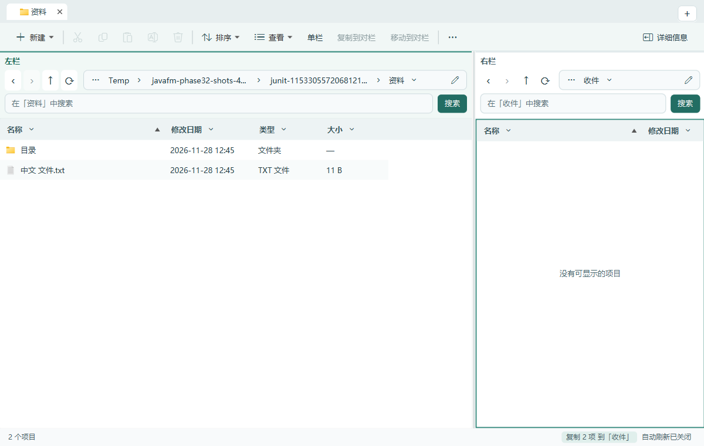
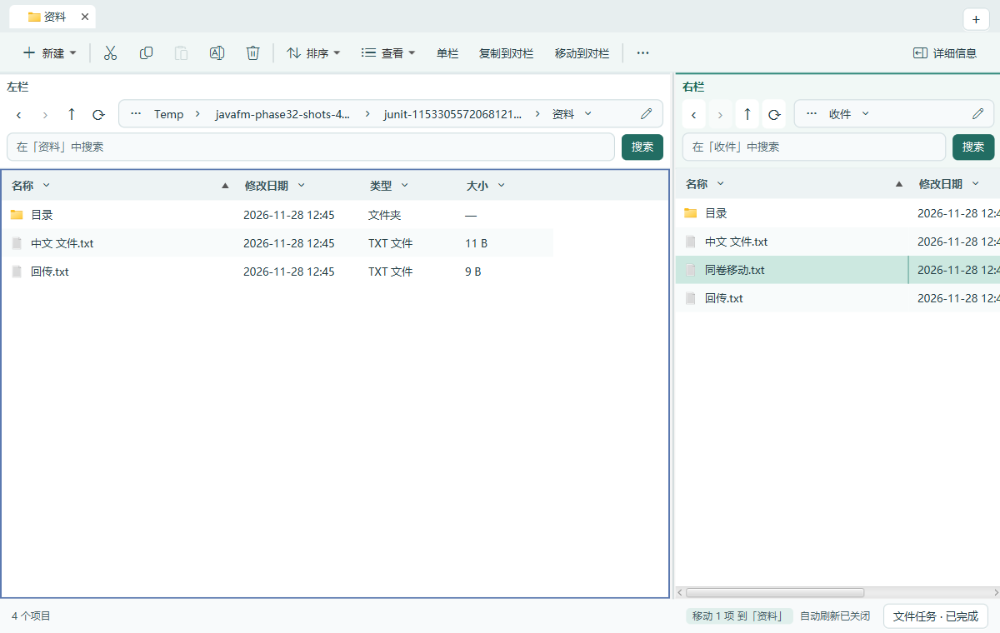
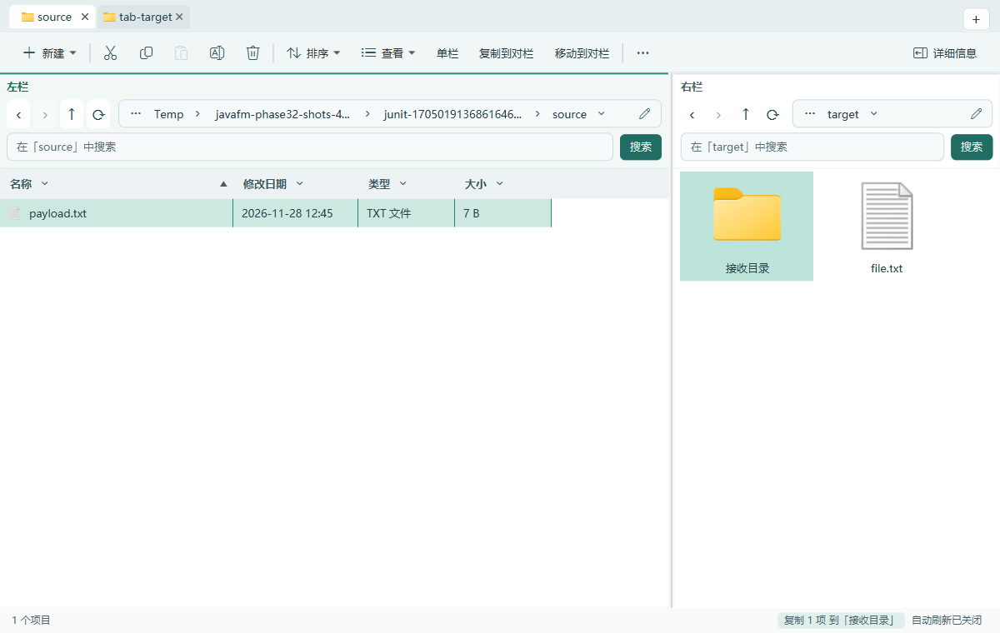

# 验证、性能与人工验收

## JDK 21 回归

测试环境为 Windows 11 26200 x64、Intel Core i7-14650HX、本地 NTFS、Microsoft OpenJDK 21.0.13.0.2、Maven 3.10.0 和 JavaFX 21.0.6。所有文件写入均位于测试新建的隔离目录。

| 运行 | 通过 | 跳过 | 失败或错误 |
| --- | ---: | ---: | ---: |
| 3.1 基线 `mvn test` | 113 | 30 | 0 |
| 3.1 基线 `mvn "-Djavafx.integration=true" package` | 139 | 4 | 0 |
| 3.2 `mvn test` | 117 | 38 | 0 |
| 3.2 `mvn "-Djavafx.integration=true" package` | 150 | 5 | 0 |
| 桌面反馈修正版 `mvn test` | 117 | 40 | 0 |
| 桌面反馈修正版 `mvn "-Djavafx.integration=true" package` | 152 | 5 | 0 |
| 独立拖放性能及 C、D 两个 NTFS 卷专项 | 2 | 0 | 0 |
| 定向 JavaFX 截图运行 | 4 | 0 | 0 |

修正版默认运行跳过 39 项 JavaFX 用例和 1 项依赖 NIO 文件键的旧用例。集成构建跳过该文件键用例、三个单独启用的性能用例及需要第二个 NTFS 卷的用例。当前阶段的拖放性能和跨卷拒绝均已独立运行。 [拖放模型测试](../../../src/test/java/edu/files/FileDragTest.java) · [JavaFX 集成用例](../../../src/test/java/edu/files/JavaFxFileOperationsTest.java)

| 范围 | 已核对的行为 |
| --- | --- |
| 多选与目标 | 冻结文件和目录混合选区，双向复制、同卷移动和撤销。投放到图标文件夹和后台标签。普通文件拒绝投放。 |
| 身份与并发 | 来源的同名同内容替换、已核验目标文件夹的替换均保留两边数据。悬停后导航使旧目标失效。自动刷新期间源会话保持有效。接受后收起目标栏，写入仍使用原目标。 |
| 任务结果 | 同名冲突跳过及保留两者，部分成功后继续，复制取消后暂存清理。注入移动成功而回执丢失的情况，实际位置刷新，记录可核查。 |
| 手势与外部数据 | 模拟外部标准文件列表、只允许 MOVE 的来源、Shift、伪造及已使用的会话、文本拖放。核对复制内容和来源保留。模拟 `DRAG_DONE` 报告 MOVE 后来源仍保留。剪贴板用替身验证版本保持。 |

截图来自实际 JavaFX 场景。用例从测试 Dragboard 注入拖放事件，操纵其中的控件并截取场景。真实资源管理器交换由下方人工步骤验收。流程图通过 Chrome 158.0.8127.38 实际渲染，SVG 尺寸为 716 × 1326。 [拖放流程](01_实现与安全边界.md#请求的归属与提交)







## 开销与资源

| 测量范围 | 样本 | 结果 |
| --- | ---: | --- |
| 从 1,200 个空文件的已选列表建立会话与 Dragboard 测试内容 | 暖机 3 次，计时 10 次 | 3.66 至 6.27 ms，中位数约 4.01 ms |
| 普通目录目标重复悬停的 JavaFX 处理 | 暖机 50 次，计时 500 次 | 中位数 0.0193 ms，P95 0.0577 ms |
| 单项目放下到完成身份复核并创建文件任务 | 5 次 | 1.41 至 9.84 ms，中位数 4.42 ms |

数据来自 Windows 上的 JavaFX 事件夹具，涵盖选区、请求、控件和必要的后台复核。悬停数据使用固定的修饰键和 Dragboard 替身，原生 OLE、鼠标采样和系统合成时间另由桌面验收观察。会话建立计时截至生成拖放数据，批量身份补采在后台进行。测试确认连续取消、悬停和传输后，来源会话、悬停记录及核验任务均已释放。实际文件任务执行前后，应用工作线程计数从 6 变为 7，增加的是原有单写入线程的首次启动。 [性能用例](../../../src/test/java/edu/files/JavaFxFileOperationsTest.java)

```powershell
mvn "-Djavafx.integration=true" "-Djavafx.dragBenchmark=true" "-Dtest=JavaFxFileOperationsTest#measureDragSessionAndHoverCosts" test
```

## 人工键鼠验收

用 JDK 21 在开发分支运行 `mvn javafx:run`。以下脚本建立专用目录，也可以使用本次验收已建好的同结构目录。应用和资源管理器的键鼠操作由验收者完成。

```powershell
$phase32Root = [IO.Directory]::CreateTempSubdirectory('javafm-drag-').FullName
foreach ($phase32Directory in @('左栏','右栏','右栏\投放目录','后台标签','资源管理器来源','资源管理器目标','左栏\资料 目录','资源管理器来源\外来 目录','左栏\传出 目录')) {
    New-Item -ItemType Directory -Path (Join-Path $phase32Root $phase32Directory) | Out-Null
}
$phase32Files = [ordered]@{
    '左栏\中文 文件.txt' = 'left-copy'
    '左栏\资料 目录\内容.txt' = 'left-directory'
    '左栏\左栏移动.txt' = 'left-move'
    '左栏\标签投放.txt' = 'tab-copy'
    '左栏\同名.txt' = 'source-conflict'
    '右栏\右栏移动.txt' = 'right-move'
    '右栏\右栏复制.txt' = 'right-copy'
    '右栏\同名.txt' = 'target-conflict'
    '右栏\普通文件.txt' = 'ordinary-target'
    '资源管理器来源\外来 文件.txt' = 'explorer-source'
    '资源管理器来源\外来 目录\内容.txt' = 'explorer-directory'
    '左栏\传出 文件.txt' = 'app-source'
    '左栏\传出 目录\内容.txt' = 'app-directory'
}
foreach ($phase32Sample in $phase32Files.GetEnumerator()) {
    Set-Content -Encoding utf8 -LiteralPath (Join-Path $phase32Root $phase32Sample.Key) -Value $phase32Sample.Value
}
Write-Output $phase32Root
```

通过 Ctrl+L 在应用左栏进入 `左栏`，打开双栏，在右栏进入 `右栏`。用 Win+E 打开资源管理器，错开放置窗口，露出拖放目标。

| 项目 | 操作和预期 |
| --- | --- |
| A 复制与目标 | 左栏多选 `中文 文件.txt` 和 `资料 目录`，拖到右栏空白处。目标绿色高亮并显示复制，左栏原件保留。选左栏一个文件拖到右栏的 `投放目录`，等实际文件夹高亮后松开。把文件拖到 `普通文件.txt` 上应显示无法投放。可以切换大图标再验证一次文件夹命中。 |
| B 同卷移动与撤销 | 先分别点击选中 `左栏移动.txt`、`右栏移动.txt`。每次开始拖动后按住 Shift，把选中的文件拖到另一栏空白处。目标应显示蓝色和「移动」。用「··· → 撤消」核对文件回到来源。 |
| C 后台标签和冲突 | 左栏先新建标签并访问 `后台标签`，切回原标签，把 `标签投放.txt` 拖到该标签标题。当前活动标签继续保留，切过去时能看到副本。把左栏 `同名.txt` 拖到右栏，选择「保留两者」，原件和副本分别保存原来的内容。 |
| D 资源管理器拖入 | 在资源管理器打开 `资源管理器来源`，选中 `外来 文件.txt` 和 `外来 目录`，按住 Ctrl 拖到应用右栏空白处。右栏应出现完整副本，资源管理器原目录中的项目仍在。可再持 Shift 拖一次并检查拒绝。 |
| E 应用拖出 | 在应用左栏选中 `传出 文件.txt` 和 `传出 目录`，开始拖动后按住 Ctrl，把选区拖到资源管理器的 `资源管理器目标`。确认两个应用都还能看到各自文件，文件夹内的 `内容.txt` 一致。 |
| F 状态清理 | 拖到无效目标或按 Esc 取消，确认高亮消失、文件留在来源。验证普通点击、双击、Ctrl 多选和地址栏文本编辑。可以在任务进行中切换标签并在进度区观察写入结果。 |

用 `Get-FileHash -LiteralPath <完整路径>` 对照来源和目标。剪贴板保持可通过验收者事先在文本框复制一段文本、拖放后再粘贴该文本检查。 [本轮结果](#真实桌面验收记录)

## 桌面试用反馈与修复

2026-11-28，用户反馈左右地址栏输入后按回车无反应，点击历史建议可以进入目录，同时文件拖动无法启动。

- 地址编辑器和历史建议弹窗共用回车处理。选中建议时进入该建议，未选中时直接提交输入的路径。测试向两栏的历史弹窗发送回车并分别核对导航结果。 [AddressBar](../../../src/main/java/edu/files/AddressBar.java)
- 文件单元格可以在事件冒泡时消费 `DRAG_DETECTED`，导致原来挂在列表上的处理器收不到事件。文件列表现在在捕获阶段使用最近的主按钮按下记录启动拖放，命中编辑控件等区域时保留原有输入处理。测试向实际 JavaFX 场景发送按下和移动事件，在进入 Windows 原生拖放循环前核对标准文件列表和会话标识。 [FileManagerApp](../../../src/main/java/edu/files/FileManagerApp.java) · [新增回归](../../../src/test/java/edu/files/JavaFxFileOperationsTest.java)

两个用例复现了修复前的行为，修复后通过。

## 真实桌面验收记录

2026-11-28，用户在 Windows 桌面复验 `7b27c6a6c49bd2195923cde8d39e3b292cbfe575` 修正版后反馈「人工核查无误」。复验结果记录为通过。

- 资源管理器拖入时，`外来 文件.txt` 与 `外来 目录/内容.txt` 在应用的右栏目录中出现。应用拖出时，`传出 文件.txt` 与 `传出 目录/内容.txt` 在资源管理器目标中出现。只读核对显示，两次复制的四对 SHA-256 均相同，原文件及源目录保留。
- 左栏的 `中文 文件.txt` 与右栏目录、右栏 `投放目录` 中的副本分别一致。后台标签的 `标签投放.txt` 与来源一致。
- 右栏的 `同名.txt` 保留原目标文本，`同名 - 副本.txt` 与左栏来源一致。用作无效目标的 `普通文件.txt` 保留原内容。

交付提交补充验收记录，所交付的源码和测试与上文通过 JDK 21 回归的修正版一致。
