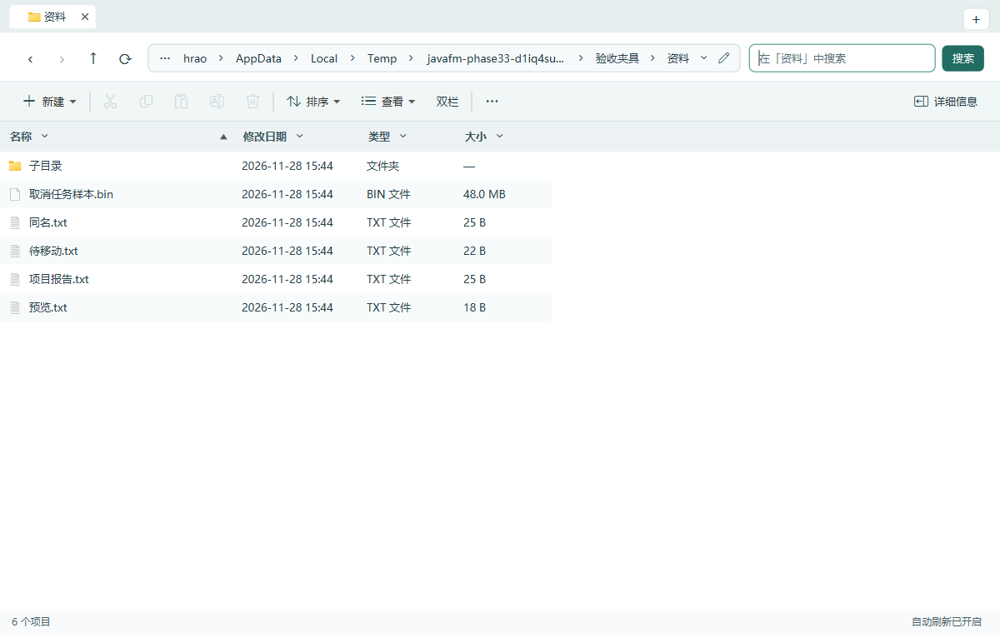
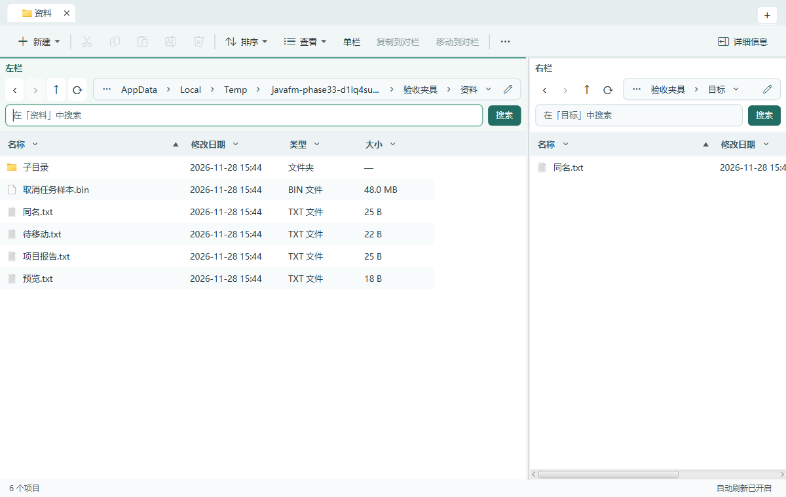

# 人工验收与发布准备

## 桌面验收

2026-11-28，用户在真实 Windows JavaFX 窗口完成桌面核查并反馈「人工核查无误，但是还未运行启动脚本」。本轮使用修复提交 `188a800176c583abbcd5cd84ae4219019747072f` 构建的代码，测试文件和 Preferences 使用隔离夹具。启动脚本和重启由后续实机复验完成。

- 只读核对了搜索结果跨标签复制、双栏拖放保留两者和拖到资源管理器的三组文件。三组 SHA-256 均相同。原同名目标文本保留，移动样本只在来源目录保留，观察目录的测试文本存在外部编辑痕迹，夹具内暂存残留计数为零。
- 正常关闭验收窗口，运行原 PowerShell 启动脚本。JDK 21 启动的新窗口显示主页，双栏模式恢复，分隔条从 0.4969 恢复到 0.4971。窗口宽度保持 1392 个逻辑像素，高度从 1084 调整到屏幕可用的 1019，纵坐标相应调整。侧栏开启，自动刷新、隐藏文件及扩展名选项与保存值一致。新窗口有一个主页标签，内部剪切和撤销记录均为空。

## 复验步骤

可另建隔离目录后运行 `mvn javafx:run` 重现日常场景。准备「资料」「目标」「观察」「资源管理器目标」四个同卷目录。「资料」中建立「子目录/研读 说明.txt」「项目报告.txt」「待移动.txt」「同名.txt」及「预览.txt」，在「目标」另放一个内容不同的同名文件，在「观察」放「自动刷新.txt」。操作和预期如下。

1. 在左右地址栏用 Ctrl+L 输入资料与目标地址并回车。验证前进、后退、上一级、历史建议和不存在的目录，失败后仍可浏览。可试收藏隔离目录或打开报告后查看近期记录。
2. 搜索「研读」，把匹配项目复制到另一标签的目标。查看实际字节，切回搜索标签核对状态，清除搜索。试选择、排序、筛选、详细和大图标，空目录和无结果状态应可继续导航。
3. 把左栏同名文件拖到右边，选择保留两者，检查原件与副本。可再选跳过或取消剩余项。放下前应有目标提示，取消后任务结果应清楚。保持正在等待决策的任务，同时切换标签浏览。
4. 剪切「待移动.txt」到目标后立即撤销，确认源回到原处且目标消失。用资源管理器 Ctrl 拖放复制一个普通文件，再试常用复制粘贴。用 `Get-FileHash -LiteralPath <路径>` 核对字节，两边源文件应保留。
5. 在观察目录打开文本预览，通过外部编辑器修改该夹具文件，检查列表及预览。试新建、行内改名和回收刚创建的空目录。进度窗口取消与应用正常关闭的自动化边界见回归文档。 [回归](05_修复记录与回归验证.md)
6. 调整窗口、双栏分隔条和侧栏，改变隐藏文件、扩展名或自动刷新选项。正常退出并再次打开，用原验收启动脚本检查几何和设置是否恢复。缩窄窗口检查两栏和长路径，浏览及文件凭据从新会话开始。

这两张图取自 150% 缩放的实际 JavaFX Scene，使用合成夹具、关闭侧栏采集。

## 阶段 4.0 发布准备

- Maven 目前以 Java 21 编译，应用入口 `edu.files.FileManagerApp`。显示名「本地文件管理器」，Maven 版本 `1.0.0`。仓库未跟踪独立应用图标或顶层软件许可证。正式分发前确认名称、版号、产品图标及项目许可。 [POM](../../../pom.xml)
- JDK 21 自带 `jpackage` 和 `jlink`。 `jdeps` 得出应用的 JDK 依赖 `java.base, java.desktop, java.logging, java.prefs` 及 `javafx.controls`。JavaFX 使用 Windows x64 的 base、graphics、controls 平台发布包。JNA 和 ICU4J 是自动模块，类路径交付比较直接。隔离实验裁剪出约 84.7 MiB 的 JDK 运行时，另带 JavaFX、JNA、ICU4J 和应用 JAR 后打开了 JavaFX 窗口并提交主页。实验保留了 `jdk.unsupported` 及诊断所用的 `java.management`，尚待在无预装 Java 的机上验收。 [JDK 21 jpackage 文档](https://docs.oracle.com/en/java/javase/21/docs/specs/man/jpackage.html)
- 分发路线先做 Windows x64 app-image，再决定 EXE/MSI。当前工具链识别这些类型，未发现 WiX 命令。阶段 4.0 需独立核对 WiX 版本、最小系统版本、签名、SmartScreen、开始菜单和卸载路径。Windows PowerShell 5.1、COM、Shell、系统字体和权限用于可选系统功能，安全策略禁用脚本时需检查缺省目录及可用类型。 [系统集成资源](../../../src/main/resources/edu/files)
- Microsoft OpenJDK 和 OpenJFX 依发行版 GPLv2 加 Classpath Exception 及第三方通知。JNA 5.17.0 以 LGPL 2.1 或 Apache 2.0 双许可发布，选择 Apache 路径需带相应许可与通知。ICU4J 79.1 声明 Unicode-3.0。应按实际打包内容保留运行时 legal 文件、JavaFX、原生 JNA 支持库和 ICU 数据的通知，并核对源代码提供义务或上游来源。 [Microsoft OpenJDK](https://learn.microsoft.com/java/openjdk/faq) · [OpenJFX 许可](https://github.com/openjdk/jfx/blob/master/LICENSE) · [JNA 许可](https://github.com/java-native-access/jna/blob/5.17.0/LICENSE) · [ICU 79 许可](https://github.com/unicode-org/icu/blob/maint/maint-79/LICENSE)
- Windows 上 Java Preferences 按用户保存于 `HKEY_CURRENT_USER\Software\JavaSoft\Prefs`，应用节点对应 `/edu/files/explorer`。卸载应清理安装目录和快捷方式，用户文件、回收站和已复制内容由系统保留。是否提供显式清理首选项由发行方案决定。 [Preferences 入口](../../../src/main/java/edu/files/FileManagerApp.java)
- GitHub Actions 可先用 Windows x64 runner、JDK 21 和 Maven 缓存跑默认测试及打包。原生 NTFS 依赖和 JavaFX 集成是否可在托管会话运行需实测。Explorer、OLE 拖放和安装卸载验收应保留独立的交互 Windows 环境。仓库当前未跟踪 workflow。 [GitHub Windows runner](https://docs.github.com/actions/using-github-hosted-runners/about-github-hosted-runners)

本轮发布调查以构建配置、命令和隔离运行时为证据。阶段 4.0 的安装、卸载、签名和发行包验证仍待完成。
