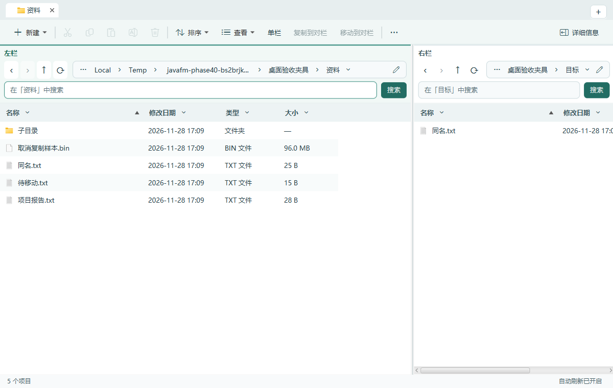

# 验证与人工验收

## 本地回归与独立运行

本地环境为 Windows 11 x64 Build 26200，NTFS，Microsoft OpenJDK 21.0.13.0.2，Maven 3.10.0，显示缩放 150%。默认回归通过 119 项、跳过 44 项。JavaFX 集成 Maven 构建通过 158 项、跳过 5 项。跳过项分别包含默认未启用的 JavaFX 用例、缺少 NIO 文件键的既有用例，以及未启用的独立性能夹具和第二卷选项。测试启动真实 JavaFX，手势自动化使用合成事件。

便携目录从一处解压完整搬移到另一处，两个目录均含中文和空格。清除测试进程的 `JAVA_HOME`、Maven 环境变量，PATH 仅保留 Windows 系统目录。启动器打开窗口，从随包 runtime 加载 JVM，JavaFX 和 JNA 从空缓存提取原生库。检查启动器与 JDK 的 67 个 PE 二进制均为 x64，随包运行时保留 58 个原始法律文件。这项验证在开发机上执行，独立的 Windows 11 无 Java 环境仍待验证。

用随包运行时及 Windows JavaFX 模块重跑测试。批量执行通过 157 项、条件跳过或假设不满足 5 项，1 项拖放测试的反射清理由 JavaFX 模块封装拦截。仅给测试命令开放相应内部包后，该拖放用例单独执行通过。生产启动器沿用模块默认封装。

修复了精简 PATH 时找不到系统 PowerShell 的问题，补充实际启动系统脚本的回归。英文 GitHub runner 暴露了 Windows 临时目录 8.3 别名和中文 WiX 参数两类问题。使用标准长路径 NTFS 夹具后，默认回归运行通过。EXE 构建使用 UTF-8 参数文件及中文 MSI 代码页，英文 runner 已生成两个版本的安装包。 [默认回归](https://github.com/hrao233/Java-/actions/runs/46129743086) · [安装验证](https://github.com/hrao233/Java-/actions/workflows/windows-installer.yml)

## 源码与打包运行时对照

同一 NTFS 夹具包含一个 100 项目录和两个各 10,000 项目录。两组进程先热身一次，再各取三次中位数。导航计时从发出请求到 JavaFX 提交，统计截至屏幕合成前。启动计时从 Java 探针类初始化到 Stage 返回和主页提交。当前独立 EXE 从启动到出现真实窗口为 2.76 秒，该次采样包括启动器、进程初始化及空缓存加载。

| 同一夹具 | 源码 JDK | 随包运行时 |
| --- | ---: | ---: |
| Stage 显示 | 865 ms | 818 ms |
| 主页可用 | 2.89 s | 2.86 s |
| 打开 100 项 | 50 ms | 46 ms |
| 单栏 10,000 项 | 375 ms | 379 ms |
| 两栏各 10,000 项，左和右 | 426 / 437 ms | 404 / 425 ms |
| 切回小目录和大目录标签 | 19 / 316 ms | 16 / 348 ms |
| 回收后 Java 堆、Java 线程 | 36.21 MiB、31 | 36.38 MiB、33 |

随包双栏样本中，大目录读取和建立列表约 381–414 ms，读取排队低于 1 ms，排序、过滤及 JavaFX 提交合计约 2–5 ms。阶段 3.3 的秒级差异本轮未复现，保留现有浏览设计。此次测量关闭自动刷新以隔离单次提交，连续导航复用系统缓存。

## 本地候选资产

| 资产 | 大小（字节） | SHA-256 |
| --- | ---: | --- |
| Windows x64 便携 ZIP | 67,324,060 | `6c8b3b775c02be1da5d22248f891682dd0bdad8020ae4c9bf1b3125f1a7c2621` |
| Windows x64 安装 EXE | 68,478,464 | `88c2f547f5d595548254aeca39c5cf8a9d6f28ab7aa763e51267edfab56cd9a3` |
| 第三方源码附件 | 188,111,958 | `653d55e8aff2b8b4ca40b0f007c5d8007d84823eb9bc7213b517ae3c4e5330ae` |
| 解压应用镜像 | 147,237,993 | 使用外层 ZIP 逐字节核对 |

资产使用应用源码提交 `f936efe2d0b0c0c2077a9831680578e50833606f`。当时工作树另有待提交说明文档，构建信息如实标记了该状态。后续构建脚本固定 WiX 使用的语言和代码页，以便在英文 runner 复现中文产品安装包。

## 桌面验收步骤

在专用目录准备「资料」「目标」「观察」「资源管理器来源」「资源管理器目标」。验收时保留这些文件，使用核对内容、路径和 SHA-256 的方式确认。

1. 核对 ZIP 哈希，解压并移动整个文件夹，双击启动器。确认主页可操作，地址栏按回车打开夹具，标签、双栏、搜索、预览和属性能够使用。
2. 复制「项目报告.txt」到目标。把源和目标各自的「同名.txt」用于保留两者冲突。检查原文件和副本。剪切「待移动.txt」到目标再撤销。
3. 使用真实资源管理器双向复制和 Ctrl 拖放，核对传入和传出文件。测试外部剪切移入的拒绝提示。
4. 观察「观察」中的文本预览，用外部编辑器修改夹具，看自动刷新。验证新建、改名和把新建空目录移到回收站。较大样本可用于复制进度与取消，检查未完成项的正式文件名和暂存残留。
5. 验证 EXE 安装，选择单独的测试安装目录，勾选桌面快捷方式，从开始菜单、桌面分别启动。调整双栏和显示选项，退出并再打开。
6. 在 Windows「已安装的应用」卸载。检查快捷方式、安装文件，并核对夹具文件仍在且内容相同。重新安装后检查偏好。真实桌面结果依维护者反馈登记。

