# 截图索引

以下 72 张 PNG 均从实际运行的 JavaFX 窗口采集。每张图记录 JavaFX 逻辑窗口尺寸及 PNG 物理尺寸。 [环境与覆盖](04_截图环境与覆盖范围.md)

## A 主界面与导航

### A01 主文件夹首页

快速访问与最近使用的文件。固定位置及最近记录用合成数据填充。 窗口 1280×800 逻辑单位，PNG 1902×1191 像素。 [首页布局](../../../src/main/java/edu/files/FileManagerApp.java#L3580)

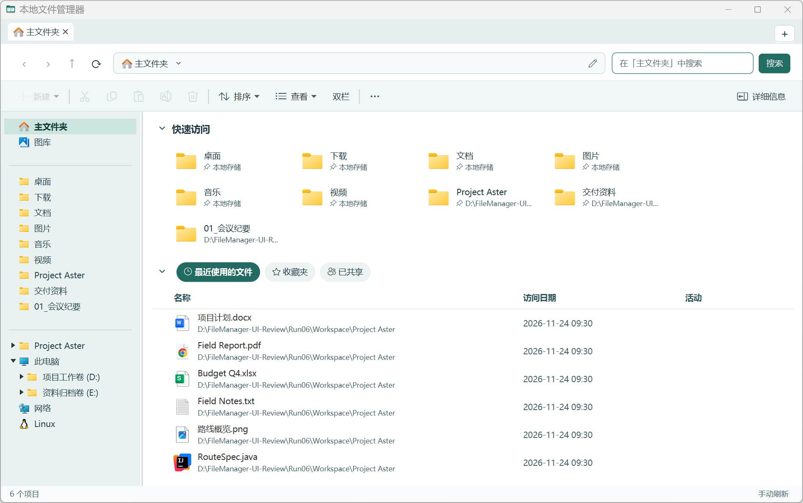

### A02 此电脑

平铺显示演示卷及项目目录。容量、卷标与文件系统文本来自夹具。 窗口 1280×800 逻辑单位，PNG 1902×1191 像素。 [此电脑数据源](../../../src/main/java/edu/files/FileManagerApp.java#L808)

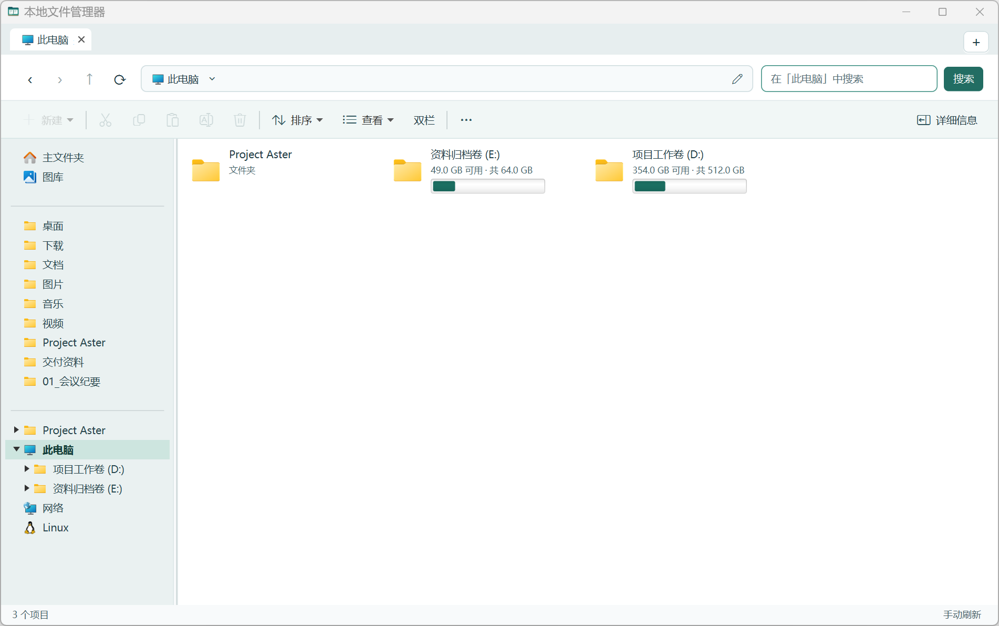

### A03 普通目录的详细信息视图

打开 Project Aster，显示文件名、修改时间、类型和大小。 窗口 1280×800 逻辑单位，PNG 1902×1191 像素。 [详细信息表格](../../../src/main/java/edu/files/BrowserView.java#L521)

### A04 地址栏编辑

打开编辑框，输入尚未提交的夹具路径。 窗口 1280×800 逻辑单位，PNG 1902×1191 像素。 [地址编辑](../../../src/main/java/edu/files/AddressBar.java#L142)

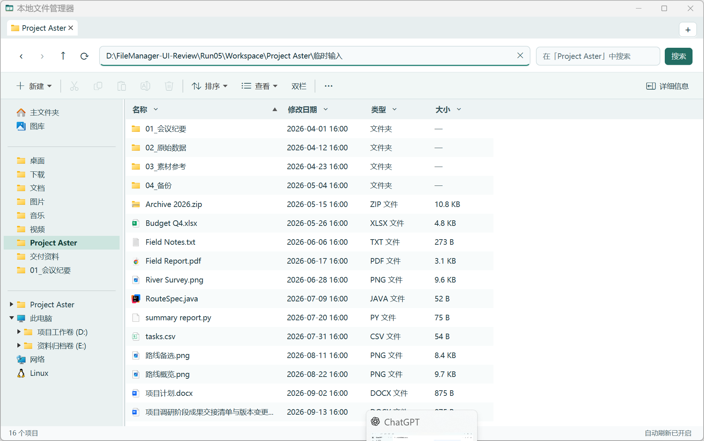

### A05 地址栏历史建议

展开实际建议弹层，历史项来自夹具访问记录。 窗口 1280×800 逻辑单位，PNG 1902×1191 像素。 [建议列表](../../../src/main/java/edu/files/AddressBar.java#L199)

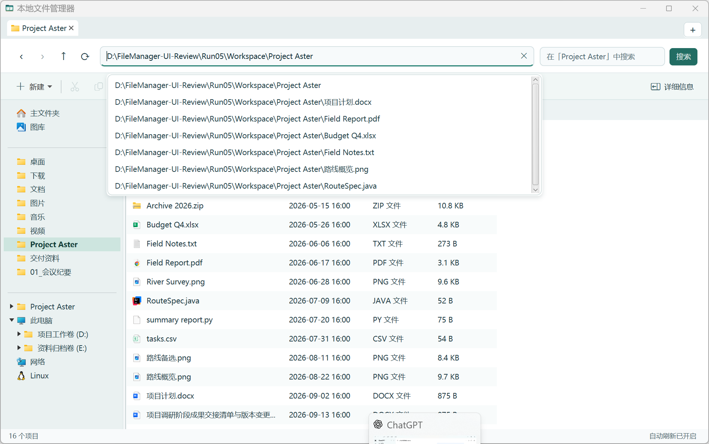

### A06 侧边栏展开

展开项目目录分支，显示按需读取的子文件夹。 窗口 1280×800 逻辑单位，PNG 1902×1191 像素。 [展开目录树](../../../src/main/java/edu/files/FileManagerApp.java#L1181)

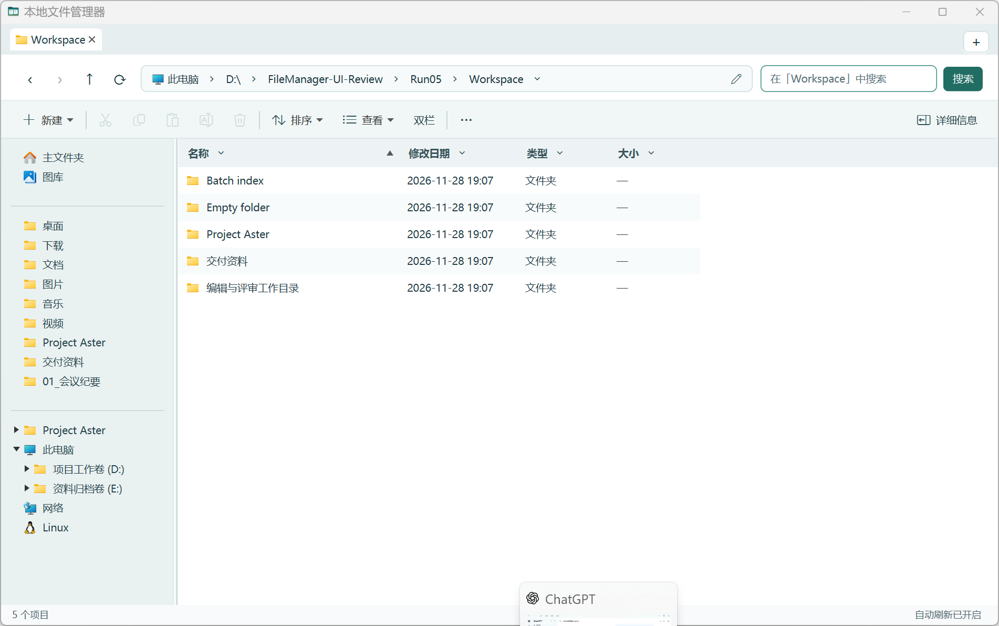

### A07 侧边栏收起

通过「查看 → 显示 → 导航窗格」隐藏侧栏。 窗口 1280×800 逻辑单位，PNG 1902×1191 像素。 [导航窗格开关](../../../src/main/java/edu/files/FileManagerApp.java#L3534)

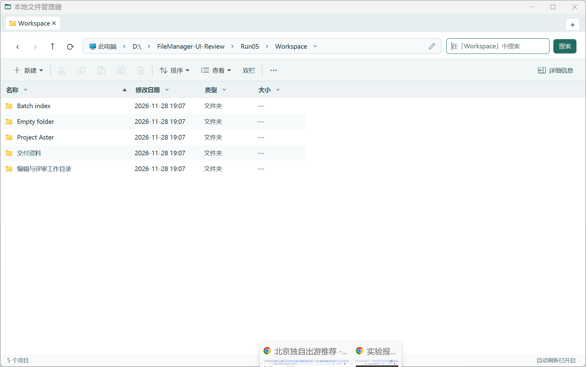

### A08 搜索结果

在项目目录搜索「路线」，显示匹配文件及所在位置。 窗口 1280×800 逻辑单位，PNG 1902×1191 像素。 [搜索命令](../../../src/main/java/edu/files/FileManagerApp.java#L3139)

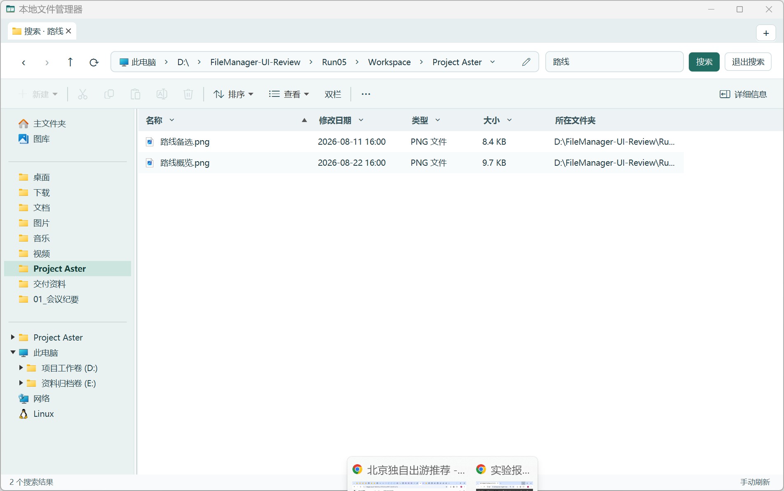

### A09 空目录

打开真实空的 Empty folder，保留列头和空状态。 窗口 1280×800 逻辑单位，PNG 1902×1191 像素。 [列表空状态](../../../src/main/java/edu/files/BrowserView.java#L347)

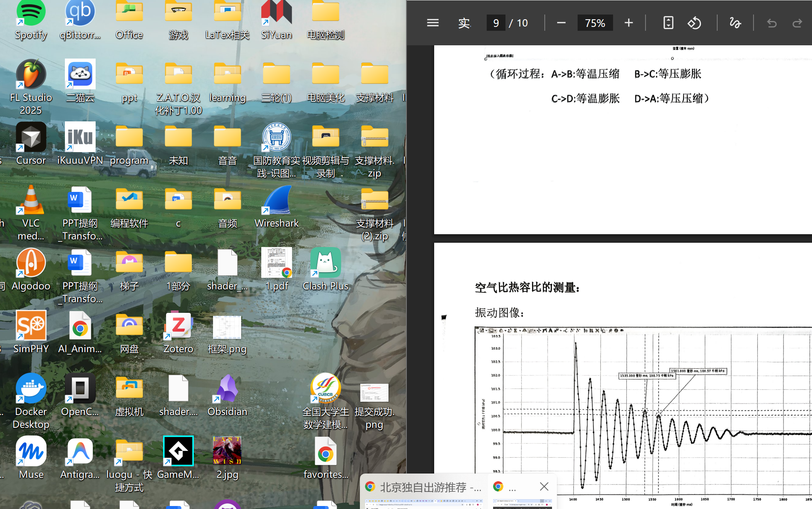

### A10 无搜索结果

输入 `zz-no-matching-file`，显示零个搜索结果及退出搜索按钮。 窗口 1280×800 逻辑单位，PNG 1902×1191 像素。 [搜索控件](../../../src/main/java/edu/files/FileManagerApp.java#L2983)

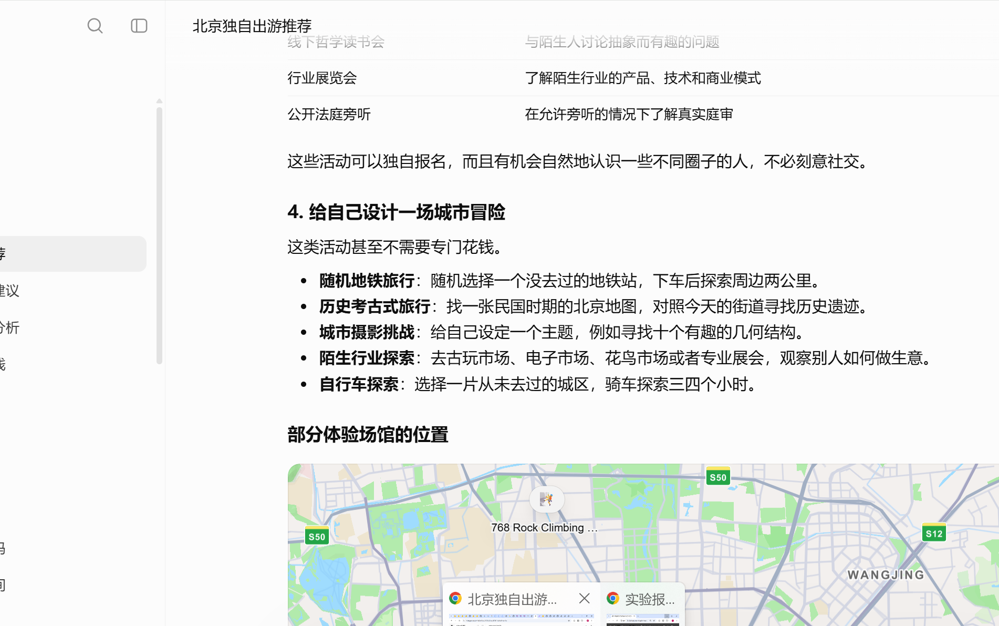

## B 文件展示

### B01 详细信息视图

项目列表按名称排列，显示列头及筛选入口。 窗口 1280×800 逻辑单位，PNG 1902×1191 像素。 [表格和列头](../../../src/main/java/edu/files/BrowserView.java#L521)

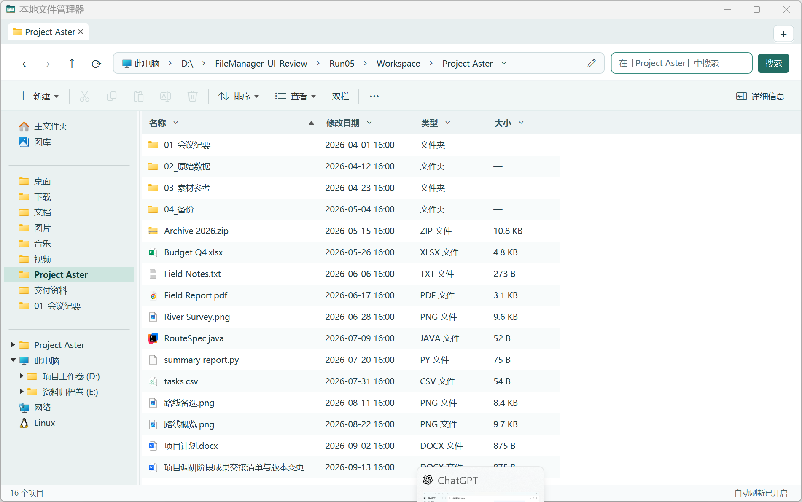

### B02 列表视图

18 逻辑像素的文件图标和名称使用列表模式排列。 窗口 1280×800 逻辑单位，PNG 1902×1191 像素。 [列表模式](../../../src/main/java/edu/files/BrowserView.java#L135)

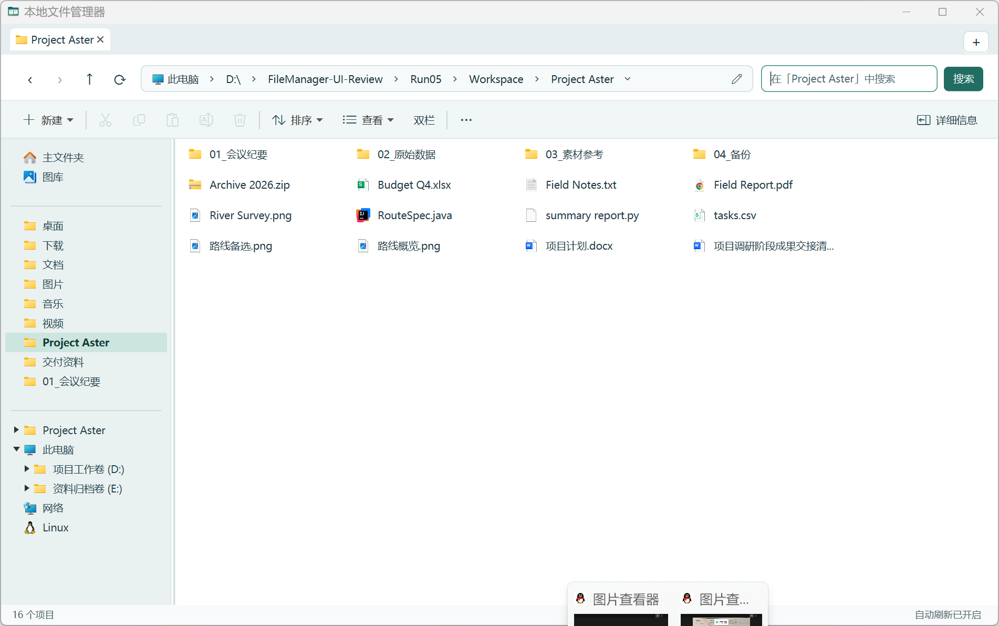

### B03 小图标视图

按当前窗口宽度排列小图标及文件名。 窗口 1280×800 逻辑单位，PNG 1902×1191 像素。 [图标单元](../../../src/main/java/edu/files/BrowserView.java#L1039)

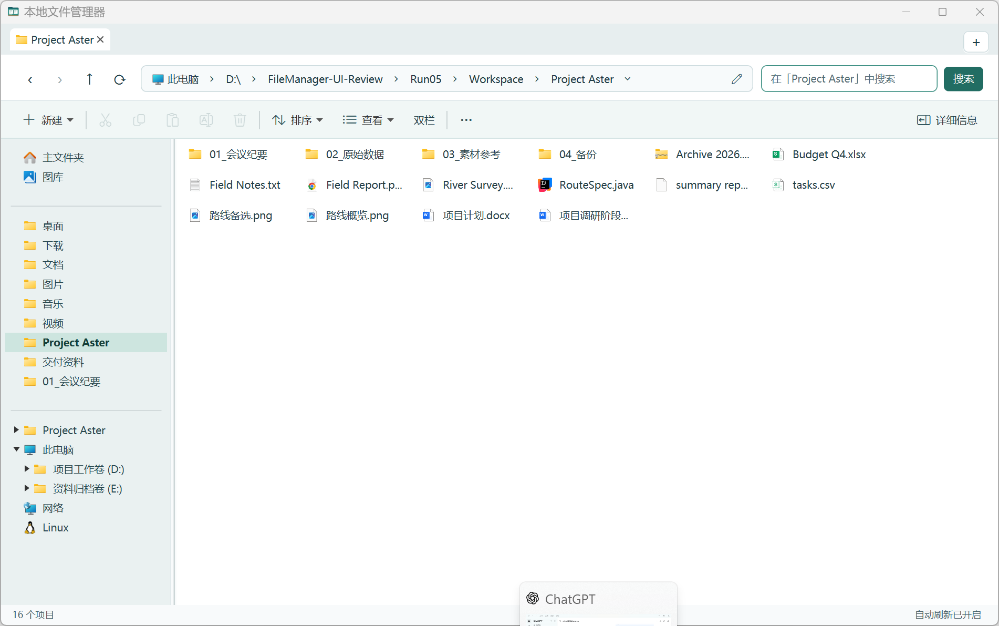

### B04 中图标视图

使用中图标，图片显示真实样例缩略图。 窗口 1280×800 逻辑单位，PNG 1902×1191 像素。 [图标和缩略图](../../../src/main/java/edu/files/BrowserView.java#L1111)

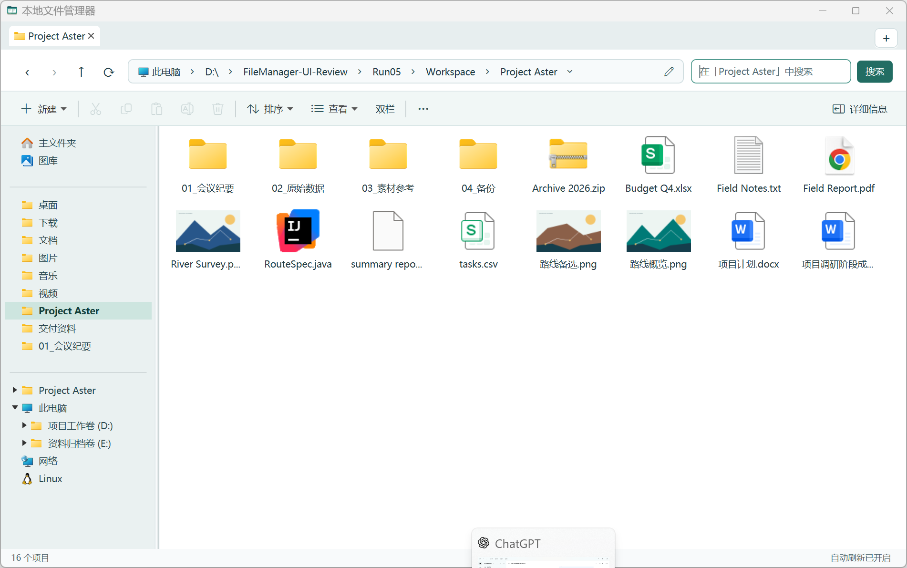

### B05 大图标视图

大图标下显示路线图缩略图、系统关联图标与长名称截断。 窗口 1280×800 逻辑单位，PNG 1902×1191 像素。 [图标和缩略图](../../../src/main/java/edu/files/BrowserView.java#L1111)

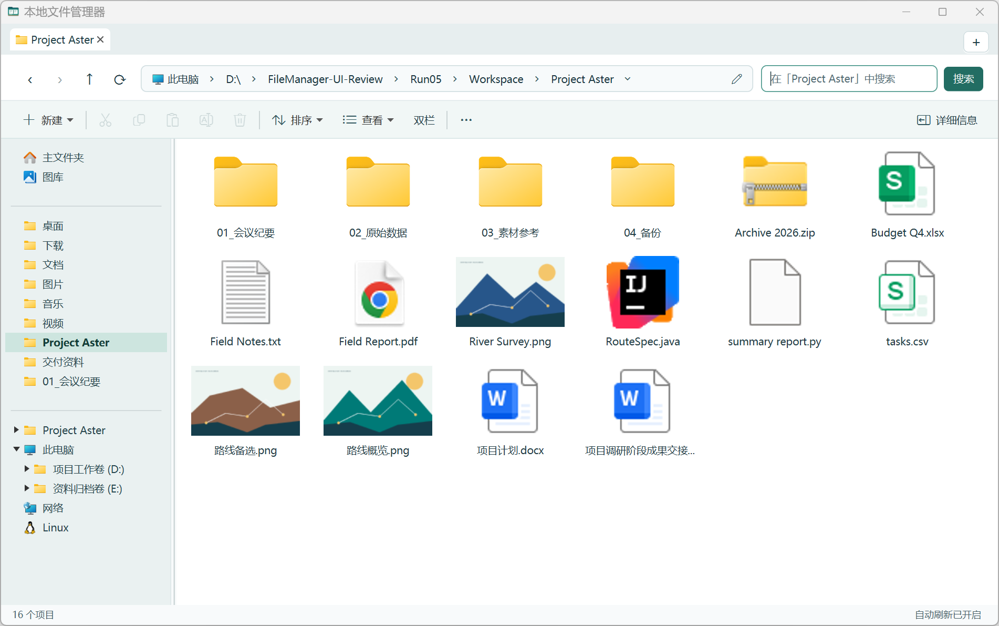

### B06a 超大图标视图

使用程序提供的最大图标档位。 窗口 1280×800 逻辑单位，PNG 1902×1191 像素。 [视图档位](../../../src/main/java/edu/files/BrowserView.java#L135)

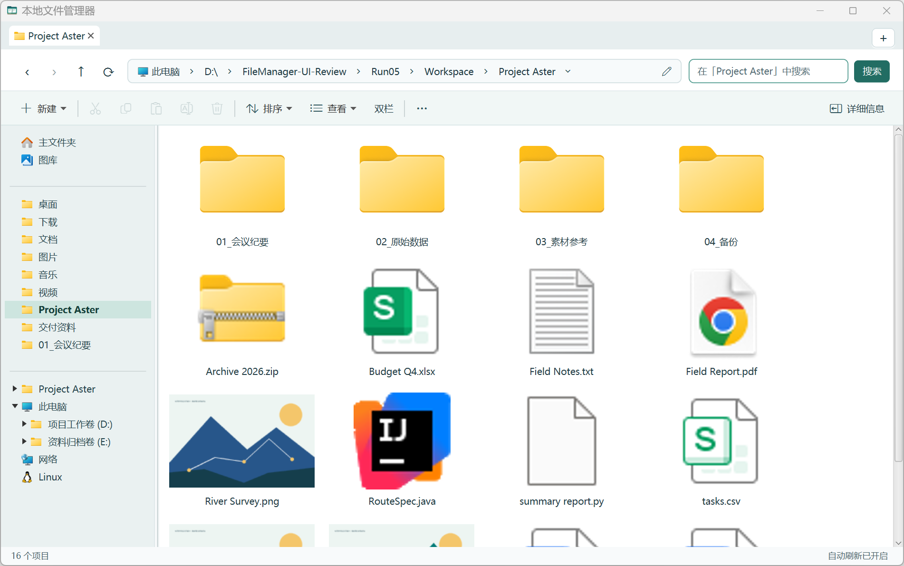

### B06b 平铺视图

用图标、文件名和辅助信息组成平铺条目。 窗口 1280×800 逻辑单位，PNG 1902×1191 像素。 [平铺条目](../../../src/main/java/edu/files/BrowserView.java#L1039)

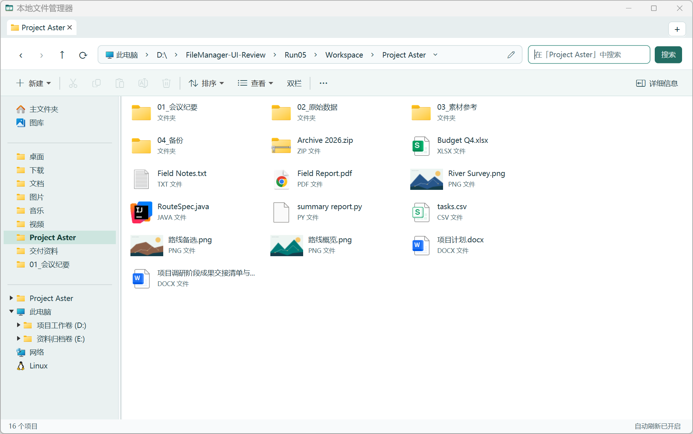

### B06c 内容视图

文件内容模式的宽行布局。 窗口 1280×800 逻辑单位，PNG 1902×1191 像素。 [内容条目](../../../src/main/java/edu/files/BrowserView.java#L1039)

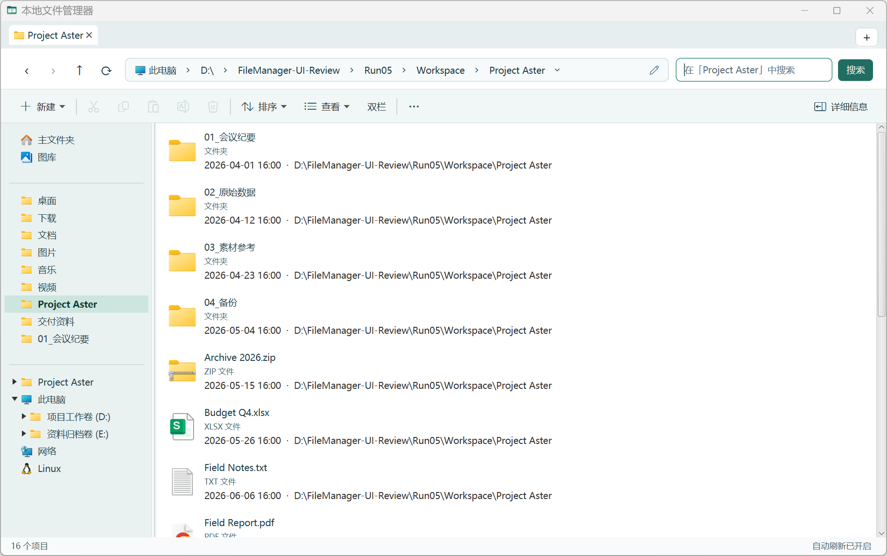

### B06d 图库

读入三张真实图片，使用日期分组和按比例排列的缩略图。 窗口 1280×800 逻辑单位，PNG 1902×1191 像素。 [图库排布](../../../src/main/java/edu/files/BrowserView.java#L875)

### B07 紧凑视图

普通详细信息列表切换到紧凑行高。 窗口 1280×800 逻辑单位，PNG 1902×1191 像素。 [紧凑模式](../../../src/main/java/edu/files/FileManagerApp.java#L3539)

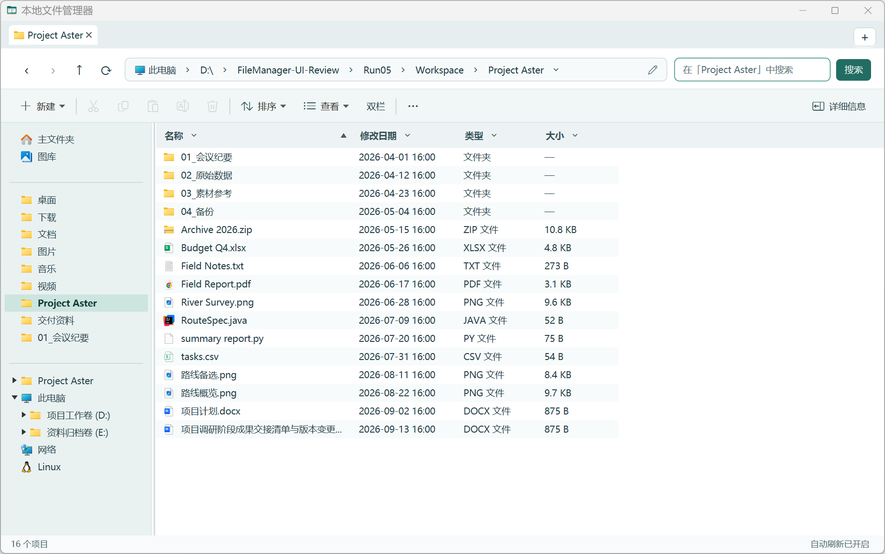

### B08 排序及分组

按修改日期排序并按文件类型分组。 窗口 1280×800 逻辑单位，PNG 1902×1191 像素。 [排序与分组](../../../src/main/java/edu/files/FileManagerApp.java#L3462)

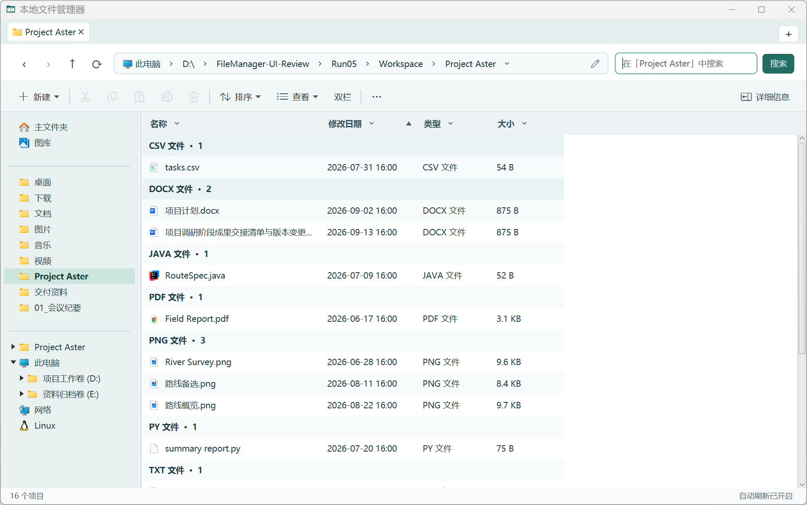

### B09 列筛选展开

打开「类型」列的复选筛选弹层。 窗口 1280×800 逻辑单位，PNG 1902×1191 像素。 [列筛选弹层](../../../src/main/java/edu/files/BrowserView.java#L683)

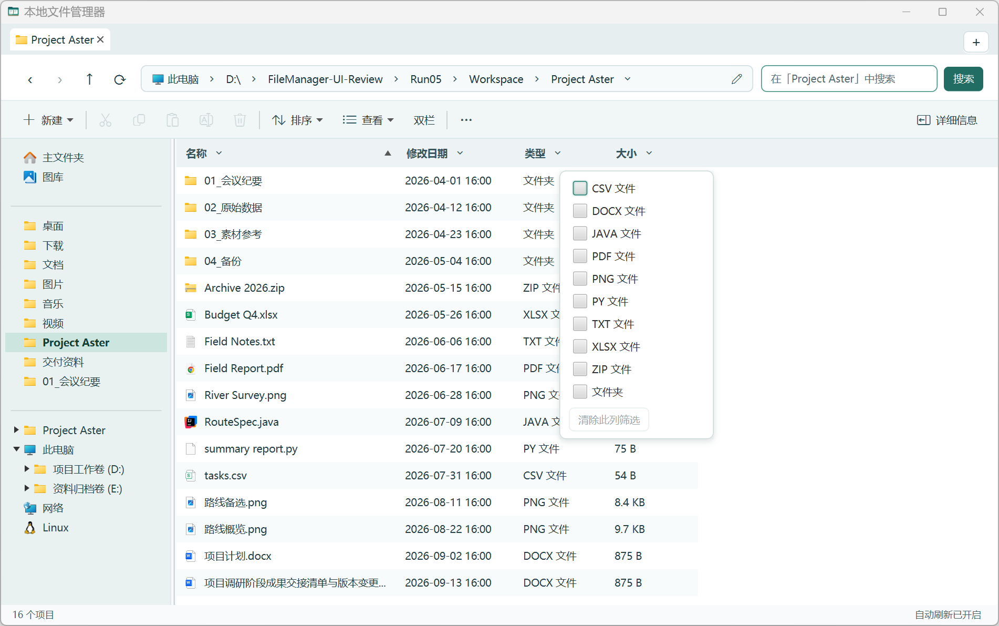

### B10a 单选

选中 Field Notes.txt，显示一条选区与可用文件命令。 窗口 1280×800 逻辑单位，PNG 1902×1191 像素。 [表格选区](../../../src/main/java/edu/files/BrowserView.java#L525)

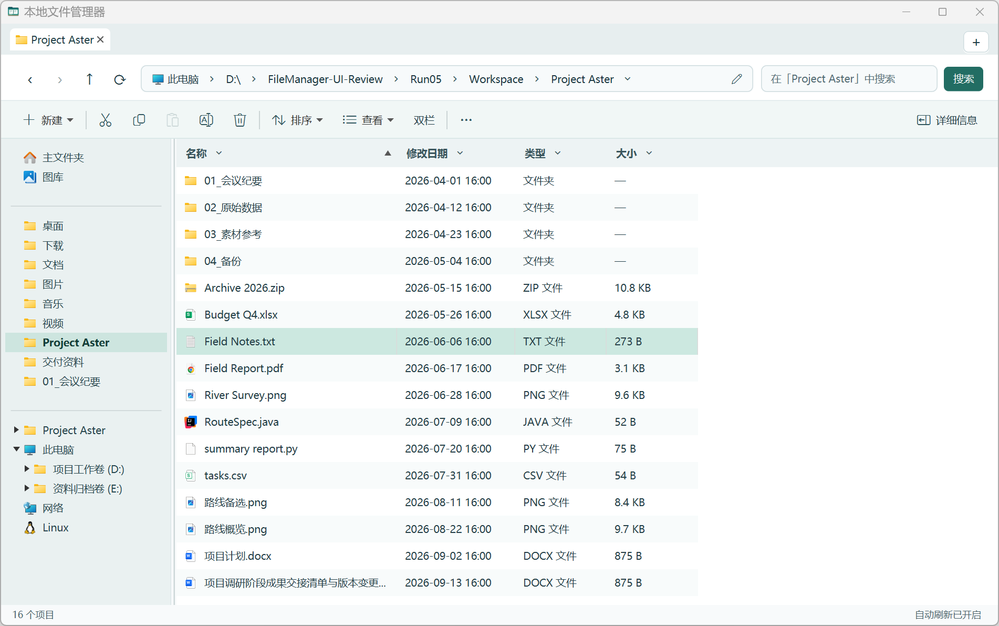

### B10b 多选

同时选中 TXT、PDF 和 XLSX 三项。 窗口 1280×800 逻辑单位，PNG 1902×1191 像素。 [同步选区](../../../src/main/java/edu/files/BrowserView.java#L1169)

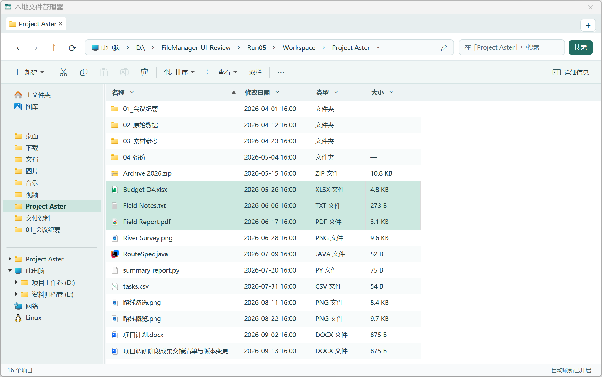

### B11 图片预览

选中路线概览 PNG，右侧显示读取后的图片。 窗口 1280×800 逻辑单位，PNG 1902×1191 像素。 [图片预览](../../../src/main/java/edu/files/FileManagerApp.java#L3742)

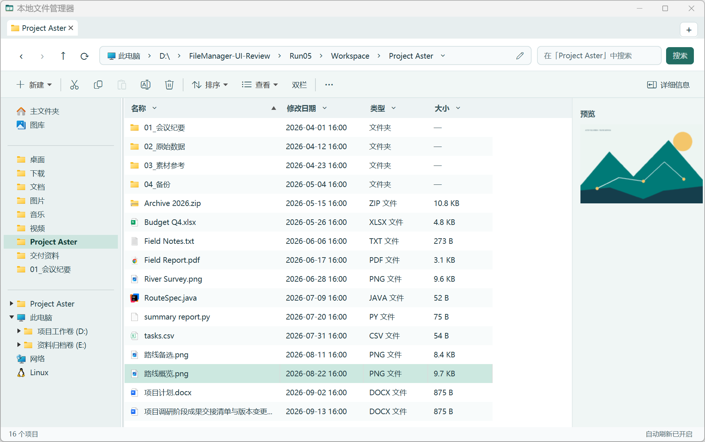

### B12 文本预览

选中 Field Notes.txt，右侧显示 UTF-8 文件正文。 窗口 1280×800 逻辑单位，PNG 1902×1191 像素。 [文本预览](../../../src/main/java/edu/files/FileManagerApp.java#L3742)

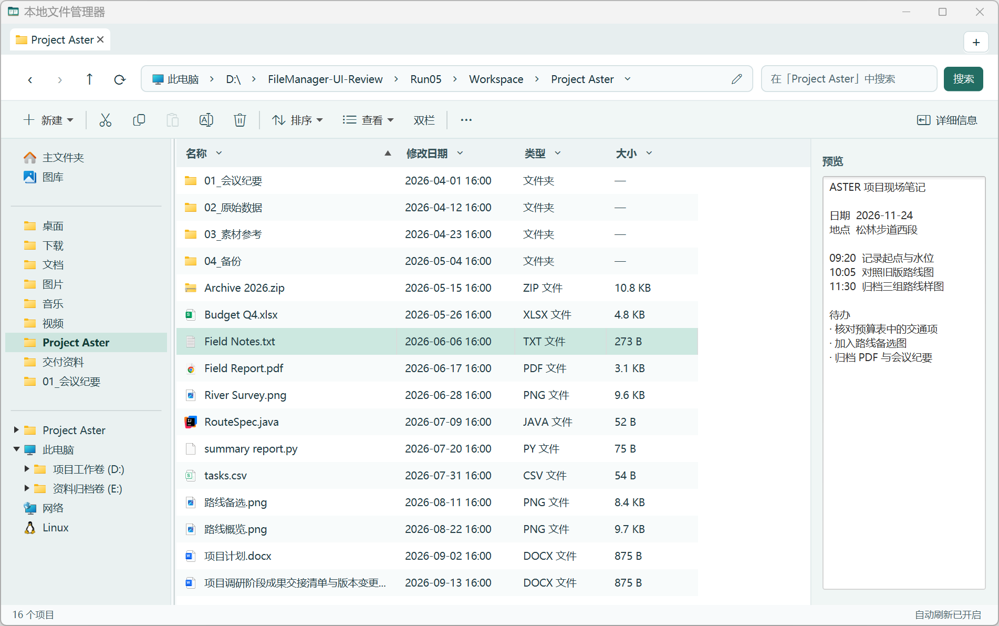

### B13 文件详细信息面板

检查器展示选中文本的路径和文件属性。 窗口 1280×800 逻辑单位，PNG 1902×1191 像素。 [详细信息面板](../../../src/main/java/edu/files/FileManagerApp.java#L3719)

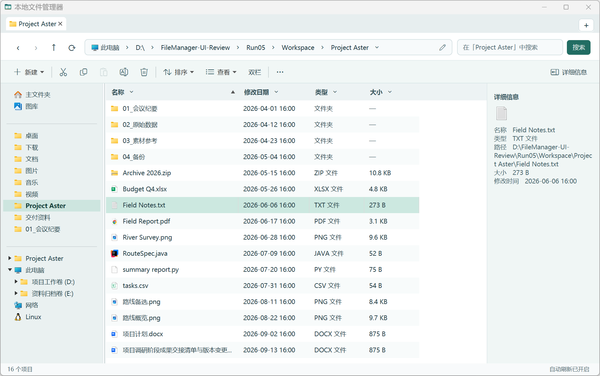

### B14 长文件名与混合类型

选中长中文 DOCX，列表仍包含多种文件与文件夹。 窗口 1280×800 逻辑单位，PNG 1902×1191 像素。 [名称单元格](../../../src/main/java/edu/files/BrowserView.java#L590)

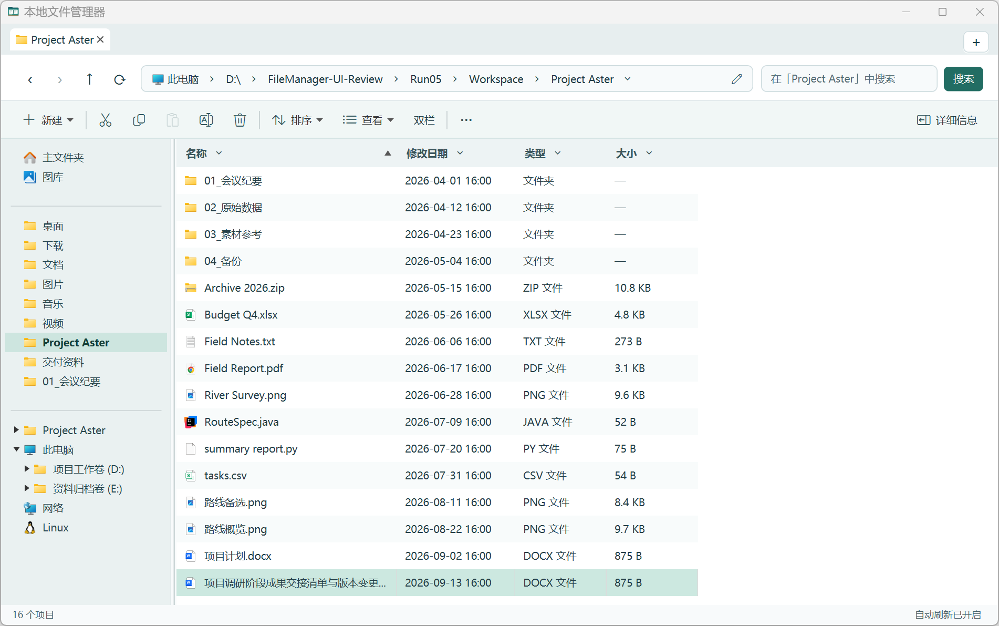

## C 多标签与双栏

### C01 多个标签页

项目、交付、大目录和会议纪要同时以标签打开。 窗口 1280×800 逻辑单位，PNG 1902×1191 像素。 [浏览标签栏](../../../src/main/java/edu/files/FileManagerApp.java#L414)

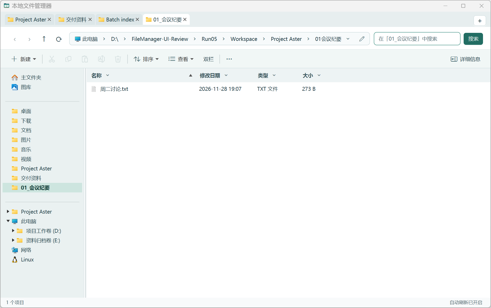

### C02 大量标签与溢出菜单

打开 17 个标签并展开 JavaFX 的溢出菜单。相邻原生弹层超出主窗右缘，截图同时收录完整弹层。窗口 1280×800 逻辑单位，PNG 2065×1191 像素。 [标签容器](../../../src/main/java/edu/files/FileManagerApp.java#L414)

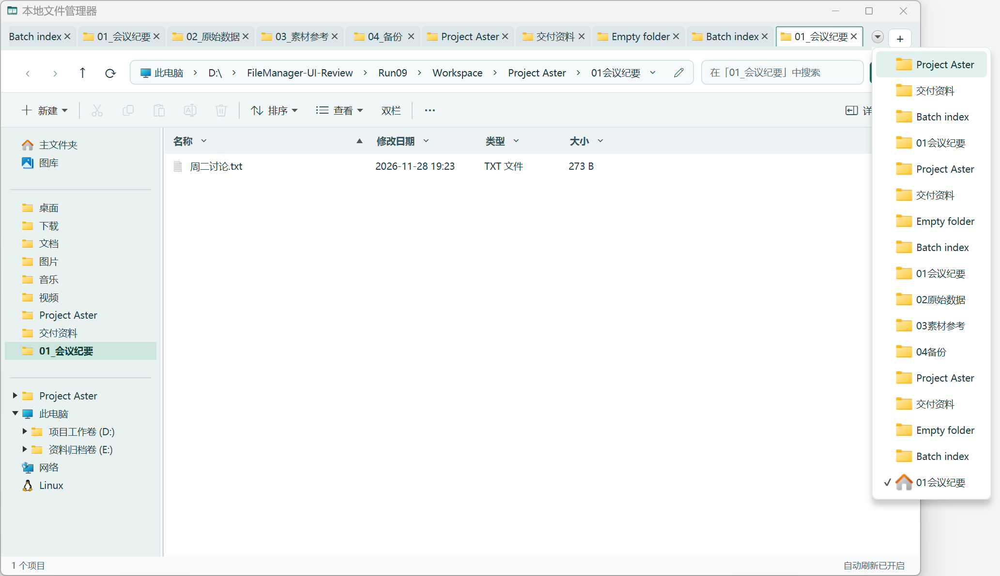

### C03 标签右键菜单

打开当前标签的复制与关闭命令。 窗口 1280×800 逻辑单位，PNG 1902×1191 像素。 [标签右键菜单](../../../src/main/java/edu/files/FileManagerApp.java#L448)

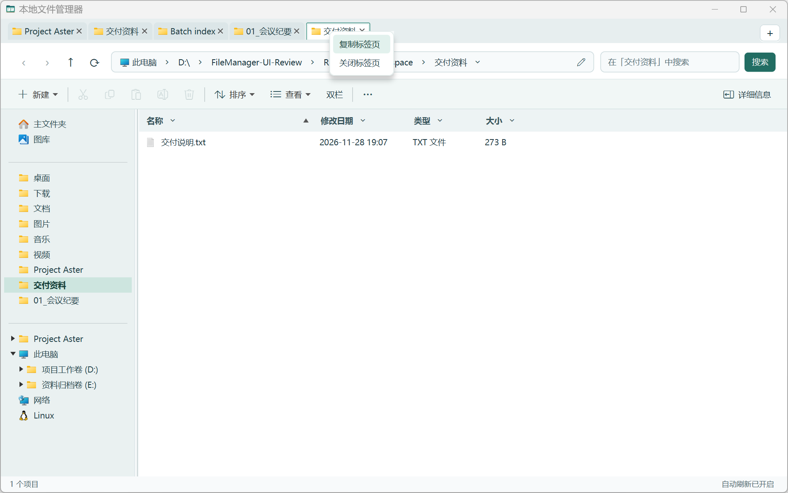

### C04 双栏普通目录

左栏项目目录和右栏交付目录同时可见。 窗口 1280×800 逻辑单位，PNG 1902×1191 像素。 [双栏布局](../../../src/main/java/edu/files/FileManagerApp.java#L576)

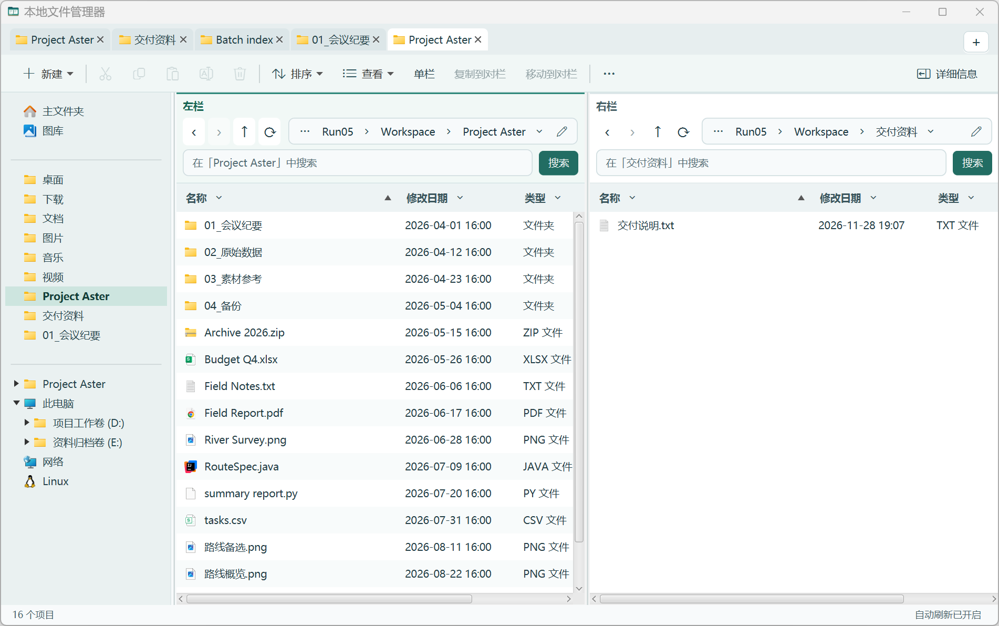

### C05 双栏不同视图

左栏保留详情列表，右栏使用中图标。 窗口 1280×800 逻辑单位，PNG 1902×1191 像素。 [每栏视图状态](../../../src/main/java/edu/files/BrowseContext.java#L98)

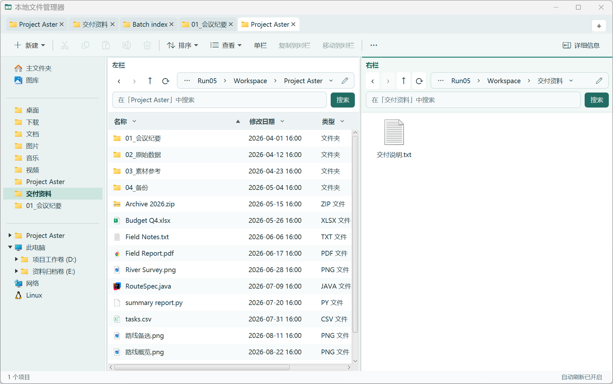

### C06 双栏搜索和预览

左栏搜索路线文件并选中图片，右栏保持普通目录。 窗口 1280×800 逻辑单位，PNG 1902×1191 像素。 [活跃栏检查器](../../../src/main/java/edu/files/FileManagerApp.java#L608)

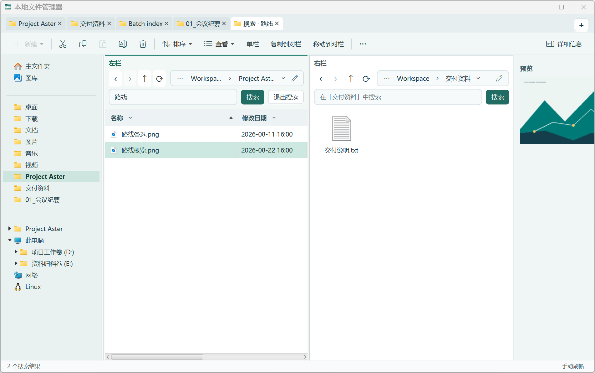

### C07 左栏活跃

左栏标题及上边框标出命令的当前归属。 窗口 1280×800 逻辑单位，PNG 1902×1191 像素。 [活跃区域](../../../src/main/java/edu/files/FileManagerApp.java#L555)

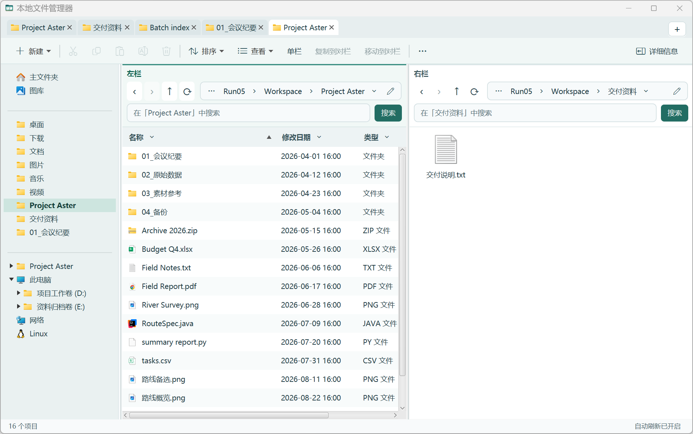

### C08 右栏活跃

右栏接收窗口级命令并显示活跃样式。 窗口 1280×800 逻辑单位，PNG 1902×1191 像素。 [活跃区域](../../../src/main/java/edu/files/FileManagerApp.java#L555)

### C09 调整双栏分隔条

将内层分隔条移到约 64% 的位置。 窗口 1280×800 逻辑单位，PNG 1902×1191 像素。 [双栏分隔条](../../../src/main/java/edu/files/FileManagerApp.java#L576)

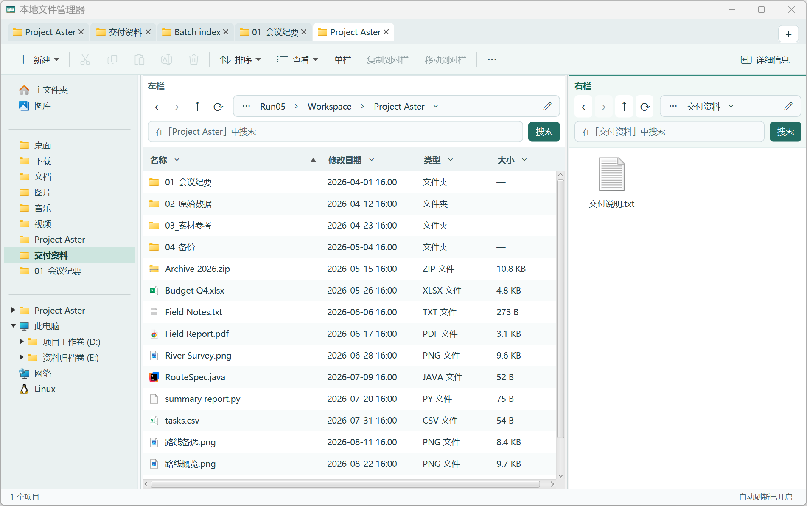

## D 菜单及交互

### D01 文件右键菜单

在 Field Notes.txt 上触发当前文件菜单。 窗口 1280×800 逻辑单位，PNG 1902×1191 像素。 [文件菜单](../../../src/main/java/edu/files/FileManagerApp.java#L986)

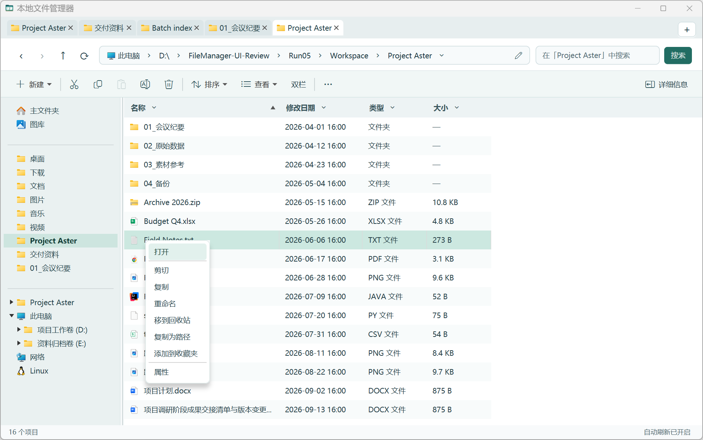

### D02 文件夹右键菜单

在会议纪要目录上触发菜单，包含在新标签打开等命令。 窗口 1280×800 逻辑单位，PNG 1902×1191 像素。 [文件夹菜单](../../../src/main/java/edu/files/FileManagerApp.java#L1002)

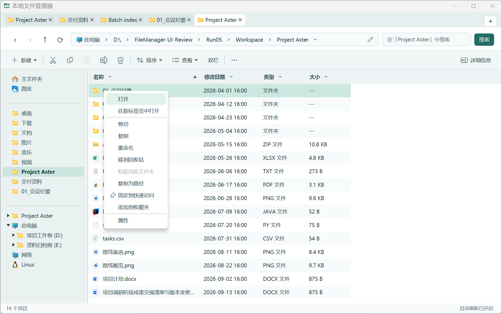

### D03 空白区域右键菜单

在空目录的浏览区域调出刷新、排序和查看等命令。 窗口 1280×800 逻辑单位，PNG 1902×1191 像素。 [空白处菜单](../../../src/main/java/edu/files/FileManagerApp.java#L986)

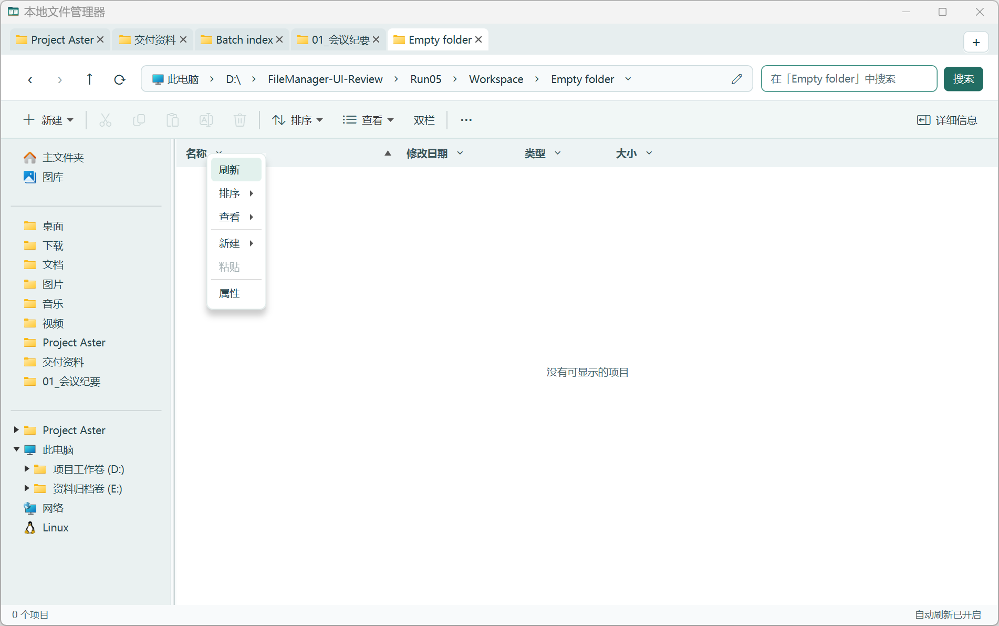

### D04 新建菜单

展示文件夹、快捷方式和合成的常见文档类型注册项。 窗口 1280×800 逻辑单位，PNG 1902×1191 像素。 [新建入口](../../../src/main/java/edu/files/FileManagerApp.java#L900)

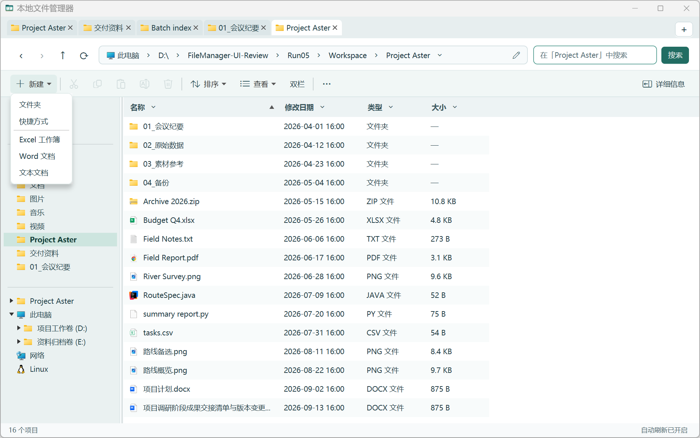

### D05 排序菜单

展开排序字段、方向和分组入口。 窗口 1280×800 逻辑单位，PNG 1902×1191 像素。 [排序菜单](../../../src/main/java/edu/files/FileManagerApp.java#L3462)

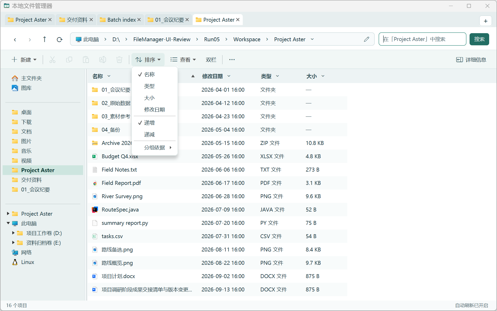

### D06 查看菜单

展开文件视图档位、检查器、自动刷新和显示设置。 窗口 1280×800 逻辑单位，PNG 1902×1191 像素。 [查看菜单](../../../src/main/java/edu/files/FileManagerApp.java#L3511)

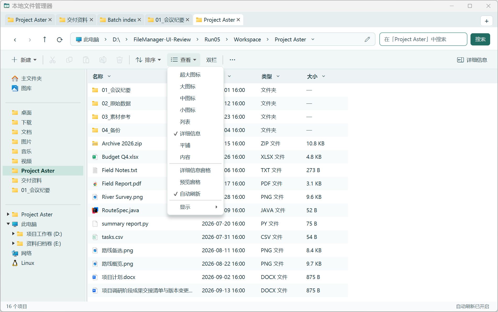

### D07 更多操作菜单

普通目录的撤消、选择、属性及选项入口。 窗口 1280×800 逻辑单位，PNG 1902×1191 像素。 [更多命令](../../../src/main/java/edu/files/FileManagerApp.java#L923)

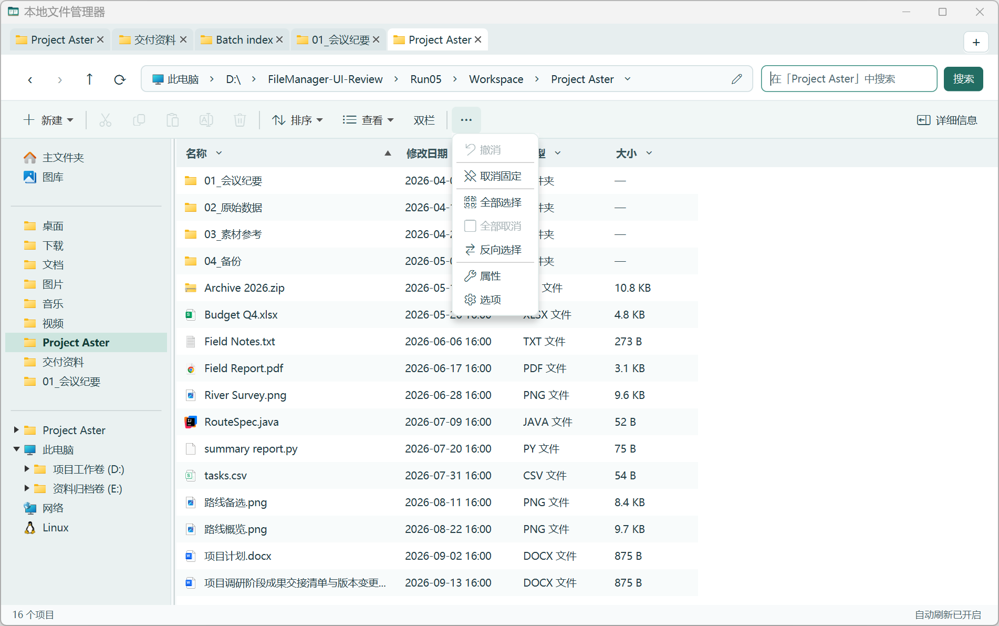

### D08 文件管理器选项

打开设置对话框，展示隐藏项、扩展名及恢复默认固定文件夹。 窗口 1280×800 逻辑单位，PNG 1902×1191 像素。 [选项对话框](../../../src/main/java/edu/files/FileManagerApp.java#L1040)

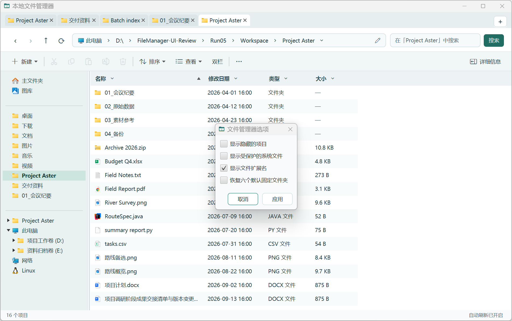

### D09 行内改名

展示原文件名选区与独立扩展名，随后取消编辑。 窗口 1280×800 逻辑单位，PNG 1902×1191 像素。 [行内改名](../../../src/main/java/edu/files/BrowserView.java#L411)

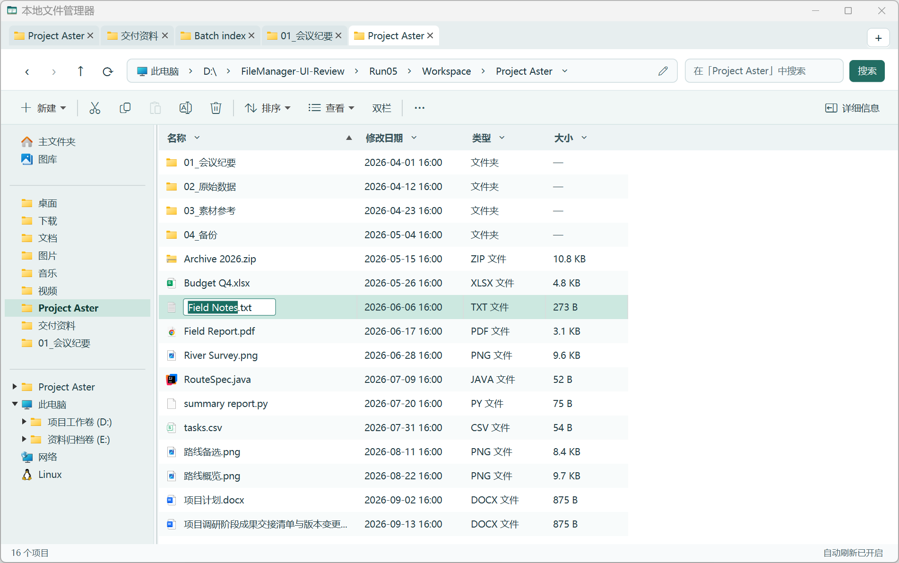

### D10 剪切淡显

夹具 TXT 经应用内剪切后淡显，剪贴板状态在底栏可见。 窗口 1280×800 逻辑单位，PNG 1902×1191 像素。 [剪切标记](../../../src/main/java/edu/files/FileManagerApp.java#L3824)

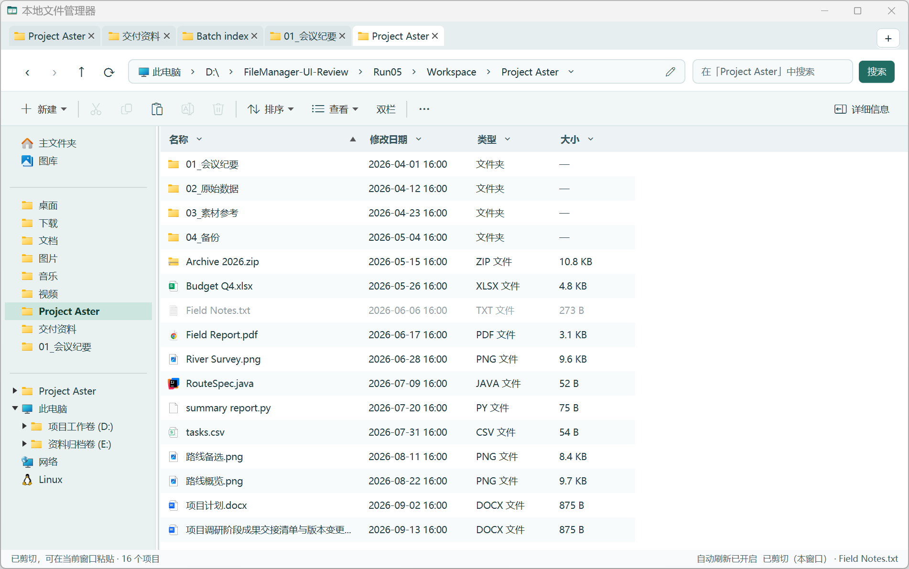

### D11 悬停和工具提示

启用复制按钮的悬停样式并显示控件自带工具提示。 窗口 1280×800 逻辑单位，PNG 1902×1191 像素。 [命令提示](../../../src/main/java/edu/files/FileManagerApp.java#L660)

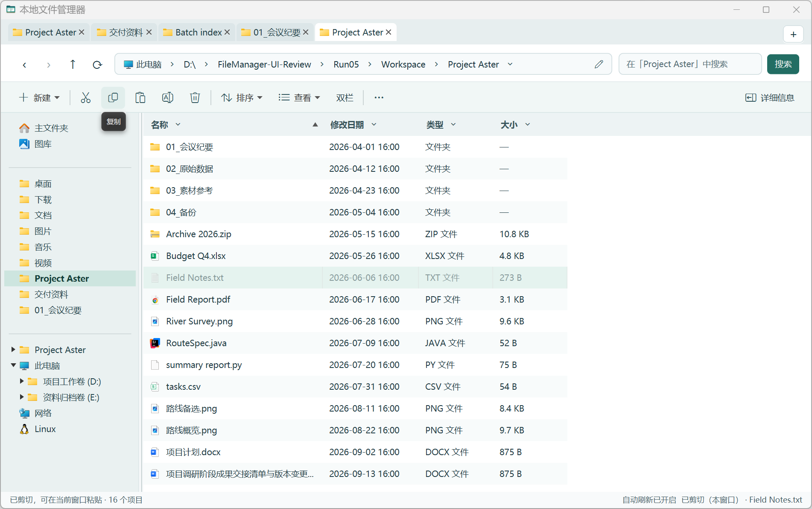

### D12 文件夹拖放高亮

合成 JavaFX 拖放悬停事件命中真实文件夹，显示绿色目标行。 窗口 1280×800 逻辑单位，PNG 1902×1191 像素。 [拖放悬停](../../../src/main/java/edu/files/FileManagerApp.java#L2003)

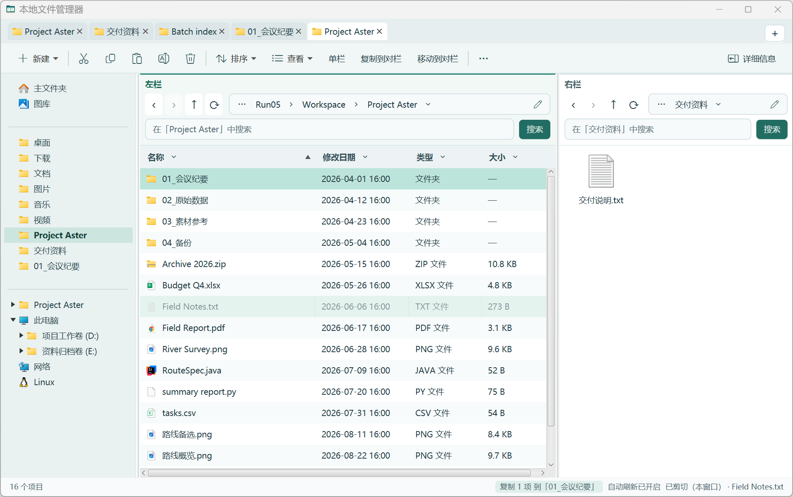

### D13a 拖放复制反馈

悬停在右栏普通目录，显示复制边框及底栏提示。 窗口 1280×800 逻辑单位，PNG 1902×1191 像素。 [复制反馈](../../../src/main/java/edu/files/FileManagerApp.java#L2003)

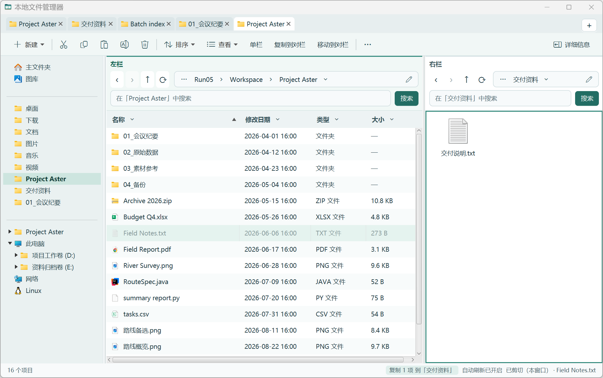

### D13b 拖放移动反馈

使用已核验的同卷夹具目标，显示蓝色移动边框和底栏提示。 窗口 1280×800 逻辑单位，PNG 1902×1191 像素。 [移动反馈](../../../src/main/java/edu/files/FileManagerApp.java#L2003)

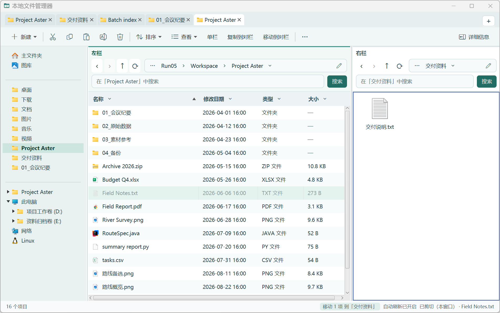

### D13c 禁止拖放反馈

命中普通文件，底栏提示可接受的目标类型。 窗口 1280×800 逻辑单位，PNG 1902×1191 像素。 [无效目标理由](../../../src/main/java/edu/files/FileManagerApp.java#L2040)

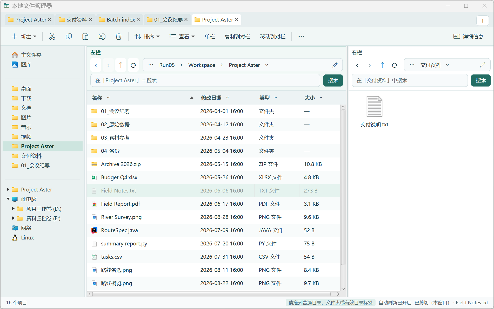

## E 任务与弹窗

### E01 文件复制进度

单文件复制开始后在真实暂存写入同步点停留。 窗口 1280×800 逻辑单位，PNG 1902×1191 像素。 [进度渲染](../../../src/main/java/edu/files/FileOperationProgress.java#L154)

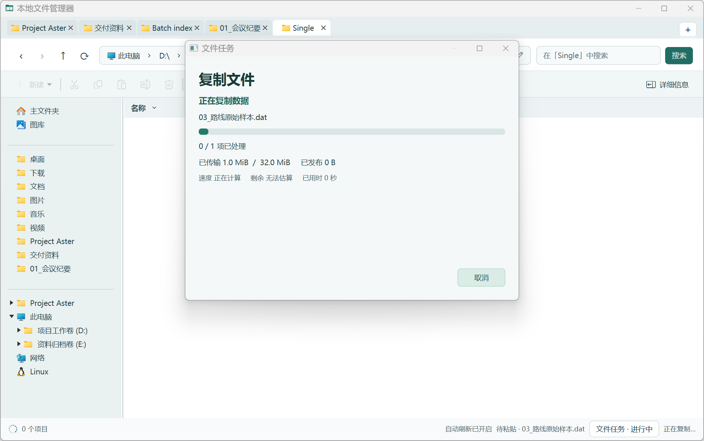

### E02 多文件批量复制

三项任务中两项实际发布，当前写入第三项。 窗口 1280×800 逻辑单位，PNG 1902×1191 像素。 [批量进度](../../../src/main/java/edu/files/FileOperationProgress.java#L154)

### E03 同名冲突对话框

夹具目的目录预置同名文件。前景弹窗展示来源、目标及处理选项。 窗口 1280×800 逻辑单位，PNG 1902×1191 像素。 [冲突窗](../../../src/main/java/edu/files/FileConflictDialog.java#L29)

### E03b 跳过同名项后的报告

选择跳过后显示已完成与已跳过计数，核对原目标保留。 窗口 1280×800 逻辑单位，PNG 1902×1191 像素。 [跳过计数](../../../src/main/java/edu/files/FileOperationProgress.java#L154)

### E04 文件任务完成

放开写入同步点后检查复制内容一致，并保留完成窗。 窗口 1280×800 逻辑单位，PNG 1902×1191 像素。 [完成状态](../../../src/main/java/edu/files/FileOperationProgress.java#L239)

### E05 文件任务部分完成

第一项实际发布，第二项在测试边界注入拒绝访问，显示「部分完成」。 窗口 1280×800 逻辑单位，PNG 1902×1191 像素。 [部分完成判定](../../../src/main/java/edu/files/FileOperationTask.java#L266)

### E06 文件任务取消

暂存复制期间使用取消按钮，释放同步点后核对目标不存在。 窗口 1280×800 逻辑单位，PNG 1902×1191 像素。 [协作取消](../../../src/main/java/edu/files/FileOperationProgress.java#L63)

### E07 回收确认

从夹具文件触发回收确认，拍摄后选择取消。 窗口 1280×800 逻辑单位，PNG 1902×1191 像素。 [回收确认](../../../src/main/java/edu/files/FileManagerApp.java#L2372)

### E08 文件操作失败提示

在夹具写入前注入拒绝访问异常，展示实际错误弹窗。 窗口 1280×800 逻辑单位，PNG 1902×1191 像素。 [错误提示](../../../src/main/java/edu/files/FileManagerApp.java#L2669)

### E09 未知结果核查

实际复制夹具文件，模拟回执丢失后从状态栏打开核查窗口。 窗口 1280×800 逻辑单位，PNG 1902×1191 像素。 [核查窗口](../../../src/main/java/edu/files/UnknownResultsDialog.java#L26)

### E10 目录不存在提示

向真实地址栏提交缺失的夹具路径并保留错误提示。 窗口 1280×800 逻辑单位，PNG 1902×1191 像素。 [目录读取失败](../../../src/main/java/edu/files/FileManagerApp.java#L3278)

## F 窗口适配

### F01 最大化单栏

窗口最大化至当前工作区，单栏显示项目列表。 窗口 1721×1033 逻辑单位，PNG 2560×1528 像素。 [窗口布局](../../../src/main/java/edu/files/FileManagerApp.java#L252)

### F02 最大化双栏

同一任务栏工作区尺寸下显示双栏。 窗口 1721×1033 逻辑单位，PNG 2560×1528 像素。 [双栏布局](../../../src/main/java/edu/files/FileManagerApp.java#L576)

### F03 约 1280×800 的普通窗口

JavaFX 布局尺寸为 1280×800，按系统 150% 缩放显示。 窗口 1280×800 逻辑单位，PNG 1902×1191 像素。 [恢复窗口尺寸](../../../src/main/java/edu/files/FileManagerApp.java#L379)

### F03b 接近 1280×800 物理像素的普通窗口

仅采集进程使用 JavaFX 100% 输出倍率，Windows 显示设置仍为 150%。 窗口 1280×800 逻辑单位，PNG 1262×791 像素。 [窗口尺寸](../../../src/main/java/edu/files/FileManagerApp.java#L379)

### F04 最小窗口

窗口缩到当前程序允许的 960×550 逻辑单位。 窗口 960×550 逻辑单位，PNG 1422×816 像素。 [窗口最小尺寸](../../../src/main/java/edu/files/FileManagerApp.java#L304)

### F05 窄窗口下的双栏

保持最小窗口并开启双栏，显示路径折叠和横向滚动。 窗口 960×550 逻辑单位，PNG 1422×816 像素。 [双栏与地址栏](../../../src/main/java/edu/files/FileManagerApp.java#L576)

### F06 长路径及面包屑

窄窗口内打开五层中文长路径，面包屑折叠前方路径段。 窗口 960×550 逻辑单位，PNG 1422×816 像素。 [面包屑布局](../../../src/main/java/edu/files/AddressBar.java#L211)

### F07 大量文件的目录

打开真实包含 1,500 份 CSV 的目录。 窗口 1280×800 逻辑单位，PNG 1902×1191 像素。 [虚拟化表格](../../../src/main/java/edu/files/BrowserView.java#L521)

### F08 高 DPI 下的文字与图标

在 150% 系统缩放下显示大图标、选区和详细信息。 窗口 1280×800 逻辑单位，PNG 1902×1191 像素。 [图标的 DPI 像素请求](../../../src/main/java/edu/files/SystemIcons.java#L71)

