# 当前界面调查

记录「本地文件管理器」1.0.0 的真实界面。调查分支从阶段 4.0 的 `bffb8485d83cb970174efe794a45f805da865280` 建立。截图运行已验收的便携版应用 JAR，包内源码提交为 `f936efe2d0b0c0c2077a9831680578e50833606f`。两者的生产源码与 POM 一致。 [阶段 4.0 基线](../../development/13_独立打包与正式发布/02_验证与人工验收.md) · [基线提交](https://github.com/hrao233/Java-/commit/bffb8485d83cb970174efe794a45f805da865280)

| 分组 | PNG 张数 |
| --- | ---: |
| A 主界面与导航 | 10 |
| B 文件展示 | 18 |
| C 多标签与双栏 | 9 |
| D 菜单及交互 | 15 |
| E 任务与弹窗 | 11 |
| F 窗口适配 | 9 |

- [完整截图索引](01_截图索引.md)
- [界面结构与组件](02_界面结构与组件.md)
- [当前视觉规范](03_当前视觉规范.md)
- [截图环境与覆盖范围](04_截图环境与覆盖范围.md)

## 代表性截图

### A01 主文件夹首页

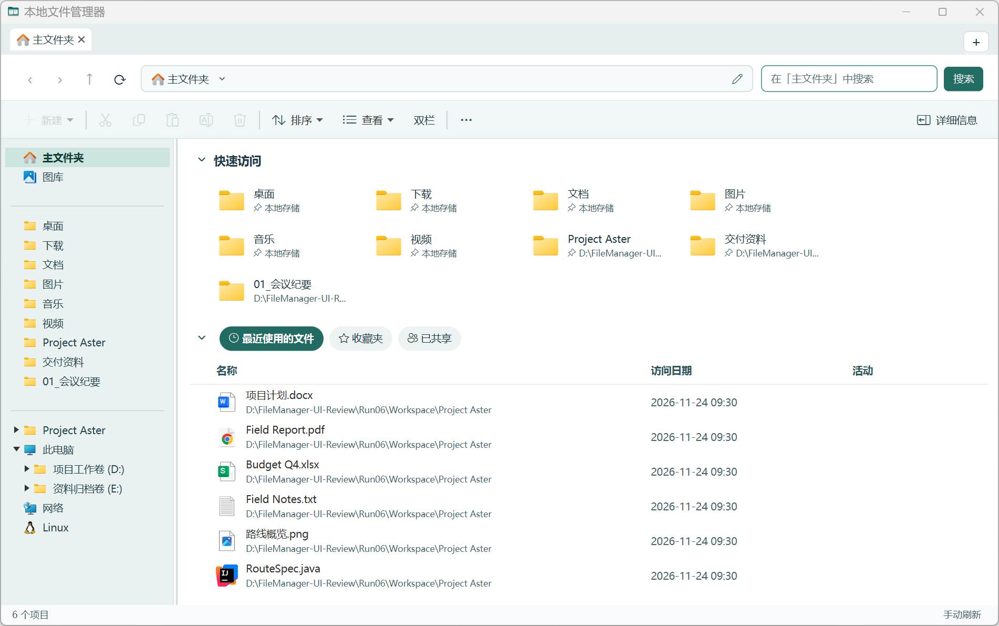

### A03 普通目录的详细信息视图

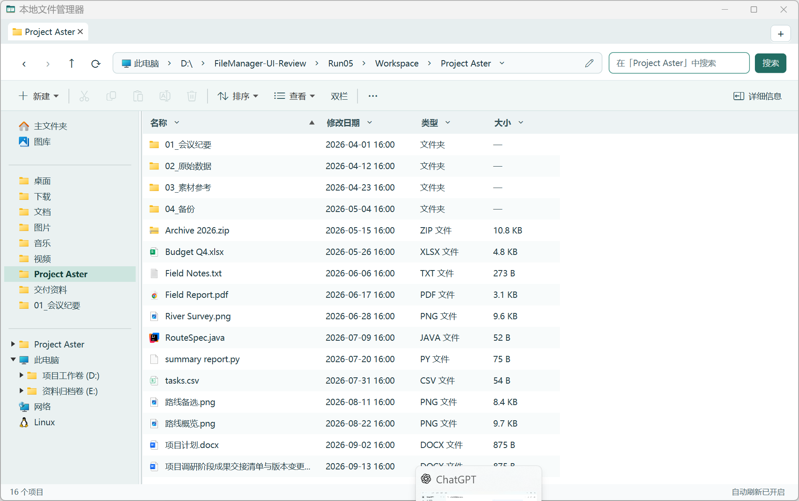

### B05 大图标视图

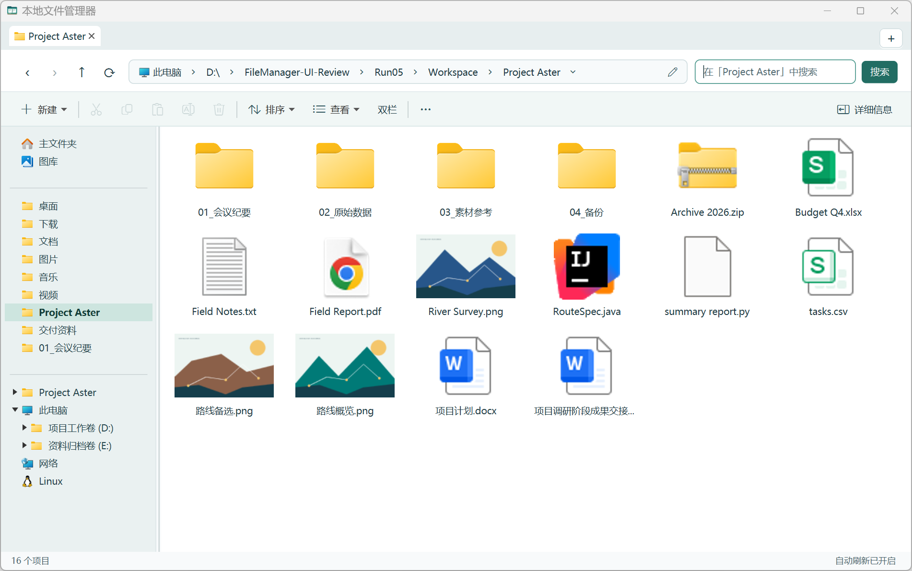

### B12 文本预览

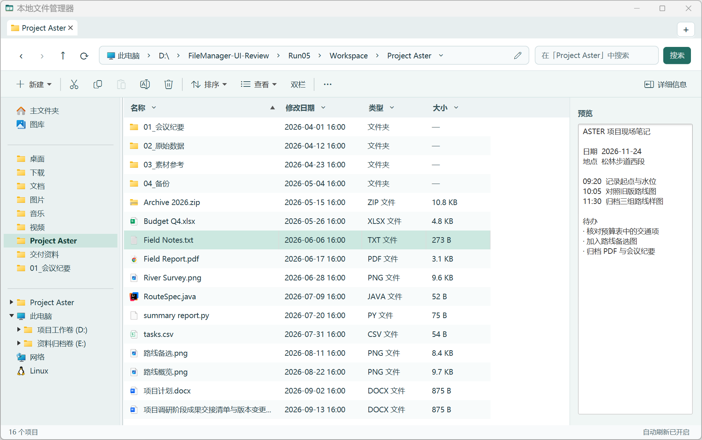

### C02 大量标签与溢出菜单

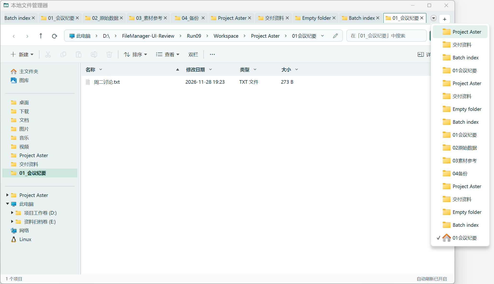

### C06 双栏搜索和预览

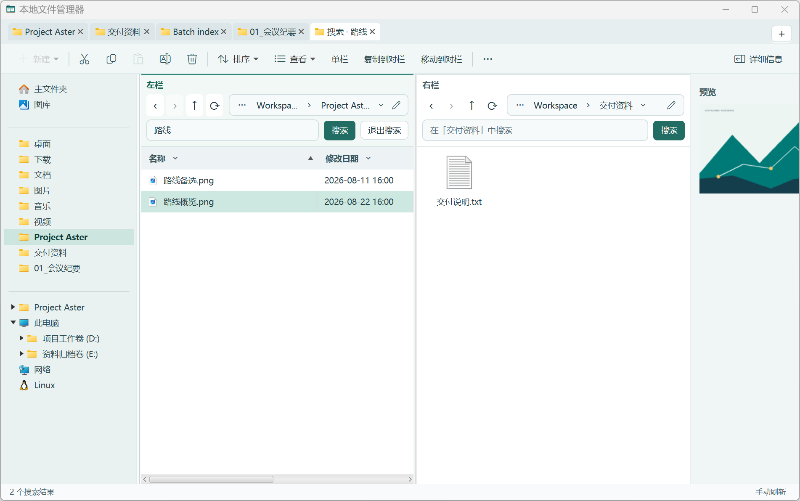

### D06 查看菜单

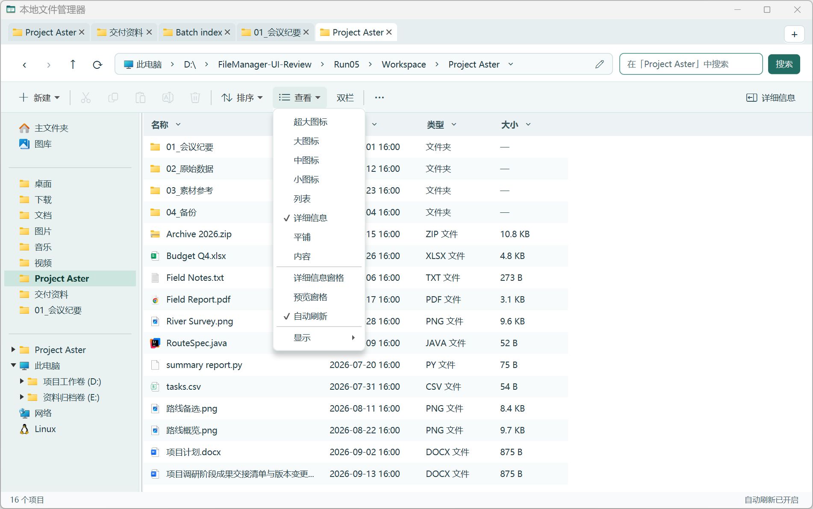

### D12 文件夹拖放高亮

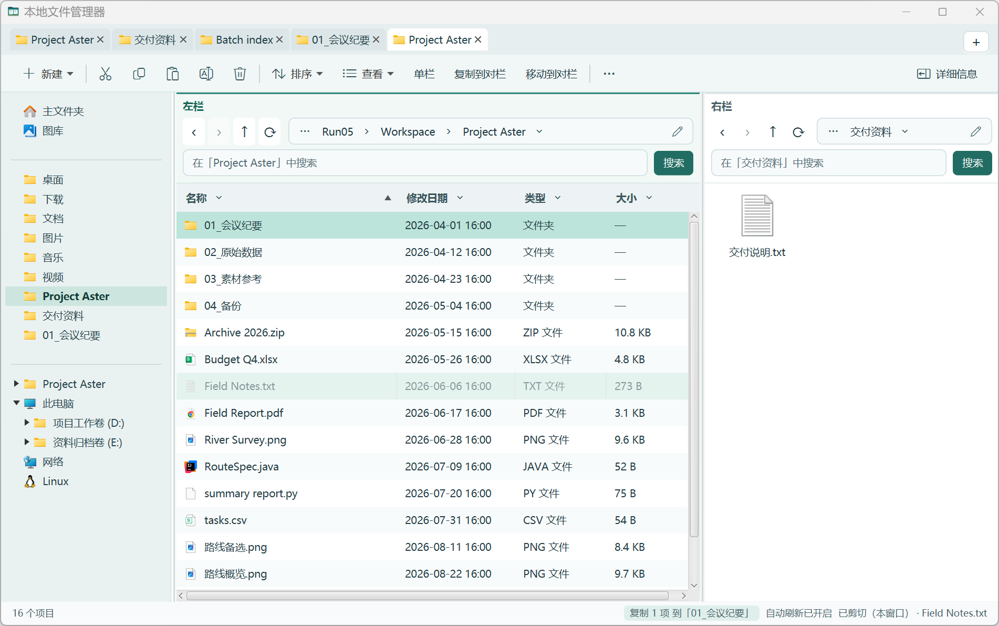

### E03 同名冲突对话框

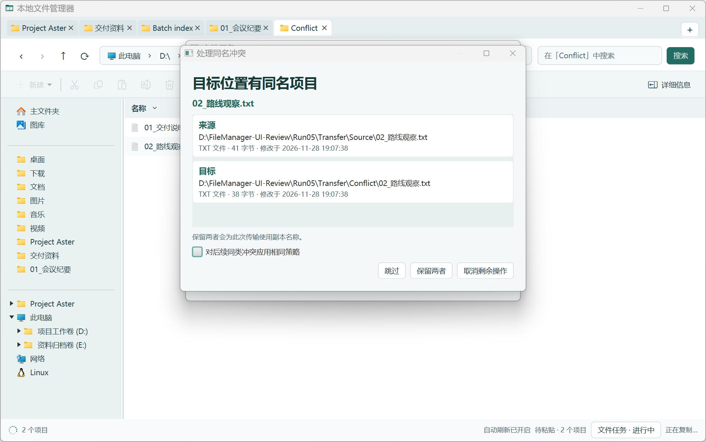

### E05 文件任务部分完成

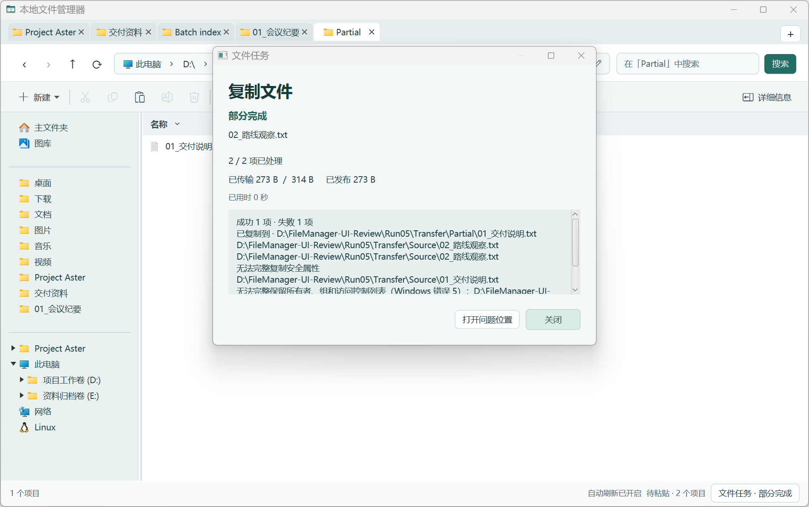

### F05 窄窗口下的双栏

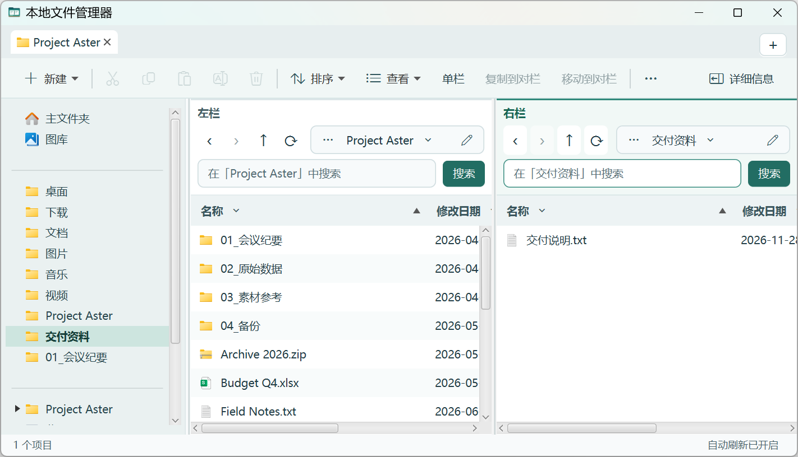
