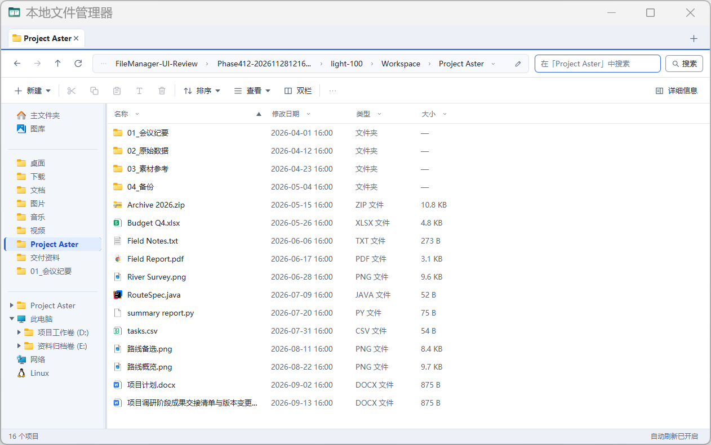
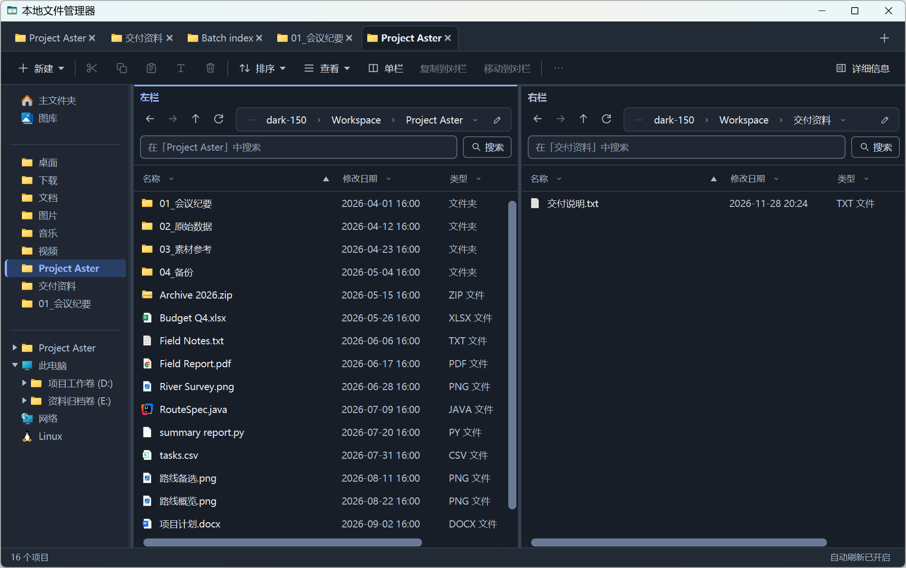
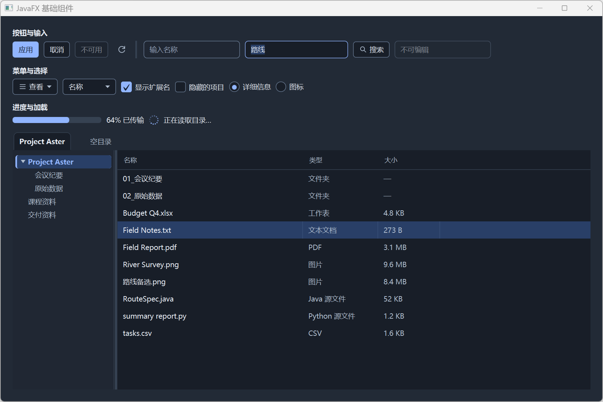
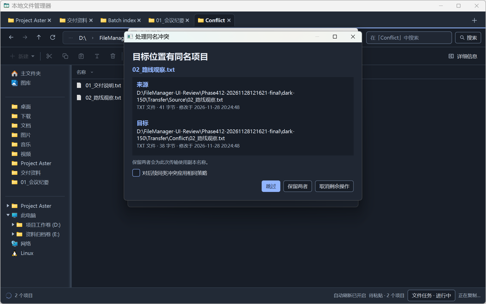

# 4.1.2 设计系统与基础组件

本阶段将经认可的 4.1.1 原型配色、密度和线性功能图标应用到现有 JavaFX 界面。主窗口的主题可以通过**查看 → 外观预览**切换，任务窗、冲突窗、对话框和弹层使用同一配色。独立组件展示入口位于本目录的采集工具中。

- [设计参考说明](reference/README.md) · [HTML 交互原型](reference/file-manager-ui-prototype.html)
- 原型效果图 [传统](reference/ui-classic.png) · [米勒列](reference/ui-columns.png) · [混合](reference/ui-hybrid.png) · [双栏](reference/ui-dual.png) · [深色](reference/ui-dark.png)
- [设计变量、组件和主题挂载](01_设计变量与组件.md)
- [22 张原始 JavaFX 截图及本地复验](02_视觉验证.md)
- [基线、完整测试结果和后续工作](03_回归与验收.md)

## 浅色主窗口

## 深色双栏

## 深色组件展示

## 深色同名冲突窗

